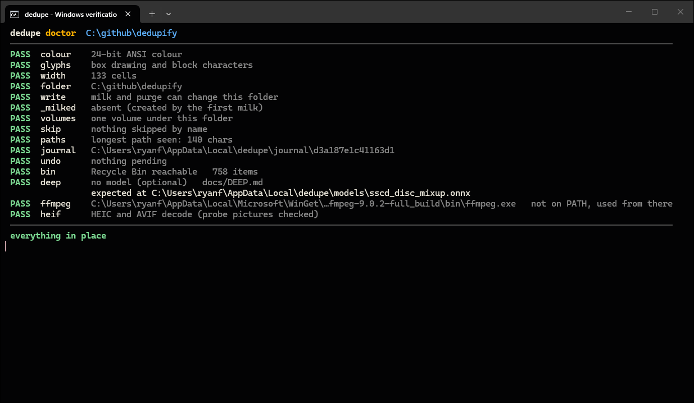

# VERIFICATION — Phase 1, run on 2026-11-05

Environment: Linux (kernel 6.18), 2 vCPUs, 7.8 GB RAM, Rust 1.97.0,
release profile. Windows was **type-checked** (`cargo check --target
x86_64-pc-windows-msvc`) so every `cfg(windows)` path compiles; it was not
executed on Windows. Numbers below are from this machine, with the files
already in the page cache; cold-disk timings depend on the drive.

## Automated

`cargo test` — 36 unit tests + 9 end-to-end tests, all passing.
`cargo test -- --ignored` — the purge → undo round trip through the OS
bin (freedesktop trash here; Recycle Bin on Windows), passing.
`cargo clippy --all-targets` — clean.

End-to-end coverage (tests/e2e.rs): `find` and `find .` counts per stage;
a same-size, same-sample, different-content decoy never reported; `-q`
reporting it as LIKELY; `milk -n` touching nothing and writing no journal;
`milk .` then `find .` reporting no duplicates; `--undo` restoring the
exact file list and pruning `_milked`; name collision inside `_milked`
getting ` (2)`; `purge -n` verifying bytes and changing nothing; `img`
filter excluding videos; every error path exiting 1 with the help hint;
help and doctor pages.

## Manual, on a generated tree

17 files, 6.4 MB, including a 4-way image group, a 2-way video group, a
pair differing only in the middle byte (sample-equal), a pair differing in
byte 5 (sample-different), two empty files, and a path 150 characters
deep.

| run | observed |
|---|---|
| `find .` | 15 candidates (2 empty skipped) → 13 share a size → 12 share a sample → 10 confirmed; 4 groups, 6 duplicates, 2.99 MB reclaimable; bytes hashed 5.76 MB (the four 300 KB copies, the two 2 MB videos, and the sample-equal pair) |
| `find` (no `.`) | 1 group: the two notes files in the root |
| `find . -q` | 5 LIKELY groups; the sample-equal decoy pair included and labelled |
| `milk . -n` | 6 `would` lines, no journal, tree untouched |
| `milk .` | 6 moved under `_milked/<same relative path>`, journal written |
| `find .` after milk | no duplicates (`_milked` is never scanned) |
| `--undo -n` | 6 `would restore`, newest first |
| `--undo` | 6 restored; `_milked` removed; second `--undo` reports nothing pending |
| `purge . img -n` | 4 verified byte for byte, 4 `would` lines |
| `purge . img` | 4 binned to the trash, journal written |
| `--undo` | 4 restored from the bin; `cmp` against the keeper: identical |
| `doctor` | 11 checks, all PASS, including bin reachable and ffmpeg found |
| `--help` | the designed page |
| errors | unknown flag, no command, missing folder, two paths → exit 1 |

Under a pseudo-terminal: 24-bit colour sequences present, Unicode glyphs
used, each stage line redrawn in place (`\r` + clear-line) and left in
the scrollback on completion. Piped: plain text, ASCII glyphs, no escapes.

Menu, driven through a pseudo-terminal with scripted keys
(enter, enter, down, enter, enter, enter): WORKFLOW → FOLDER → SCOPE →
KIND → CONFIRM frames rendered at exact frame width; CONFIRM showed
`dedupe find <folder> .`; the run produced the same output as the typed
command.

## Scale

2,300 files of 256 KB (575 MB): 1,500 originals, 500 copies, 300
same-size decoys differing in one middle byte.

| run | wall | result |
|---|---|---|
| `find .` | 0.38 s (first), 0.14 s (repeat) | 435 groups, 518 duplicates, 130 MB reclaimable; 353 MB hashed |
| `find . -q` | ~0.1 s | 613 groups, 800 "duplicates" — the 300 decoys counted, as the LIKELY label warns |

Peak resident memory 13 MB.

## Not verified here

- Execution on Windows (type-checked only): Recycle Bin send/restore via
  `trash::os_limited`, virtual-terminal enabling via crossterm, path
  separators in output.
- Behaviour on a tree with hundreds of thousands of files (walker is
  single-threaded `walkdir`; hashing is parallel).
- Terminals that are not UTF-8: the ASCII set is selected only by
  `DEDUPE_ASCII=1` or non-terminal output, not by code-page detection.

---

# VERIFICATION — Phase 2, run on 2026-11-05

Same environment (Linux, 2 vCPUs, Rust 1.97, release). Windows
type-checked again (`cargo check --target x86_64-pc-windows-msvc`), not
executed.

## Automated

`cargo test --release` — 48 unit tests + 12 end-to-end tests, all passing.
New unit coverage: DCT-II against the naive double sum; dihedral group
relations on the grid; mirrored and 90°-rotated files matching the
corresponding variant within 2 bits; 25 % rescale and q30 JPEG inside the
thresholds; flat image below the quality gate; EXIF orientation 6 applied
at decode; MIH query equals brute force at radii 0/3/7/10; MIH pairs equal
linear pairs; planted copies found and random pairs not; union–find.
New end-to-end coverage: `find . img` reports the exact groups first and
the NEAR group after, keeper by pixels, mirror labelled, `+GROUP` link,
flat image skipped, the different picture excluded; plain `find .` prints
the `near` hint and no NEAR; `purge -n` runs the near pass with `would~`
lines; `milk . img` moves 6 (3 exact, 3 near) and `--undo` restores the
exact file list.

## Threshold corpus — `cargo test --release --test corpus -- --ignored --nocapture`

150 procedural photographs (value noise, soft ellipses, hard rectangles,
tint; 640×480 to 900×1200) × 21 perturbations = 3,300 signatures. 22.5 ms
per perturbed image including the transform itself.

| perturbation | d max | d p95 | p max | p p95 | recall |
|---|---|---|---|---|---|
| scale 50 % | 1 | 0 | 2 | 0 | 100 % |
| scale 25 % | 2 | 1 | 2 | 0 | 100 % |
| upscale 150 % | 1 | 0 | 2 | 0 | 100 % |
| JPEG q90 | 1 | 0 | 2 | 0 | 100 % |
| JPEG q60 | 2 | 1 | 2 | 2 | 100 % |
| JPEG q30 | 3 | 1 | 2 | 2 | 100 % |
| crop 90 % | 16 | 13 | 20 | 18 | 70.0 % |
| crop 80 % | 25 | 22 | 32 | 26 | 2.7 % |
| crop 60 % | 34 | 29 | 36 | 32 | 0 % |
| rotate 2° | 10 | 6 | 12 | 8 | 100 % |
| rotate 5° | 21 | 13 | 16 | 14 | 77.3 % |
| rotate 90° | 0 | 0 | 0 | 0 | 100 % |
| mirror | 0 | 0 | 0 | 0 | 100 % |
| brightness +20 % | 2 | 1 | 6 | 4 | 100 % |
| brightness −20 % | 3 | 1 | 2 | 2 | 100 % |
| gamma 1.5 | 8 | 5 | 14 | 8 | 100 % |
| watermark | 2 | 2 | 24 | 20 | 76.7 % |
| blur | 1 | 0 | 2 | 0 | 100 % |
| noise ±10 | 3 | 1 | 2 | 2 | 100 % |
| letterbox | 14 | 11 | 26 | 20 | 62.0 % |
| squeeze 75 % | 1 | 1 | 2 | 0 | 100 % |

Negatives: 480,525 pairs (source vs source, every variant vs every other
source). **False positives at d≤10 ∧ p≤14: 0.** Closest negative: d 5,
p 10, d+p 26.

Threshold sweep — recall over the perturbations a block hash can be
expected to survive (all but rotate 2°/5° and crop 60 %) | false positives:

| d \ p | ≤10 | ≤12 | ≤14 | ≤16 | ≤18 | ≤20 |
|---|---|---|---|---|---|---|
| ≤6 | 81.7 % \| 0 | 83.4 % \| 0 | 85.7 % \| 0 | 87.2 % \| 0 | 87.7 % \| 0 | 88.1 % \| 0 |
| ≤8 | 83.2 % \| 0 | 85.5 % \| 0 | 88.3 % \| 0 | 90.0 % \| 0 | 90.8 % \| 0 | 91.3 % \| 0 |
| **≤10** | 83.7 % \| 0 | 86.5 % \| 0 | **89.5 % \| 0** | 91.4 % \| 1 | 92.4 % \| 1 | 93.0 % \| 1 |
| ≤12 | 84.3 % \| 0 | 87.4 % \| 0 | 90.6 % \| 0 | 92.8 % \| 1 | 93.9 % \| 2 | 94.7 % \| 3 |
| ≤14 | 84.4 % \| 0 | 87.7 % \| 0 | 91.0 % \| 2 | 93.4 % \| 19 | 94.5 % \| 38 | 95.6 % \| 65 |
| ≤16 | 84.5 % \| 0 | 87.8 % \| 0 | 91.2 % \| 3 | 93.7 % \| 27 | 95.1 % \| 90 | 96.4 % \| 298 |

Both engines on the 3,300 real signatures: linear 0.056 s, MIH 0.043 s,
identical 25,299 pairs.

## Engine crossover — `cargo test --release --lib -- --ignored crossover --nocapture`

Random codes with planted copies, 2 vCPUs:

| signatures | linear | MIH |
|---|---|---|
| 2,200 | 0.024 s | 0.032 s |
| 5,500 | 0.154 s | 0.120 s |
| 11,000 | 0.599 s | 0.364 s |
| 22,000 | 2.44 s | 0.80 s |
| 44,000 | 10.4 s | 2.29 s |

Shipped `LINEAR_MAX = 4,000`.

## Scale — 423 photographs, 33.8 MB

300 originals at 1600×1200 (JPEG q88), 60 downscaled 800×600 copies
(q70), 43 re-encodes (q60), 20 mirrors (q88), planted so that 94 groups
exist: 68 of two, 23 of three, 3 of four.

`find . img`: 3.8 s wall, of which DECODE 3.8 s (9 ms per image, two
cores), MATCH under 0.05 s. Result: **94 near groups, 68/23/3 by size —
exactly the planted structure**; 0 false merges; one member displayed over
threshold relative to its keeper (linked through the mirror), shown in the
warning colour as designed.

## Not verified here

- Execution on Windows (type-checked only).
- Real photographs: the corpus is procedural. Rates above are the
  measurement that fixed the thresholds; a photo library will show more
  structure per image and fewer accidental collisions than value noise.
- HEIC/AVIF/RAW are not decodable by this build's `image` features; they
  pass through the exact tier and count as `undecodable` in DECODE.
- Decode speed on 24-megapixel camera files (~10× the pixels timed here).

---

# VERIFICATION — Phase 2b (PDQ), run on 2026-11-07

Same environment. Windows type-checked, not executed. `cargo test
--release`: 56 unit + 12 end-to-end tests passing; `cargo clippy
--all-targets` clean.

## Unit coverage added

Window-size formula against the reference's values; the 1-D box pass
against a direct window average for w ∈ {2, 3, 7, 8} and the reference's
worked example (w = 8: output 0 averages 0..=4, output 4 averages 1..=8);
the all-columns pass against the per-column 1-D pass; a horizontal ramp
through filter + decimation stays a strictly increasing ramp with
identical rows; every DCT-domain dihedral variant within 2 bits of the
pixel-domain transform of the 64×64 buffer, and each non-identity variant
more than 40 bits from the identity; quality 0 on a flat buffer, 100 on a
0/255 checkerboard, ≥ 50 on textured synthetic content; exactly 128 set
bits; a 640×480 synthetic within 15 bits of its half-size and 1.5× Lanczos
resamples and bit-identical through u8 rounding; a 4×4 input yields
quality 0 and no hash.

## Corpus — `cargo test --release --test corpus -- --ignored --nocapture`

Same 150 × 21 corpus. `q` is the PDQ distance on the orientation the
64-bit pair chose; `q*` the best over all orientations.

| perturbation | q max | q p95 | q* max | recall q≤31 | d∧p∧q | d∧p only |
|---|---|---|---|---|---|---|
| scale 50 % | 8 | 8 | 8 | 100 % | 100 % | 100 % |
| scale 25 % | 14 | 10 | 14 | 100 % | 100 % | 100 % |
| upscale 150 % | 12 | 8 | 12 | 100 % | 100 % | 100 % |
| JPEG q90 | 8 | 6 | 8 | 100 % | 100 % | 100 % |
| JPEG q60 | 10 | 8 | 10 | 100 % | 100 % | 100 % |
| JPEG q30 | 16 | 10 | 16 | 100 % | 100 % | 100 % |
| crop 90 % | 110 | 102 | 110 | 0 % | 0 % | 70.0 % |
| crop 80 % | 148 | 138 | 124 | 0 % | 0 % | 2.7 % |
| crop 60 % | 140 | 136 | 128 | 0 % | 0 % | 0 % |
| rotate 2° | 62 | 50 | 62 | 22.0 % | 22.0 % | 100 % |
| rotate 5° | 116 | 98 | 110 | 0 % | 0 % | 77.3 % |
| rotate 90° | 18 | 16 | 18 | 100 % | 100 % | 100 % |
| mirror | 14 | 10 | 10 | 100 % | 100 % | 100 % |
| brightness +20 % | 16 | 12 | 16 | 100 % | 100 % | 100 % |
| brightness −20 % | 4 | 4 | 4 | 100 % | 100 % | 100 % |
| gamma 1.5 | 56 | 24 | 56 | 98.7 % | 98.7 % | 100 % |
| watermark | 100 | 90 | 100 | 0.7 % | 0.7 % | 76.7 % |
| blur | 4 | 2 | 4 | 100 % | 100 % | 100 % |
| noise ±10 | 12 | 6 | 12 | 100 % | 100 % | 100 % |
| letterbox | 142 | 122 | 124 | 0 % | 0 % | 62.0 % |
| squeeze 75 % | 10 | 4 | 10 | 100 % | 100 % | 100 % |

Negatives, 480,525 pairs: min q* **74**, 0.1st percentile 94, 1st
percentile 102, median 116, mean 115.5. False positives at q* ≤ T for
T ∈ {24, 28, 31, 36, 40, 48, 56, 64}: **0 at every T**. PDQ-alone recall
over the survivable perturbations: 77.6 % at T = 24, 77.7 % at 31, 80.4 %
at 64 — the ceiling is set by the crop/rotate/watermark/letterbox rows,
which no threshold under 64 reaches.

PDQ quality: 93 of 150 sources below 50 (procedural textures are smoother
than photographs). Their positives matched at the rates above and their
negatives never came within 74 bits.

### Small-input upscale floor (`MIN_SIDE`)

| MIN_SIDE | scale 25 % q max / p95 | scale 50 % q max | bright −20 % q max | gamma recall |
|---|---|---|---|---|
| none | 32 / 26 (99.3 %) | 12 | 4 | 98.7 % |
| 256 | 16 / 10 | 12 | 4 | 98.7 % |
| **384** | **14 / 10** | **8** | **4** | **98.7 %** |
| 512 | 10 / 8 | 8 | 8 | 98.0 % |

Negatives identical for all four. Shipped: 384.

## Manual, photo fixture (8 files)

| run | observed |
|---|---|
| `find . img` | GROUP 001 (export + byte copy); NEAR 002: keeper `beach.png`, mirror q 8, export q 2, 5 % crop d 10 p 6 **q 32** lit in warning colour, small q 4 |
| `purge . -n` | 1 `would` + 3 `would~` (q 8, 2, 4); `kept~ beach_crop.jpg  PDQ q 32 over 31`; footer names `dedupe milk .` |
| `purge .` | 4 binned through the OS trash; crop stays |
| `find . img` after | NEAR 001: keeper + crop only |
| `--undo` | 4 restored; file list identical to before |

## Scale — 423 photographs

`find . img`: 7.5 s wall before the column-pass rewrite, DECODE 16 ms per
image (two cores); after the rewrite the PDQ stage costs 3.1 ms per image
single-threaded on 800×600 prefiltered luma (Jarosz was 7.5 ms). 94 near
groups as before; **all 123 near members PDQ-confirmed, max q 6**; `purge
-n` would bin all 123.

Per-image profile (1600×1200 JPEG, single thread): decode 5.8 ms,
prefilter 3.9 ms, Lanczos grid 7.0 ms, PDQ 3.2 ms, dHash+pHash×8 1.2 ms.

## Not verified here

- Bit-identity with the reference PDQ tool (its Python wrapper could not
  be installed in this environment; the departures are documented in
  RESEARCH §2.2b).
- Windows execution.
- Real photographs: PDQ quality will sit higher than on this corpus; the
  recall figures for crop/rotate/letterbox are the mechanism's and will
  transfer.

---

# VERIFICATION — Phase 3 (video), run on 2026-11-07

Same environment; ffmpeg 6.1.1 with libx264. Windows type-checked, not
executed. `cargo test --release`: 63 unit + 15 end-to-end tests passing
(the three video end-to-end tests generate their clips with ffmpeg and
skip when it is absent); `cargo clippy --all-targets` clean.

## Unit coverage added

Position indices inside the frame range and increasing; frame-rate
fraction parsing; identical TMK descriptors score level 1 = level 2 = 1 at
offset 0; copies of a synthetic feature stream shifted by 45, 150 and 600
frames keep level 2 > 0.9 and level 1 > 0.9; independent streams score
below 0.3 on both; the normaliser c_0 + 2Σc_j equals 1.9292 from the
reference table; the grouping/binning rules on constructed relations
(TMK 0.85 groups and is not binned with the reason `TMK 0.85 under 0.9`;
frames d 2 p 3 q 40 group and are not binned with
`frames q 40 over 31; …`; frames d 20 p 30 do not group).

A note on what the TMK tests do not claim: with the reference's
per-coefficient normalisation the recovered time offset on a slowly varying
synthetic stream came out at 4 frames for a 45-frame shift. The score
stays high; the offset is approximate, is not asserted, and is not shown.

## Corpus — `cargo test --release --test video_corpus -- --ignored --nocapture`

16 sources (four Mandelbrot zooms, three Life runs, three cellular
automata, two test patterns, two gradient fields, SMPTE bars, RGB test),
20 s each at 640×360 libx264 crf 20; 12 edits each; 208 clips, 60,304
frames at 15 fps; generation 294 s, hashing 132 s (2.18 ms per frame
including ffmpeg).

| edit | d med | p med | q med | l1 min | l2 min | positional | TMK | grouped | binnable |
|---|---|---|---|---|---|---|---|---|---|
| re-encode crf30 | 2 | 2 | 6 | 0.957 | 0.948 | 94 % | 100 % | 100 % | 100 % |
| scale 50 % | 1 | 2 | 6 | 0.950 | 0.973 | 100 % | 100 % | 100 % | 100 % |
| crop 90 % | 9 | 14 | 88 | 0.501 | 0.493 | 50 % | 50 % | 56 % | 31 % |
| trim head 3 s | 16 | 20 | 104 | 0.762 | 0.890 | 19 % | 100 % | 100 % | 94 % |
| trim tail 3 s | 15 | 20 | 108 | 0.688 | 0.862 | 12 % | 100 % | 100 % | 88 % |
| trim both 2+2 s | 12 | 16 | 114 | 0.665 | 0.785 | 19 % | 94 % | 94 % | 88 % |
| title card 3 s | 15 | 20 | 116 | 0.994 | 0.989 | 12 % | 100 % | 100 % | 100 % |
| speed 1.1× | 1 | 2 | 16 | 0.975 | 0.982 | 94 % | 100 % | 100 % | 100 % |
| mirror | 0 | 0 | 4 | −1.000 | 0.010 | 100 % | 6 % | 100 % | 88 % |
| letterbox | 9 | 18 | 106 | −0.196 | 0.046 | 0 % | 25 % | 25 % | 0 % |
| fps 15 | 0 | 0 | 2 | 0.997 | 0.995 | 94 % | 100 % | 100 % | 100 % |
| brightness +0.1 | 1 | 2 | 8 | 0.990 | 0.986 | 100 % | 100 % | 100 % | 100 % |

Level 2 per edit (min / p10 / median): re-encode 0.948/0.981/1.000;
trim head 0.890/0.906/0.987; trim tail 0.862/0.876/0.971; trim both
0.785/0.834/0.982; title card 0.989/0.993/0.997.

Negatives, 3,000 pairs: max level 1 **0.817**, max level 2 **0.769**;
positional closest d 1 p 28 q 124. The six closest are all Mandelbrot
`mandel_a` against `mandel_d` and its edits.

TMK sweep — false groups | recall over the TMK-carried edits (all but
crop, mirror, letterbox):

| l1 \ l2 | ≥0.70 | ≥0.75 | ≥0.80 | ≥0.85 | ≥0.90 |
|---|---|---|---|---|---|
| ≥0.5 | 19 \| 100 % | 4 \| 100 % | **0 \| 99.3 %** | 0 \| 98.6 % | **0 \| 96.5 %** |
| ≥0.6 | 19 \| 100 % | 4 \| 100 % | 0 \| 99.3 % | 0 \| 98.6 % | 0 \| 96.5 % |
| ≥0.7 | 19 \| 98.6 % | 4 \| 98.6 % | 0 \| 97.9 % | 0 \| 97.9 % | 0 \| 96.5 % |
| ≥0.8 | 2 \| 97.9 % | 2 \| 97.9 % | 0 \| 97.2 % | 0 \| 97.2 % | 0 \| 96.5 % |

Shipped: gate l1 ≥ 0.5; group l2 ≥ 0.8; bin l2 ≥ 0.9. With these: **0
false groups, 0 false confirms** across the 3,000 negatives.

## Manual, six clips

`find . vid` on a fractal zoom, its byte copy, a 320×180 crf-32 re-encode,
a mirror, a 4-second head cut, and two unrelated clips: GROUP 001 (zoom +
byte copy); VIDEO 002 with the zoom as keeper (`keeper of GROUP 001`), the
mirror at d 0 p 0 q 2 `tmk -` `mirror`, the small copy at d 1 p 2 q 8
tmk 1.00, the cut at d 15 p 20 q 102 tmk 0.98 `trim`; the unrelated clips
out. `purge . vid`: 1 `binned`, 3 `binned~`, through the OS trash;
`--undo`: 4 restored, file list identical. Under a pseudo-terminal the
FRAMES line redrew in place and closed with `6 videos hashed   1,740
frames at 15 fps   4.5 s`.

## Scale — the 208-clip corpus as a folder

`find . vid` (821 MB): FRAMES 129 s (one ffmpeg process at a time on this
2-core box — `concurrency()` is ⌈cores/2⌉ clamped to 1–4), MATCH 3.0 s
for 21,528 pairs, **16 video groups = the 16 source families, none
mixed**, 11–13 members each (crop and letterbox edits are the ones
missing), 192 of 208 clips grouped.

## Not verified here

- More than one ffmpeg process at a time (this box runs one); the cap of
  four with `-threads 2` each is the shipped guess for a desktop.
- Real footage: the corpus is synthetic. The hard negatives (two zooms into
  the same fractal) model "same generator, different parameters" — burst
  clips, multiple takes — which is the class a real library will test.
- Windows execution: `ffmpeg.exe` through `std::process::Command` with a
  piped stdout is the same code path; not run.
- Files over ~2 hours (four minutes of ffmpeg each on this box; memory per
  descriptor is 256 KB regardless of length).

---

# VERIFICATION — Phase 4 (deep tier), run on 2026-11-07

Same environment. The model ran through `tract` 0.23 on two cores.

## Suite

`cargo test --release`, without the model: 65 unit + 16 end-to-end pass
(ignored: the two corpus harnesses, the video corpus, the bin round trip,
the two fixture writers). With `DEDUPE_MODEL` set: the same 65 + 16 pass,
the deep end-to-end test now running instead of skipping; one existing
near-pass test needed a model-aware assertion, since the procedural
`forest.png` is listed by the deep tier (as `deep`, never `near`) when the
model is present. `cargo clippy --all-targets --release` clean after one
redundant-closure fix; `cargo fmt` clean. With `--no-default-features`:
63 unit + 16 end-to-end pass (the two deep unit tests are compiled out).

Windows, type-checked only (`cargo check --target x86_64-pc-windows-msvc
--all-targets --features blake3/pure`): passes without the deep feature,
and with it when `clang` stands in as the cross C compiler for
`tract-linalg`'s assembly kernels (`CC_x86_64_pc_windows_msvc=clang
AR_x86_64_pc_windows_msvc=llvm-lib`). Not linked, not run.

## Provenance checks

- `sscd_disc_mixup.onnx` from Hugging Face `nutszebra/sscd_onnx`:
  98,156,202 bytes, SHA-256
  `e65e2a5b9a5e44a0b0f011bddaa6f28621021f6120ca7ce8b526c19f2f6156f8` —
  matches the repository's own `sscd.json`.
- Meta's `sscd_disc_mixup.torchscript.pt` downloaded from
  `dl.fbaipublicfiles.com`: SHA-256
  `9f26bd4c848cc19b73d2ae92eea6e04886f61a7b764ceb7a13aeee62e6a6db56` —
  matches the `sourceSha256` the export declares. Output agreement between
  the two was not checked (no PyTorch here).

## Unit coverage added

`skew_320` preprocessing shape and normalisation values; with the model
installed: self-cosine 1.0, a 4× downscale at 0.97, a 30 % crop at 0.79,
a structurally different picture at 0.51 — against `DEEP_MIN` 0.70.

## Corpus — `DEDUPE_MODEL=… cargo test --release --test corpus -- --ignored measure_deep --nocapture`

Run twice (the second time after the harness output of the first was lost;
the table below is the second run's output, copied by a parser, not
retyped). Every statistic recorded from the first run matches the second
to three decimals; the first took 326 s (370 ms per embedding), the second
343 s with an e2e test running beside it.

| perturbation | min | p5 | median | recall at 0.70 |
|---|---|---|---|---|
| scale 50% | 0.907 | 0.939 | 0.987 | 100.0 % |
| scale 25% | 0.764 | 0.886 | 0.955 | 100.0 % |
| upscale 150% | 0.967 | 0.993 | 0.998 | 100.0 % |
| jpeg q90 | 0.848 | 0.862 | 0.933 | 100.0 % |
| jpeg q60 | 0.656 | 0.739 | 0.841 | 95.0 % |
| jpeg q30 | 0.648 | 0.655 | 0.750 | 77.5 % |
| crop 90% | 0.838 | 0.852 | 0.889 | 100.0 % |
| crop 80% | 0.712 | 0.746 | 0.787 | 100.0 % |
| crop 60% | 0.362 | 0.430 | 0.592 | 2.5 % |
| rotate 2° | 0.748 | 0.763 | 0.836 | 100.0 % |
| rotate 5° | 0.666 | 0.691 | 0.751 | 90.0 % |
| rotate 90° | 0.619 | 0.638 | 0.712 | 77.5 % |
| mirror | 0.909 | 0.911 | 0.940 | 100.0 % |
| bright +20% | 0.938 | 0.944 | 0.977 | 100.0 % |
| bright -20% | 0.936 | 0.959 | 0.971 | 100.0 % |
| gamma 1.5 | 0.886 | 0.925 | 0.956 | 100.0 % |
| watermark | 0.844 | 0.872 | 0.926 | 100.0 % |
| blur | 0.831 | 0.905 | 0.983 | 100.0 % |
| noise ±10 | 0.666 | 0.673 | 0.806 | 92.5 % |
| letterbox | 0.662 | 0.694 | 0.768 | 92.5 % |
| squeeze 75% | 0.972 | 0.996 | 0.998 | 100.0 % |

Negatives, 33,540 pairs: **median 0.425, p99 0.582, p99.9 0.629, max 0.669.**
Sweep (false positives | recall over all perturbations | over crops and
rotations): 0.45 → 12,368 | 99.5 % | 98.0 %; 0.50 → 4,892 | 99.0 % | 96.0 %; 0.55 → 1,151 | 98.3 % | 93.0 %; 0.60 → 127 | 97.3 % | 88.5 %; 0.65 → 4 | 95.2 % | 82.5 %; **0.70 → 0 | 91.8 % | 78.5 %**; 0.75 → 0 | 82.9 % | 68.0 %; 0.80 → 0 | 70.7 % | 45.0 %.

Shipped `DEEP_MIN = 0.70`.

Where the hash pair stops and the model continues: dHash∧pHash caught
70.0 % of the 10 % crops, 2.7 % of the 20 % crops and 62.0 % of the
letterboxes (Phase 2 table); SSCD at 0.70 catches 100 %, 100 % and
92.5 %. Neither handles the 40 % crop (0 % and 2.5 %): at that crop less
than half of the picture's area remains, and the descriptor's median falls
to 0.59.

## Fixture — where the limit showed

On the photo fixture (a different procedural generator, smoother), the
unrelated `forest.png` scored **0.76** against `beach.png`: above the
threshold. The letterbox scored 0.78 (a true catch the hash pair missed),
the 95 % crop 0.82, the 50 % downscale 0.59 (a true copy below the
threshold; the hash pair has it). Both deep-only members printed with the
`deep` verb; `milk` left them in place; `purge -n` listed neither among
the `would` lines. That false positive is the measured basis for the
list-never-act rule.

Before the grouping change the same run had made the letterbox (more
pixels) the keeper and had pulled `forest.png` into the family through a
deep edge in the union–find. Degree-first keeper selection and star-shaped
deep attachment removed both; the no-model run is unchanged.

## Scale and size

Binary: 25.6 MB with the tier (default), 2.9 MB with
`--no-default-features`. One embedding 307 ms on two cores (tract,
single-threaded per image, parallel across images). DECODE for the
10-image fixture: 2.2 s with the model, 0.1 s without.

## Not verified here

- Output agreement of the ONNX export with Meta's TorchScript model.
- Behaviour on real photographs: the negative distribution above is for
  procedural textures and is expected to sit lower on photographs; the
  harness exists to measure that on a real library before the tier is
  ever allowed to act.
- Windows execution (type-checked only, see Suite); on a real Windows
  build `tract-linalg` assembles its kernels with the MSVC toolchain's
  `ml64`, a path this environment cannot exercise.

---

# VERIFICATION — Phase 5 (polish), run on 2026-11-08

Same environment (two cores, Linux, `ffmpeg` present, the model file
available through `DEDUPE_MODEL` for the deep cases). Windows: type-checked
as before, not executed.

## The audit

A fixture tree of 37 files assembled from the earlier fixtures: the exact
set (IMG_0041 ×4, two `a.mp4`, `notes.txt` + copy, the head/mid decoys,
two empty files, a PNG pair), the photo set (beach and its mirror, export,
copy, 5 % crop, small, rotated small, letterbox, forest), the video set
(`a.mp4` and its copy, mirror, small, 4-second trim, two unrelated clips),
an empty folder, a folder with one file, and a stale `_milked\backup\
IMG_0041.jpg` to force a rename. 51 cases — every command × token × flag
that the grammar admits, the error paths, the undo sequences, five menu
drives — each run under a pseudo-terminal at 80 and/or 120 columns (100
for the rest) and once piped; 56 terminal captures and 15 piped ones, all
kept and read.

Before the fixes, 36 of the 56 terminal captures held at least one line
wider than the terminal (measured in display cells after stripping colour
codes). After them, none at 80, 100 or 120 columns; the help page at 60
columns has seven lines over, and its claim was changed from 60 to 80.

## What the reading found, and what was done

| seen | fix |
|---|---|
| `next` lines and action footers carried the full absolute root again (`move duplicates into /tmp/…/audit_root/_milked`), 130+ cells | the typed form: `.\_milked` or `<PATH>\_milked` |
| DECODE / FRAMES stage lines wrapped at 80 columns; the in-place redraw then left debris | a stage line drops its rightmost segments to fit |
| NEAR member lines overflowed at 80 (tail widths were estimated); VIDEO lines overflowed below ~95 | path column sized from the widest real tail; VIDEO drops codec, then dimensions, before the path falls under 18 cells |
| NEAR / VIDEO headers said `6 similar` for keeper + 5 while the totals said 5 | headers count members beside the keeper |
| totals lines (policy + thresholds) wrapped at 80 | policy part moves to an indented second line |
| `near` / `video` hint verbs of different widths left the commands unaligned | fixed verb column |
| after `find -q`, the `next` lines suggested `milk . --quick-search` | follow-ups are the full form |
| `purge -q -n` listed `decoys/mid_differs.bin` as `would` — a size+sample match whose middle byte differs, with no byte check | quick purge verifies bytes; the line now reads `kept  bytes differ from keeper` and the total dropped from 9 to 8 |
| `purge . img` printed `FRAMES 0 videos hashed`, `purge . vid` printed `DECODE 0 images hashed` | each pass runs only when the kind can feed it |
| `find img` in a folder without images printed SIZE/SAMPLE/HASH/DECODE lines of zeros; one file printed `1 files` | empty scan: SCAN and totals only; nothing sharing a size: stage lines stop at SIZE; plurals |
| `no duplicates` printed above a near group | `no exact duplicates` when near or video groups exist |
| action-line details (`d 0 p 0 q 8 mirror`) ragged when right-aligned | same fixed-width layout as the NEAR/VIDEO lines |
| `img vid` together silently kept the last | error: `one kind at a time` |
| `q` did nothing in the menu; a menu-launched command carried the full cwd path, so its `next` lines were 200+ cells | `q` quits from the choice steps; the folder is omitted when it is the cwd |
| doctor: `1 files`; paths wrapped at 80; fix line for the model path wrapped | plural; details and fix lines shortened in the middle |
| the model was found through `DEDUPE_JOURNAL_DIR`'s sibling `models` folder (how the audit's own layout turned the deep tier on by accident) | the model path derives from the app data folder only; `DEDUPE_MODEL` overrides |
| `NO_COLOR=1` also switched to ASCII glyphs | it only removes colour |
| `tmk   -  ` (9 cells) beside `tmk 0.98` (8) | `tmk    -` |

Read from the code rather than the screens: Ctrl-C mid-change lost the
journal (written only at the end); Windows `canonicalize` would have shown
`\\?\C:\…` in the header, the `next` lines and the journal; `_milked`
matched case-sensitively on a case-insensitive file system; dates were
UTC. All four changed (CLI.md §1, §3, §5).

## Ctrl-C

3,000 duplicate pairs (`a/fNNNN.bin` = `b/fNNNN.bin`, 512–1024 bytes);
`dedupe milk .` started, SIGINT sent after the first `moved` line:

- exit 130; `2,826 moved … journal 20261108-063254`, then
  `interrupted after 2,826 moves; the journal covers them, dedupe --undo
  reverses them`
- the journal file holds 2,826 entries, `consumed: false`, no `.tmp` left
  behind; `_milked` holds 2,826 files
- `dedupe --undo`: `2,826 restored`; `a/` and `b/` back to 3,000 each,
  `_milked` gone

SIGINT during a `find` scan ends the process as before (no change had
started). The same sequence is an end-to-end test on Unix
(`interrupted_milk_leaves_a_journal_undo_can_use`).

## Dates

The build machine runs in PST. Fixture files stamped at UTC midnight
(`2019-06-12 00:00Z`) now print `2019-06-11`, the local calendar date, as
Explorer would show them on that machine. The journal id stays UTC.

## Suite

`cargo test --release`: 68 unit tests (3 new: ANSI-aware width, segment
fitting and counting, the verbatim-prefix strip; the journal round trip
now also covers the writer, `keep_remaining` and the unreadable count) and
22 end-to-end tests (6 new: quick purge verifies bytes, one kind at a
time, passes by kind, empty-scan stage lines, the undo-elsewhere hint,
the Unix Ctrl-C sequence). All pass without the model and with
`DEDUPE_MODEL` set; with `--no-default-features` 66 + 22 pass. `cargo
clippy --all-targets --release` clean, `cargo fmt` clean.

Windows, type-checked only (`cargo check --target x86_64-pc-windows-msvc
--all-targets --features blake3/pure`): passes with and without the deep
feature, so `ctrlc` (SetConsoleCtrlHandler) and `time`'s local offset
compile for that target. Not linked, not run.

Binary: 25,697,216 bytes with the deep tier (was 25,618,368; `ctrlc` and
`time` add 79 KB), 3,018,152 bytes without.

## Not verified here

- Windows execution: the `\\?\` strip, the case-insensitive `_milked`
  match, the console Ctrl-C handler and the local-date offset are all
  type-checked, none observed on a Windows console. An attempt to place
  the repository on the linked Windows machine for a real run was blocked
  by the session's folder-access policy.
- The deep tier's cost on Windows (tract's `ml64`-assembled kernels).

---

# VERIFICATION — Phase 6 (real photographs, the fit, the moment), run on 2026-11-08

Same environment. Real pictures: the 98 JPEG/PNG files and 4 AVI clips
in OpenCV's `samples/data` (sparse checkout of `opencv/opencv` at
master), 9.94 MB of images — photographs, renders, scans, diagrams and
line art, with known relations inside the set: two stereo pairs
(`aloeL/R`, `left/right`), a chessboard photographed from 26 positions
(`left01–14`, `right01–14`), consecutive frames (`basketball1/2`,
`rubberwhale1/2`), a viewpoint pair (`graf1/3`), an aerial pair
(`aero1/3`), an exposure pair (`leuvenA/B`), a mirrored render
(`Blender_Suzanne1/2`) and `lena.jpg` beside `lena_tmpl.jpg`. Real
videos: `vtest.avi` (80 s), `Megamind.avi` and its shorter `_bugy`
variant, `tree.avi`, plus three re-encodes made here with ffmpeg.

## 1. The shipped rule on the real pictures (before this phase's changes)

`DEDUPE_REAL_DIR=… cargo test --release --test real_corpus -- --ignored measure_real --nocapture`

All 4,753 pairs of distinct files, the closest by d+p:

| d | p | q | pair | shipped rule |
|---|---|---|---|---|
| 1 | 0 | 24 | Blender_Suzanne1 ~ Blender_Suzanne2 | group, PDQ confirms |
| 1 | 0 | 8 | rubberwhale1 ~ rubberwhale2 | group, PDQ confirms |
| 4 | 2 | 22 | basketball1 ~ basketball2 | group, PDQ confirms |
| 3 | 12 | 44 | lena ~ lena_tmpl | group, q over |
| 7 | 8 | 80 | opencv-logo-white ~ opencv-logo | group, q over |
| 13 | 6 | 64 | left11 ~ left14 | — |
| 10 | 12 | 76 | **right01 ~ right06** | **group, q over** |
| 10 | 12 | 102 | **right01 ~ right09** | **group, q over** |
| 14 | 8 | 110 | right05 ~ right12 | — |

7 pairs grouped; PDQ confirms 3 — the three that are the same picture.
The two bold rows are the same chessboard photographed from three
positions: distinct photographs the two hashes grouped at exactly their
thresholds. Before this phase `milk` would have moved `right06.jpg` and
`right09.jpg` into `_milked`. The d+p histogram shows where the real
world sits: 11 pairs at ≤ 24, 8 at 25–28, 23 at 29–32, 28 at 33–36 —
the calibration series fills the band just outside the rule.

Derivatives of the first 60 real sources (21 perturbations each) against
the shipped rule, and negatives (each variant against every other
source, 122,220 pairs):

| perturbation | d max | p max | q max | d∧p | d∧p∧q |
|---|---|---|---|---|---|
| scale 50 % | 2 | 18 | 92 | 98.3 % | 98.3 % |
| scale 25 % | 5 | 14 | 108 | 100 % | 98.3 % |
| upscale 150 % | 2 | 14 | 80 | 100 % | 98.3 % |
| JPEG q90 / q60 / q30 | 2 / 4 / 5 | 22 / 24 / 28 | 92 / 138 / 150 | 98.3 % | 98.3 % |
| crop 90 % | 34 | 22 | 138 | 35.0 % | 0 % |
| crop 80 % / 60 % | 32 / 35 | 29 / 34 | 150 / 140 | 0 % | 0 % |
| rotate 2° | 20 | 24 | 118 | 91.7 % | 30.0 % |
| rotate 5° | 22 | 24 | 120 | 43.3 % | 0 % |
| rotate 90°, mirror | 0 | 0 | 30 / 26 | 100 % | 100 % |
| bright ±20 %, gamma 1.5 | 5 / 1 / 5 | 20 / 10 / 14 | 118 / 50 / 64 | 98.3–100 % | 98.3 % |
| watermark | 2 | 32 | 128 | 95.0 % | 53.3 % |
| blur, noise ±10 | 2 / 20 | 14 / 24 | 54 / 128 | 100 / 96.7 % | 98.3 / 96.7 % |
| letterbox | 18 | 24 | 122 | 40.0 % | 0 % |
| squeeze 75 % | 1 | 10 | 64 | 100 % | 98.3 % |

The one source behind every 98.3 % is `gradient.png`, a synthetic ramp:
its hashes and PDQ change under any resampling. Real photographs behave
as the procedural corpus predicted for rescale, re-encode, mirror and
rotation, and worse for crops (35 % against 70 % at 10 %) and letterbox
(40 % against 62 %). Negatives: of 122,220 variant-vs-other-source
pairs the rule grouped 107, PDQ confirmed 58, and every one of them
belongs to five source pairs — three that are the same picture
(Suzanne pair, basketball frames, lena pair) and two chessboard poses
(`left11~left14`, `left12~left14`), which PDQ refused.

## 2. The geometric fit

`measure_geometry` (procedural, 60 × 21 positives, 5,588 negative source
pairs) and `measure_geometry_real` (60 × 21 positives from the real
sources, all 4,753 negative pairs). Fit = best band-passed NCC over the
search in RESEARCH §2.7.

Positives (fit minimum / 5th percentile / median, recall at 0.92):

| perturbation | procedural min / p5 / median | recall | real min / p5 / median | recall |
|---|---|---|---|---|
| rescale 50 %, 25 %, 150 % | 1.000 / 1.000 / 1.000 | 100 % | 0.575 / 0.999 / 1.000 | 98.3 % |
| JPEG q90 / q60 / q30 | 0.998 / 0.999 / 1.000 and below | 100 % | 0.445 / 1.000 / 1.000; 0.119 / 0.999 / 1.000; 0.170 / 0.999 / 1.000 | 98.3 % |
| crop 90 % | 0.956 / 0.986 / 0.993 | 100 % | 0.207 / 0.963 / 0.988 | 96.7 % |
| crop 80 % | 0.927 / 0.976 / 0.985 | 100 % | 0.158 / 0.929 / 0.979 | 95.0 % |
| crop 60 % | 0.935 / 0.975 / 0.991 | 100 % | 0.385 / 0.861 / 0.980 | 93.3 % |
| rotate 2° | 0.999 / 0.999 / 0.999 | 100 % | 0.672 / 0.993 / 0.999 | 98.3 % |
| rotate 5° | 0.945 / 0.959 / 0.975 | 100 % | 0.792 / 0.921 / 0.969 | 95.0 % |
| rotate 90°, mirror | 0.40 / 0.48 / 0.61; 0.31 / 0.33 / 0.48 | 0 % | 0.12 / 0.30 / 0.50; 0.08 / 0.27 / 0.40 | 0 / 1.7 % |
| brightness ±20 %, gamma 1.5 | ≥ 0.941 | 100 % | 0.220 / 0.986 / 0.998 and better | 98.3 % |
| watermark | 0.661 / 0.721 / 0.888 | 28.3 % | 0.506 / 0.927 / 0.984 | 95.0 % |
| blur, noise ±10 | ≥ 0.999 | 100 % | ≥ 0.820 / 0.997 / 1.000; 0.231 / 1.000 / 1.000 | 98.3 % |
| letterbox | 0.918 / 0.935 / 0.983 | 98.3 % | 0.218 / 0.950 / 0.979 | 95.0 % |
| squeeze 75 % | 0.999 / 1.000 / 1.000 | 100 % | 0.216 / 0.995 / 1.000 | 98.3 % |

Every real-set minimum under 0.6 and every "98.3 %" is `gradient.png`,
whose band-passed thumbnail is nothing (a box filter maps a ramp onto
itself, so the narrow-minus-wide difference is zero); the fit cannot
confirm it and the hashes miss it too. Mirror and 90° rotation are not
searched by the fit; the hashes own them and PDQ confirms them. The
procedural watermark (a bright 18 % × 8 % box with strokes) costs 0.3 of
correlation on value-noise textures, 0.07 on photographs.

Negatives over every pair of distinct files — procedural 5,588 pairs:
max 0.929, p99.9 0.881, p99 0.800, median 0.552; real 4,753 pairs: max
0.995, p99.9 0.913, p99 0.779, median 0.410. Sweep (false positives |
recall over all perturbations | over crops, rotations and letterbox):

| T | procedural | real |
|---|---|---|
| 0.85 | 18 \| 88.7 % \| 100 % | 14 \| 88.7 % \| 96.7 % |
| 0.88 | 6 \| 88.3 % \| 100 % | 9 \| 88.4 % \| 96.1 % |
| 0.90 | 3 \| 87.7 % \| 100 % | 7 \| 88.3 % \| 96.1 % |
| **0.92** | **2 \| 87.0 % \| 99.7 %** | **2 \| 88.1 % \| 95.6 %** |
| 0.95 | 0 \| 85.3 % \| 97.5 % | 1 \| 86.6 % \| 91.9 % |

The two real pairs at or above 0.92 are the same picture both times
(`rubberwhale1~2` 0.995, `basketball1~2` 0.931, consecutive frames); the
highest unrelated real pair is `digits.png~notes.png` at 0.918. The two
procedural pairs are value-noise textures the hashes never grouped. The
fit is consulted only for pairs a hash or the descriptor admitted, and
among those no non-derivative reached 0.62 in either corpus.

Shipped `FIT_MIN = 0.92`.

Named pairs in the real set (`geometry_real_named`): among the pairs
the hashes grouped, `rubberwhale1~2` fit 1.00, `basketball1~2` 0.93,
`lena~lena_tmpl` 0.80, logo pair 0.68, `right01~right06` 0.45,
`right01~right09` 0.31, the mirrored Suzanne pair 0.32 (the fit does not
search mirrors; PDQ confirms that pair). The best-fitting pairs of
distinct files that are not the same picture are text and line-art
images (`digits.png~notes.png` 0.918, `imageTextN.png~pic2.png` 0.914):
band-passed strokes correlate across unrelated documents. None of these
is a hash or deep candidate, so the fit is never asked about them.

## 3. The binary on the real set

`find img`, 98 files, DECODE 1.0 s, MATCH 0.1 s with 4 fits:

```
 --------------------------------------------------------------------------------------------------------------------------------
 SCAN   ==============================  98 files   9.94 MB   0.0 s
 SIZE   ==============================  0 share a size
 DECODE ==============================  98 images hashed   1.0 s
 MATCH  ==============================  7 similar pairs   13 images grouped   4 fits, 0 confirmed   0.1 s

 NEAR 001   1 similar   353 KB reclaimable
   keep  rubberwhale1.png                                                        584x388      352 KB   2026-11-07
   near  rubberwhale2.png                                                        584x388      353 KB   d  1  p  0  q   8
 NEAR 002   1 similar   130 KB reclaimable
   keep  basketball1.png                                                         640x480      130 KB   2026-11-07
   near  basketball2.png                                                         640x480      130 KB   d  4  p  2  q  22
 NEAR 003   1 similar   24.8 KB reclaimable
   keep  Blender_Suzanne1.jpg                                                    640x480      24.8 KB  2026-11-07
   near  Blender_Suzanne2.jpg                                                    640x480      24.8 KB  d  1  p  0  q  24  mirror
 NEAR 004   1 similar   0 B reclaimable
   keep  lena.jpg                                                                512x512      89.7 KB  2026-11-07
   near  lena_tmpl.jpg                                                           512x512      77.6 KB  d  3  p 12  q  44  fit 0.80
 NEAR 005   1 similar   0 B reclaimable
   keep  opencv-logo.png                                                         600x794      39.2 KB  2026-11-07
   near  opencv-logo-white.png                                                   180x238      9.53 KB  d  7  p  8  q  80  fit 0.68
 NEAR 006   2 similar   0 B reclaimable
   keep  right01.jpg                                                             640x480      26.4 KB  2026-11-07
   near  right06.jpg                                                             640x480      27.2 KB  d 10  p 12  q  76  fit 0.45
   near  right09.jpg                                                             640x480      25.3 KB  d 10  p 12  q 102  fit 0.31
 --------------------------------------------------------------------------------------------------------------------------------
 no exact duplicates   98 files   9.94 MB checked
 6 near groups   7 similar   507 KB reclaimable
   keep: shared moment, most matched, then most pixels   dHash <=10  pHash <=14  PDQ <=31 or fit >=0.92 to act
 next   dedupe milk img   move duplicates into ./_milked
        dedupe purge img  send duplicates to the Recycle Bin
```

`milk img -n`:

```
 would~    rubberwhale2.png                                                                                     d  1  p  0  q   8
 would~    basketball2.png                                                                                      d  4  p  2  q  22
 would~    Blender_Suzanne2.jpg                                                                         d  1  p  0  q  24  mirror
 kept~     lena_tmpl.jpg                                                                    PDQ q 44 over 31; fit 0.80 under 0.92
 kept~     opencv-logo-white.png                                                            PDQ q 80 over 31; fit 0.68 under 0.92
 kept~     right06.jpg                                                                      PDQ q 76 over 31; fit 0.45 under 0.92
 kept~     right09.jpg                                                                     PDQ q 102 over 31; fit 0.31 under 0.92
 3 would move   507 KB into ./_milked
 4 kept~: similar on two hashes, confirmed by nothing else; shown, left in place
```

With the model (`DEDUPE_MODEL`), the descriptor admitted 11 more pairs
on the real set, every one a sibling capture: the stereo pair
`aloeL~aloeR` (deep 0.91), chessboard poses at 0.72–0.88, and the ELA
forensic pair `ela_original~ela_modified` (0.78), which is a real edit
and crop of the same photograph. The fit refused all 15 pairs it was
asked about (stereo 0.74, ELA 0.77, poses 0.28–0.62), so nothing was
acted on. Two readings: the deep threshold of 0.70, set on procedural
pictures, admits same-scene photographs freely on real ones — the
list-never-act rule of Phase 4 is what keeps that harmless; and the ELA
pair is a true derivative that neither PDQ (q 122) nor the fit (0.77:
the edit, plus a crop — 902×770 against 897×708) confirms — a miss,
recorded.

Real video, `find vid` on the seven clips (FRAMES 4.7 s):

```
 VIDEO 001   2 similar   2.72 MB reclaimable
   keep  vtest.avi                                           768x576      1:20    msmpe  7.75 MB  2026-11-07
   near  vtest_small.mp4                                     384x288      1:20    h264   621 KB   d  0 p  2  q   2  tmk 1.00
   near  vtest_trim.mp4                                      768x576      0:40    h264   2.12 MB  d  6 p 12  q  58  tmk 0.84  trim
 VIDEO 002   2 similar   1.22 MB reclaimable
   keep  Megamind.avi                                        720x528      0:11    mpeg4  1.13 MB  2026-11-07
   near  megamind_x264.mp4                                   720x528      0:11    h264   408 KB   d  0 p  2  q   4  tmk 1.00
   near  Megamind_bugy.avi                                   720x528      0:09    mpeg4  841 KB   d  2 p  2  q  12  tmk 1.00  trim
 2 video groups   4 similar   3.94 MB reclaimable
   keep: longest, then most pixels   tmk >=0.8 groups, >=0.9 bins, or frames q <=31
```

## 4. The fixture

`find . img` without the model: the 5 % crop, PDQ 32 (one bit over the
confirmation threshold through Phase 5), now reads
`d 10  p  6  q  32  fit 1.00  crop 95%` and both commands act on it. With
the model: the letterboxed copy (`d 11  p 20  q  92  deep 0.78  fit 1.00`)
is `near` and acts; `forest.png` (`deep 0.76  fit 0.51`) stays `deep`,
listed. A copy with a caption bar over its lower 15 % (d 5, p 14, q 36,
fit 0.78 — chosen with `examples/fit_diag.rs`) is grouped by the hashes
and printed `kept~` by `milk`, which moves the confirmed members and
leaves it. Capture moments: three JPEGs of one exposure stamped
`2021:03:04 05:06:07` (original, re-export, one with EXIF stripped) and
the next frame stamped `05:06:08` — the frame prints as
`kin … taken 2021-03-04 05:06:08`, the keeper is the original, the
stripped copy is an ordinary `near`, `milk` moves the re-export and the
stripped copy and leaves the frame.

## Suite

`cargo test --release`: 78 unit tests (10 new: six for the fit —
identity, crop located at its scale, letterbox found the other way
round, small rotation recovered, different pictures do not fit,
brightness invariance — and four for capture moments, one of which
builds a JPEG with an EXIF segment and reads it back) and 24 end-to-end
tests (3 changed for the acting rule and the fit, 2 new: an edit the
hashes group but nothing confirms stays `kept~` under `milk`; four
JPEGs with synthesised capture moments give one `kin` that neither
command touches while the same-moment re-export and the EXIF-stripped
copy move). All pass without the model and with `DEDUPE_MODEL` set; with
`--no-default-features` 76 + 24 pass. `cargo clippy --all-targets
--release` clean, `cargo fmt` clean. Windows type-checks pass with and
without the deep feature (`kamadak-exif` compiles for the target). The
Phase 5 audit re-run on this build: 56 terminal captures, no line over
the width at 80, 100 or 120 columns (NEAR blocks drop their dimensions
column at 80 when a `fit` tail is present).

Binary: 25,903,792 bytes with the deep tier, 3,225,576 without
(`kamadak-exif` and the fit add about 200 KB).

## Not verified here

- The capture-moment rule on a camera roll: the real set carries no
  EXIF; verified on synthesised EXIF only.
- The fit on crops under half a side, rotations past 6°, and on real
  letterboxes with non-black bars (procedural letterbox measured only).
- Windows execution (type-checked, with and without the deep feature).

---

# VERIFICATION — Phase 7 (conformance, and the second real set), run on 2026-11-08

Same environment. Reference material: a sparse checkout of
`facebook/ThreatExchange` at main — `pdq/cpp` (source, read; the
regression inputs `pdq/data/reg-test-input/dih/*.jpg` and the recorded
outputs `pdq/cpp/reg_test/expected/out`) and `tmk/cpp` (source, read;
`tmk/sample-videos/*.mp4`, fifteen clips, and `tmk/sample-hashes/*.tmk`,
the descriptors the reference `tmk-hash-video` wrote for them). The
reference C++ was not built: `make` in the checkout was refused by the
environment's policy, as `pip install pdqhash` had been in Phase 2b. The
comparisons below are against the outputs the reference recorded, which
is what the reference's own `reg_test` compares against.

## 1. PDQ against the reference hashes

`cargo run --release --example pdq_ref -- …/ThreatExchange/pdq`

Two readings of the reference had to be settled before a bit compared:

- Its hex is sixteen 16-bit words printed last DCT row first, column j
  at bit j (`pdqBuffer16x16ToBits`); our `Hash256` keeps bit i·16+j of
  the row-major band at position 63 − (b mod 64) of word b/64. With the
  words read the other way round the distances were 118–138 bits.
- The reference *tool* does not hash the picture it is given. Before
  luma, `pdq-photo-hasher` resizes any image with a side over 512 to
  512×512 by nearest neighbour (CImg `resize(512, 512, 1, 3, 1)`, source
  index ⌊x·W/512⌋). The regression images are 1600×1004 JPEGs (and their
  rotations), so every one of them goes through it.

| file | ref quality | ours | prefiltered input | full-resolution input | the tool's 512 input |
|---|---|---|---|---|---|
| bridge-1-original | 100 | 100 | 6 | 6 | **0** |
| bridge-2-rotate-90 | 100 | 100 | 8 | 8 | **0** |
| bridge-3-rotate-180 | 100 | 100 | 6 | 6 | **0** |
| bridge-4-rotate-270 | 100 | 100 | 2 | 2 | **0** |
| bridge-5-flipx | 100 | 100 | 2 | 2 | **0** |
| bridge-6-flipy | 100 | 100 | 8 | 8 | **0** |
| bridge-7-flip-plus-1 | 100 | 100 | 6 | 6 | **0** |
| bridge-8-flip-minus-1 | 100 | 100 | 6 | 6 | **0** |

Distances in bits of 256. The same eight images decoded by libjpeg (PIL,
saved losslessly; `DEDUPE_PDQ_PNG_DIR`) give the same three columns, so
the 2–8 bits of the first two are not the JPEG decoder's. The eight
dihedral hashes the reference derives from `bridge-1-original` (lines
42–49 of the expected output) match our seven DCT-domain variants plus
the identity at 0 bits each (the two sides name the rotation direction
and the flip axis the other way round — our `Rotate90` is the
reference's `rotate270`, our `FlipH` its `flipy` — and otherwise agree).

The port is therefore the reference algorithm bit for bit; what differs
in the shipped hashes is the input, and that is measured next.

## 2. Which input to ship

`cargo test --release --test corpus -- --ignored measure_pdq_prep --nocapture`
and `DEDUPE_REAL_DIR=… cargo test --release --test real_corpus -- --ignored measure_pdq_prep_real --nocapture`

PDQ alone, each perturbation against its source on the matcher's
orientation: worst distance, 95th percentile, share at or under 31.
`Prefiltered` is the shipped input (box-prefiltered luma, short side
576–1151, Lanczos floor at 384); `Tool` is the reference tool's.

Procedural corpus, 150 sources, positives from the first 60:

| perturbation | Prefiltered max / p95 / ≤31 | Tool max / p95 / ≤31 |
|---|---|---|
| scale 50 % | 8 / 8 / 100 % | 16 / 14 / 100 % |
| scale 25 % | 14 / 10 / 100 % | 22 / 20 / 100 % |
| upscale 150 % | 12 / 8 / 100 % | 6 / 6 / 100 % |
| JPEG q90 / q60 / q30 | 6 / 6 / 16 max, all 100 % | 6 / 10 / 12 max, all 100 % |
| rotate 90°, mirror | 18, 14 max, 100 % | 18, 24 max, 100 % |
| gamma 1.5 | 30 / 24 / 100 % | 32 / 24 / 98.3 % |
| blur, noise ±10 | 4, 6 max, 100 % | 8, 8 max, 100 % |
| squeeze 75 % | 6 / 4 / 100 % | 8 / 4 / 100 % |
| crops, rotations 2–5°, watermark, letterbox | 0–20 % either way (PDQ's known blind spots; unchanged) | |
| negatives, 11,175 pairs | closest 78, none ≤ 31 | closest 82, none ≤ 31 |

Real photographs, 98 sources, positives from the first 60:

| perturbation | Prefiltered max / p95 / ≤31 | Tool max / p95 / ≤31 |
|---|---|---|
| scale 50 % | 92 / 16 / **98.3 %** | 98 / 40 / **91.7 %** |
| scale 25 % | 108 / 24 / **98.3 %** | 102 / 50 / **88.3 %** |
| upscale 150 % | 80 / 12 / 98.3 % | 68 / 24 / 98.3 % |
| JPEG q90 / q60 / q30 | p95 2 / 4 / 8, 98.3 % | p95 4 / 8 / 14, 98.3 % |
| rotate 90° | 30 / 24 / **100 %** | 90 / 38 / **95.0 %** |
| mirror | 26 / 18 / **100 %** | 48 / 44 / **93.3 %** |
| bright ±20 %, gamma 1.5 | p95 24 / 2 / 18, 98.3 % | p95 20 / 2 / 20, 98.3 % |
| blur | 54 / 18 / 98.3 % | 62 / 38 / 95.0 % |
| noise ±10 | 128 / 4 / 98.3 % | 132 / 6 / 98.3 % |
| squeeze 75 % | 64 / 14 / 98.3 % | 80 / 34 / 95.0 % |
| negatives, 4,753 pairs | closest 8, 3 ≤ 31 | closest 10, 3 ≤ 31 |

The 98.3 % rows miss the same one source as in Phase 6 (`gradient.png`,
a synthetic ramp). The three negatives under 31 are the three
same-picture pairs of Phase 6 (Suzanne, basketball frames, rubberwhale
frames) under either input. Nearest-neighbour decimation aliases — the
p95 doubles on rescales, rotations and mirrors — and on real pictures
that costs recall at the threshold. **Shipped: `Prefiltered`**, as it
was; `PdqPrep::Tool` stays in the crate for the conformance check.
Hashes made here sit 2–8 bits from the reference tool's for the same
file (table above), inside the 31-bit rule, so a PDQ hash published by
the reference tool still matches one made here.

## 3. TMK against the reference descriptors

`cargo run --release --example tmk_ref -- …/ThreatExchange/tmk`

The `.tmk` layout (`io/tmkiotypes.h`, `algo/tmkfv.cpp`): `TMK1`,
`FVEC`, `PDQF`; `int` frames-per-second 15, P = 4, m = 32, d = 256,
frame count; the four periods; the 32 coefficients (equal to ours to
10⁻⁹); the pure average; cos[period][coefficient] then
sin[period][coefficient], 256 `float`s each — 263,344 bytes, which the
files are. Our descriptor of each sample video was computed two ways and
scored against the file:

| video | ref frames | ours (shipped / tool path) | level 1, level 2 — shipped frames | level 1, level 2 — tool's frames | max element Δ, tool's frames |
|---|---|---|---|---|---|
| chair-19-sd-bar | 284 | 282 / 284 | 0.9998, 0.9998 | 1.0000, 1.0000 | 3.1·10⁻⁵ |
| chair-20-sd-bar | 309 | 307 / 309 | 0.9998, 0.9997 | 1.0000, 1.0000 | 3.1·10⁻⁵ |
| chair-22-sd-grey-bar | 338 | 337 / 338 | 0.9998, 0.9998 | 1.0000, 1.0000 | 6.1·10⁻⁵ |
| chair-22-sd-sepia-bar | 338 | 337 / 338 | 0.9997, 0.9997 | 1.0000, 1.0000 | 3.1·10⁻⁵ |
| chair-22-with-large-logo-bar | 338 | 337 / 338 | 0.9977, 0.9982 | 1.0000, 1.0000 | 4.6·10⁻⁵ |
| chair-22-with-small-logo-bar | 338 | 337 / 338 | 0.9990, 0.9991 | 1.0000, 1.0000 | 3.1·10⁻⁵ |
| chair-orig-22-fhd-no-bar | 339 | 337 / 339 | 0.9999, 0.9999 | 1.0000, 1.0000 | 1.5·10⁻⁵ |
| chair-orig-22-hd-no-bar | 338 | 337 / 338 | 0.9999, 0.9999 | 1.0000, 1.0000 | 1.5·10⁻⁵ |
| chair-orig-22-sd-bar | 338 | 337 / 338 | 0.9998, 0.9998 | 1.0000, 1.0000 | 2.3·10⁻⁵ |
| doorknob-hd-no-bar | 62 | 60 / 62 | 0.9955, 0.9955 | 1.0000, 1.0000 | 1.5·10⁻⁵ |
| pattern-hd-no-bar | 105 | 103 / 105 | 0.9892, 0.9824 | 1.0000, 1.0000 | 1.5·10⁻⁵ |
| pattern-longer-no-bar | 119 | 118 / 119 | 0.9906, 0.9839 | 1.0000, 1.0000 | 3.1·10⁻⁵ |
| pattern-sd-grey-bar | 105 | 103 / 105 | 0.9905, 0.9855 | 1.0000, 1.0000 | 3.1·10⁻⁵ |
| pattern-sd-with-large-logo-bar | 105 | 103 / 105 | 0.9965, 0.9955 | 1.0000, 1.0000 | 3.1·10⁻⁵ |
| pattern-sd-with-small-logo-bar | 105 | 103 / 105 | 0.9916, 0.9883 | 1.0000, 1.0000 | 3.1·10⁻⁵ |

"Tool's frames": ffmpeg `-s 64:64 -an -f rawvideo -pix_fmt rgb24 -r 15`
as `tmk-hash-video` runs it, Rec. 601 luma, the 64×64 straight to the
DCT (what `pdqFloat256FromFloatLuma` does for a 64×64 input). On those
frames our accumulator reproduces every reference file to float
rounding — the descriptor, its normalisation and its scoring are the
reference's. "Shipped frames" are our `fps=15,scale=288:288:flags=area,
format=gray` with the Jarosz pass to 64: a different frame path, which
moves level 2 by 0.0001–0.018 on these clips. Frame counts differ by one
or two between `fps=15` and `-r 15`.

Pair scores, the reference files against each other and ours (shipped
frames) against each other, before this phase's bar handling:

| pair | ref l1 | ref l2 | ours l1 | ours l2 |
|---|---|---|---|---|
| chair-orig-22-sd-bar ~ chair-22-sd-grey-bar | 1.000 | 1.000 | 1.000 | 1.000 |
| chair-orig-22-sd-bar ~ chair-22-sd-sepia-bar | 1.000 | 1.000 | 1.000 | 1.000 |
| chair-orig-22-sd-bar ~ chair-22-with-large-logo-bar | 0.463 | 0.654 | 0.460 | 0.651 |
| chair-orig-22-sd-bar ~ chair-22-with-small-logo-bar | 0.926 | 0.953 | 0.933 | 0.957 |
| chair-orig-22-sd-bar ~ chair-orig-22-hd-no-bar | 0.720 | **0.738** | 0.724 | **0.741** |
| chair-orig-22-sd-bar ~ chair-orig-22-fhd-no-bar | 0.720 | 0.738 | 0.724 | 0.741 |
| chair-19-sd-bar ~ chair-20-sd-bar | 0.989 | 0.991 | 0.990 | 0.992 |
| chair-19-sd-bar ~ chair-orig-22-sd-bar | 0.952 | 0.962 | 0.954 | 0.964 |
| pattern-hd-no-bar ~ pattern-sd-with-small-logo-bar | 0.786 | 0.772 | 0.780 | 0.769 |
| pattern-hd-no-bar ~ pattern-sd-with-large-logo-bar | 0.454 | 0.449 | 0.440 | 0.441 |
| pattern-hd-no-bar ~ pattern-sd-grey-bar | 0.856 | 0.855 | 0.852 | 0.853 |
| pattern-hd-no-bar ~ pattern-longer-no-bar | 0.981 | 0.955 | 0.977 | 0.943 |
| doorknob-hd-no-bar ~ chair-orig-22-sd-bar | 0.178 | 0.270 | 0.172 | 0.271 |
| doorknob-hd-no-bar ~ pattern-hd-no-bar | −0.006 | 0.022 | −0.028 | 0.020 |
| chair-orig-22-sd-bar ~ pattern-hd-no-bar | −0.020 | 0.024 | 0.023 | 0.033 |

Level 2 within 0.013 everywhere; level 1 within 0.011 on the related
pairs and 0.043 on the unrelated ones near zero. The bold row is the
pair the set is built
around: the same clip with and without 32-px black pillars. The
reference scores it 0.738; our 0.8 grouping bar leaves it out — the
listing below had the chair in two groups.

## 4. Black bars — the sample set as a folder

`dedupe find <sample-videos> vid`, 16 files (the fifteen plus a 1080×1080
padded test pattern), before this phase:

```
 VIDEO 001   6 similar   14.1 MB reclaimable
   keep  chair-orig-22-sd-bar.mp4                  480x720      0:22    h264   2.47 MB  2026-11-08
   near  chair-22-sd-sepia-bar.mp4                 480x720      0:22    h264   2.67 MB  d  0 p  0  q   4  tmk 1.00
   near  chair-22-with-large-logo-bar.mp4          480x720      0:22    h264   2.50 MB  d  3 p 12  q  58  tmk    -
   near  chair-22-with-small-logo-bar.mp4          480x720      0:22    h264   2.39 MB  d  1 p  4  q  16  tmk 0.96
   near  chair-22-sd-grey-bar.mp4                  480x720      0:22    h264   2.26 MB  d  0 p  0  q   2  tmk 1.00
   near  chair-20-sd-bar.mp4                       480x720      0:20    h264   2.24 MB  d 16 p 16  q 116  tmk 0.99  trim
   near  chair-19-sd-bar.mp4                       480x720      0:19    h264   2.02 MB  d 22 p 26  q 114  tmk 0.96  trim
 VIDEO 002   4 similar   5.23 MB reclaimable
   keep  pattern-longer-no-bar.mp4                 720x1280     0:08    h264   2.42 MB  2026-11-08
   near  pattern-hd-no-bar.mp4                     720x1280     0:07    h264   2.09 MB  d 27 p 24  q 126  tmk 0.94  trim
   near  pattern-sd-with-large-logo-bar.mp4        480x720      0:07    h264   1.11 MB  d 28 p 28  q 126  tmk    -  trim
   near  pattern-sd-with-small-logo-bar.mp4        480x720      0:07    h264   1.05 MB  d 28 p 26  q 120  tmk 0.74  trim
   near  pattern-sd-grey-bar.mp4                   480x720      0:07    h264   992 KB   d 28 p 26  q 118  tmk 0.80  trim
 VIDEO 003   1 similar   5.15 MB reclaimable
   keep  chair-orig-22-fhd-no-bar.mp4              720x1280     0:23    h264   5.36 MB  2026-11-08
   near  chair-orig-22-hd-no-bar.mp4               720x1280     0:22    h264   5.15 MB  d  9 p  8  q  72  tmk 1.00
```

Three groups: the bars family, the pattern family, and the two no-bar
exports of the chair on their own; the pillarbox pair scores 0.741
(the reference's own files: 0.738) and is not grouped. With the bar pass (`-skip_frame nokey`,
`cropdetect=limit=24:round=2:reset=0:skip=0`; the sd clips report
`crop=416:720:32:0`, the no-bar clips the full frame, the padded test
pattern `crop=608:1080:236:0`):

```
 VIDEO 001   8 similar   21.7 MB reclaimable
   keep  chair-orig-22-fhd-no-bar.mp4        720x1280     0:23    h264   5.36 MB  2026-11-08
   near  chair-orig-22-sd-bar.mp4            480x720      0:22    h264   2.47 MB  d  8 p  8  q  74  tmk 1.00  bars
   near  chair-orig-22-hd-no-bar.mp4         720x1280     0:22    h264   5.15 MB  d  9 p  8  q  72  tmk 1.00
   near  chair-22-sd-sepia-bar.mp4           480x720      0:22    h264   2.67 MB  d 10 p  8  q  72  tmk 1.00  bars
   near  chair-22-with-large-logo-bar.mp4    480x720      0:22    h264   2.50 MB  d 12 p 16  q  82  tmk    -  bars
   near  chair-22-with-small-logo-bar.mp4    480x720      0:22    h264   2.39 MB  d 10 p  8  q  76  tmk 0.95  bars
   near  chair-22-sd-grey-bar.mp4            480x720      0:22    h264   2.26 MB  d 10 p  8  q  72  tmk 1.00  bars
   near  chair-20-sd-bar.mp4                 480x720      0:20    h264   2.24 MB  d 24 p 24  q 124  tmk 0.99  trim  bars
   near  chair-19-sd-bar.mp4                 480x720      0:19    h264   2.02 MB  d 30 p 28  q 120  tmk 0.96  trim  bars
 VIDEO 002   4 similar   5.23 MB reclaimable
   keep  pattern-longer-no-bar.mp4           720x1280     0:08    h264   2.42 MB  2026-11-08
   near  pattern-hd-no-bar.mp4               720x1280     0:07    h264   2.09 MB  d 27 p 24  q 126  tmk 0.94  trim
   near  pattern-sd-with-large-logo-bar.mp4  480x720      0:07    h264   1.11 MB  d 27 p 28  q 124  tmk    -  trim  bars
   near  pattern-sd-with-small-logo-bar.mp4  480x720      0:07    h264   1.05 MB  d 27 p 24  q 124  tmk 0.86  trim  bars
   near  pattern-sd-grey-bar.mp4             480x720      0:07    h264   992 KB   d 27 p 24  q 122  tmk 0.94  trim  bars
```

Two groups, as the set is labelled: the chair's nine exports with the
FHD original kept (longest, then most pixels), the pattern's five with
the longer export kept; `doorknob` and the padded test pattern alone.
The pillarbox pair scores `tmk 1.00`; the pattern family's small-logo
and grey exports move from 0.74 and 0.80 against the keeper to 0.86 and
0.94. Every bars-against-no-bars line carries `bars`. `q 72` between the
two no-bar chair exports is a property of the data, not the hashes: the
FHD export is time-shifted against the HD one (a frame grabbed at 11.2 s
from each shows the hand-held pan at visibly different points — the
glass on the floor a fifth of the frame apart), which the positional
tier cannot know and TMK's offset search absorbs. FRAMES
13 s → 15 s.

The real AVI set of Phase 6 (seven clips, no bars anywhere; cropdetect
reports the full frame for each) groups exactly as before; FRAMES 4.7 s
→ 6.2 s, because every frame of an all-intra AVI is a keyframe and the
bar pass decodes them all.

Synthetic corpus (`measure_video_thresholds` on the Phase 3 clips, kept
under `DEDUPE_VIDEO_CORPUS_DIR`; 208 clips, 60,304 frames), hashed once
with the bar pass switched off in the harness (`hash_video_inside(…,
None)`, which reproduces the Phase 3 table to the digit) and once as
shipped. Three rows move; the other nine are identical in every column,
and so are the negatives (3,000 pairs: max level 1 0.817, max level 2
0.769, 0 false groups, 0 false confirms):

| edit | d / p / q med | l1 min | l2 min | positional | TMK | grouped | binnable |
|---|---|---|---|---|---|---|---|
| letterbox, before | 9 / 18 / 106 | −0.196 | 0.046 | 0 % | 25 % | 25 % | 0 % |
| letterbox, after | 1 / 2 / 4 | 0.930 | 0.930 | **100 %** | **100 %** | **100 %** | **100 %** |
| crop 90 %, before → after | 9 / 14 / 88 | 0.501 | 0.493 | 50 % → 56 % | 50 % | 56 % | 31 % |
| bright +0.1, before → after | 1 / 2 / 8 | 0.990 | 0.986 | 100 % → 94 % | 100 % | 100 % | 100 % |

The letterbox edit (`pad=iw:ih*1.25`, 45-px black bars) is detected on
every clip as `crop=640:360:0:44` and becomes an ordinary re-encode. The
two moved percentages are one source each, `rgbtestsrc`, whose picture
has a 78-px black margin on its left by construction: its 90 % crop now
lines up with it (gain), and its brightened copy no longer does — +0.1
lifts the margin to luma ≈ 41, over the 24 limit, so the source is
cropped and the copy is not. Run as a folder of four (`rgbtest`, its
bright, letterbox and crop edits): the bright copy reads `d 0 p 16 q 72
tmk 1.00 bars` against the source — the positional tier misaligned by
78 px and over its pHash bar, TMK unmoved on a static pattern — and it is
the keeper, since its uncropped 640×360 counts as more picture than the
source's 562×360. That is the mechanism to know about: a bar the two
files do not share the same way costs the positional tier its alignment,
and a copy whose bars were brightened out of black counts them as
picture. Both files still group and bin. Hashing 130.9 s → 158.9 s
(+21 %; these clips have a keyframe every 250 frames, so the bar pass
decodes 1 frame in 250 — the cost is the second process and its demux
of 20-second files, not decoding).

## 5. The fixture

`zoom_pillars.mp4` — the 640×360 zoom padded to 800×360 with 80-px black
pillars — joins the video group as `near … 800x360 … tmk 1.00 … bars`
with the unpadded zoom kept; `milk . vid` moves six (the two byte
copies, the phone copy, the mirror, the cut, the pillars) and `--undo`
restores the tree.

## Suite

`cargo test --release`: 79 unit tests (1 new: `cropdetect` lines
become `Bars` or nothing — the last line wins, the whole frame is
nothing, a 2-px edge is nothing, a quarter-side box is nothing, a
letterbox parses) and 24 end-to-end tests (1 changed: the video group
gains the pillarboxed copy and `milk . vid` moves six). All pass without
the model and with `DEDUPE_MODEL` set; with `--no-default-features`
77 + 24 pass. `cargo clippy --all-targets --release` clean, `cargo fmt`
clean. Windows type-checks pass with and without the deep feature
(`cargo check --target x86_64-pc-windows-msvc --all-targets --features
blake3/pure`, `clang`/`llvm-lib` standing in for `tract-linalg`'s
kernels as in Phase 4). Two examples added, `pdq_ref` and `tmk_ref`,
both needing the ThreatExchange checkout as their argument.

Binary: 25,911,008 bytes with the deep tier, 3,232,728 without.

## Not verified here

- Bars that are not black (white, blurred-copy "ambient" bars, bars
  with a logo in them): `cropdetect` sees luma under 24 only.
- The bar pass on long all-intra files (ProRes, DV, MJPEG): the cost is a
  full decode at source resolution; measured here on 80-second AVI only.
- The capture-moment rule on a camera roll (carried from Phase 6).
- Windows execution (type-checked, with and without the deep feature).

---

# VERIFICATION — Phase 7, Windows execution, run on 2026-11-09

The first run on Windows. Machine `homeone`: Windows 11 Home
(10.0.26300), AMD Ryzen 7 9800X3D (16 threads), 61.6 GB, `rustc 1.99.0`,
`cargo 1.99.0`, ffmpeg/ffprobe 9.0.2 (gyan.dev full build, found through
the WinGet packages path), Windows PowerShell 5.1 in ConsoleHost at
133 columns, code page 437. Repository at `C:\github\dedupify`, pulled to
`f3f05f1` first (`runs/win/logs/git_pull.txt`). Driven by one
double-click on `runs/win/RUN_VERIFY.cmd`, which runs
`runs/win/win_verify.ps1`; every step's output is under `runs/win/logs/`
(converted from PowerShell's UTF-16 to UTF-8 afterwards, otherwise
untouched). The sample tree it ran on is not committed (`runs/win/
.gitignore`): 23 real OpenCV pictures with derived copies (crop 80 %,
letterbox, half size, 90° rotation, JPEG q60, mirror), three JPEGs of one
exposure stamped `2021:03:04 05:06:07` (original, 75 % export, EXIF
stripped) and the next frame stamped `05:06:08`, `vtest.avi` with an
x264 re-encode, a pillarboxed export, a 30-second trim and the unrelated
`tree.avi`, 39 files, 35.3 MB.

## Build and suite

`cargo build --release`: 4 m 17 s, `dedupe.exe` 28,013,056 bytes (deep
tier in). `cargo test --release`: 79 unit tests and 23 end-to-end tests
pass (the 24th, the Ctrl-C test, is `cfg(unix)`); the end-to-end suite
again with `DEDUPE_MODEL` pointing at the SSCD model: 23 pass; the
ignored `purge_then_undo_through_the_bin`, which goes through the real
Recycle Bin: passes in 0.52 s. `runs/win/logs/test.txt`,
`test_model.txt`, `test_recycle.txt`.

## The binary on the sample tree

`--doctor` (`doctor.txt`): every line PASS — folder writable, `_milked`
absent, longest path 119 chars, journal dir
`C:\Users\ryanf\AppData\Local\dedupe\journal\…`, Recycle Bin reachable
with 267 items, deep model "expected at …\AppData\Local\dedupe\models\
sscd_disc_mixup.onnx", ffmpeg found. No `\\?\` anywhere in any output.

`find <sample> . img` (`find_img.txt`, and the live screen the person
pasted back, at 133 columns): 33 images hashed in 0.1 s; 12 near
groups, 15 similar, 1 kin. Every `d p q fit` value equals the Linux run
on the same files: mirror `d 0 p 0 q 0 mirror`, the 75 % export `q 4`,
the EXIF-stripped copy `q 0`, the next frame `kin … taken 2021-03-04
05:06:08` with the original as keeper (shared moment), `board_rot90`
`q 6 rot 90`, `basketball1~2` `d 4 p 2 q 22`, `Blender_Suzanne` `q 24
mirror`, `lena~lena_tmpl` `q 44 fit 0.80`, the chessboard poses `q 76
fit 0.45` and `q 102 fit 0.31`. The pasted screen shows the `━ ─ ×`
glyphs rendered in a code-page-437 console: Rust's console path writes
UTF-16 to a console handle, so the code page does not reach the glyphs.
The colour was not confirmed (the person pasted text, not a picture).

With the model (`find_img_model.txt`): `+deep` on the DECODE line,
0.8 s for 33 embeddings, `2 added by deep` — the letterboxed baboon
(`d 15 p 10 q 102 deep 0.80 fit 1.00`) and the 80 % crop of the fruit
bowl (`d 24 p 22 q 142 deep 0.81 fit 1.00 crop 80%`), both missed by
the hashes, both admitted by the descriptor and confirmed by the fit, so
both act. `lena_tmpl` `deep 0.67` and the chessboard poses `deep 0.60 /
0.69` stay below the descriptor's bar as on Linux.

`find <sample> . vid` (`find_vid.txt`): 6 videos, 5,671 frames at 15 fps
in 1.2 s; one group of five — re-encode `tmk 1.00`, pillarboxed export
`tmk 1.00 bars`, trim `d 7 p 12 q 52 tmk 0.85 trim`, the byte copy; the
unrelated clip alone. Same numbers as Linux.

`purge <sample> .` (`purge.txt`, `purge_undo.txt`, `tree_before.txt`,
`tree_after_purge.txt`, `tree_after_purge_undo.txt`, `purge_roundtrip
.txt`): 15 `binned~` (12 images, 3 videos), 4 `kept~` with their
reasons (`PDQ q 44 over 31; fit 0.80 under 0.92`, the two poses,
`frames q 52 over 31; TMK 0.85 under 0.9` for the trim). `--undo
<sample>`: `15 restored   19.3 MB back in place   journal
20261109-101131`, each line `from Recycle Bin`. SHA-256 of all 39 files
before and after: identical. A second `--undo`: `nothing to undo under
C:\github\dedupify\runs\win\sample`. The journal lives at
`…\AppData\Local\dedupe\journal\<root hash>\20261109-101131.json`
(`journal_dir.txt`).

`find <sample> img vid` → `one kind at a time  img  and  vid   (leave both
out for everything)`, exit 1; `find C:\no\such\folder` → `folder not
found`, exit 1 (`err_two_kinds.txt`, `err_missing.txt`). `--help` fits
100 columns (`help.txt`).

## What the exact tier found, and why

Every exact-tier run reports `6 share a size   0 share a sample   no
duplicates`, so `milk` moved nothing and its round trip is vacuous. The
three pairs meant as byte copies were not byte copies when they reached
the machine: the transfer path that carried the sample files embeds a
C2PA content-credentials manifest (a JUMBF `c2pa` segment with a unique
`urn:c2pa:` id, +5,771 bytes) into each media file it moves, so
`starry_night.jpg` and `starry_night (1).jpg` arrived 302,901 → 308,672
bytes and differing from byte 21 on; the `.ps1` beside them arrived
byte-identical. `dedupe` reported the truth about the files it was given.
The exact tier on Windows is covered by the end-to-end suite above (its
fixtures are written on the machine) and by the Recycle Bin round trip;
the sample's copies have since been replaced with true copies on the
machine, so the next run shows the three `GROUP`s.

## Closed and open

Closed: Windows execution — build, suite, deep tier through tract,
ffmpeg through `std::process::Command`, EXIF capture moments, the
Recycle Bin round trip, the `_milked` and journal paths, `\\?\` stripping,
glyphs in a code-page-437 console, exit codes.

Not verified here:

- Colour in the Windows console (`crossterm::ansi_support`): no picture
  of the screen was taken.
- The exact tier on this sample (see above); verified on Windows by the
  suite's fixtures only.
- Interrupt handling on Windows: the Ctrl-C test is `cfg(unix)`; the
  `ctrlc` handler is installed but was not exercised.
- Bars that are not black; long all-intra files; the capture-moment rule
  on a camera roll (carried).

---

# VERIFICATION — Phase 8 (the result is the workspace), run on 2026-11-09

Same environment. The sample tree of the Windows run (39 files: real
OpenCV pictures with derived copies, three EXIF-stamped shots and the
next frame, `vtest.avi` with a re-encode, a pillarboxed export, a trim
and a byte copy, the unrelated `tree.avi`), on Linux.

## 1. One rule for depth

`find <sample> .` now runs SCAN → SIZE → SAMPLE → HASH → DECODE → MATCH →
FRAMES → MATCH and lists 3 exact groups, 10 near groups (13 similar,
1 kin) and 1 video group (4 similar). `milk <sample> . -n` previews the
same 12 + 4 files; before this phase it answered `no duplicates` to the
same folder. `find <sample> . -q` lists the 3 exact groups and ends with
`full   dedupe find <sample> .   33 images, 6 videos seen; the full run
matches near duplicates`. `find <sample> . img` has no FRAMES line;
`find <sample> . vid` no DECODE line; a folder without images prints no
DECODE line at all (before: `DECODE 0 images`).

## 2. Words first

Every member line on the sample, 120 columns:

```
 GROUP 001   2 copies   7.75 MB each   7.75 MB reclaimable
   keep  clips/vtest.avi                                                                                     2026-11-09
   dupe  clips/vtest - Copy.avi
 GROUP 002   2 copies   296 KB each   296 KB reclaimable
   keep  photos/starry_night.jpg                                                                             2026-11-09
   dupe  photos/exports/starry_night (1).jpg
 GROUP 003   2 copies   31.4 KB each   31.4 KB reclaimable
   keep  photos/home.jpg                                                                                     2026-11-09
   dupe  photos/exports/home-copy.jpg
 NEAR 004   1 similar   955 KB reclaimable
   keep  photos/graf1.png                      800x640      929 KB   2026-11-09
   near  photos/exports/graf1_mirror.png       800x640      955 KB   mirrored                d  0  p  0  q   0
 NEAR 005   3 similar  +1 kin   918 KB reclaimable
   keep  photos/shot_a.jpg                     1282x1110    531 KB   2026-11-09
   near  photos/exports/shot_a_export.jpg      961x832      223 KB   resized 75%             d  0  p  0  q   4
   near  photos/aloeL.jpg                      1282x1110    308 KB   same picture            d  0  p  0  q   0
   near  photos/exports/shot_a_stripped.jpg    1282x1110    387 KB   same picture            d  0  p  0  q   0
   kin   photos/shot_b.jpg                     1282x1110    642 KB   another shot, 05:06:08  d  1  p  2  q   4
 NEAR 006   1 similar   353 KB reclaimable
   keep  photos/rubberwhale1.png               584x388      352 KB   2026-11-09
   near  photos/rubberwhale2.png               584x388      353 KB   re-encoded              d  1  p  0  q   8
 NEAR 007   1 similar   163 KB reclaimable
   keep  photos/board.jpg                      640x480      119 KB   2026-11-09
   near  photos/exports/board_rot90.jpg        480x640      163 KB   rotated 90°             d  0  p  0  q   6
 NEAR 008   1 similar   130 KB reclaimable
   keep  photos/basketball1.png                640x480      130 KB   2026-11-09
   near  photos/basketball2.png                640x480      130 KB   near copy               d  4  p  2  q  22
 NEAR 009   1 similar   47.0 KB reclaimable
   keep  photos/castle.jpg                     1012x675     162 KB   2026-11-09
   near  photos/exports/castle_q60.jpg         1012x675     47.0 KB  same picture            d  0  p  0  q   0
 NEAR 010   1 similar   24.8 KB reclaimable
   keep  photos/Blender_Suzanne1.jpg           640x480      24.8 KB  2026-11-09
   near  photos/Blender_Suzanne2.jpg           640x480      24.8 KB  mirrored                d  1  p  0  q  24
 NEAR 011   1 similar   17.9 KB reclaimable
   keep  photos/butterfly.jpg                  493x356      43.7 KB  2026-11-09
   near  photos/exports/butterfly_small.jpg    246x178      17.9 KB  resized 50%             d  0  p  0  q   4
 NEAR 012   1 similar   0 B reclaimable
   keep  photos/lena.jpg                       512x512      89.7 KB  2026-11-09
   near  photos/lena_tmpl.jpg                  512x512      77.6 KB  similar, unconfirmed    d  3  p 12  q  44  fit 0.80
 NEAR 013   2 similar   0 B reclaimable
   keep  photos/right01.jpg                    640x480      26.4 KB  2026-11-09
   near  photos/right06.jpg                    640x480      27.2 KB  similar, unconfirmed    d 10  p 12  q  76  fit 0.45
   near  photos/right09.jpg                    640x480      25.3 KB  similar, unconfirmed    d 10  p 12  q 102  fit 0.31
 VIDEO 014   3 similar   10.2 MB reclaimable   keeper of GROUP 001
   keep  clips/vtest.avi                                       768x576      1:20    msmpe  7.75 MB  2026-11-09
   near  clips/vtest_x264.mp4                                  768x576      1:20    h264   4.33 MB  re-encoded          
   near  clips/vtest_pillars.mp4                               960x576      1:20    h264   4.29 MB  pillarboxed         
   near  clips/vtest_trim30.mp4                                768x576      0:30    h264   1.61 MB  similar, unconfirmed
```

The same files on Windows (Phase 7 run) read `d 0 p 0 q 0 mirror`,
`d 0 p 0 q 4`, `d 1 p 2 q 4 taken 2021-03-04 05:06:08`, `d 0 p 0 q 6 rot
90`; the evidence is still there, dim, after the words, and is the first
column to go when the width is short — at 110 columns and under on this
listing (a `fit 0.80` line makes the evidence 27 cells), at 80 the path
still keeps 24 cells. `basketball1~2` — consecutive frames of a moving
scene, `d 4 p 2 q 22` — reads `near copy`, not `re-encoded`: the hashes
cannot tell a re-encode from a small motion, and the word says only what
they can.

Unit tests on `Relation::words_for` cover: `same picture`, `re-encoded`,
`near copy`, `resized 50%` / `150%`, an odd shape (`800×750`), `rotated
90°` on swapped dimensions, `mirrored`, `mirrored, resized 50%`, `cropped
95%`, `letterboxed` against `with a border` by aspect, `rotated +4°`,
`similar, unconfirmed` when the fit fell short, `another shot, 05:06:08`
and `another shot, 2021-03-05` by day, `looks alike`, `edited`.

## 3. The workspace

Driven through a pseudo-terminal (`python3 pty` here; `script(1)` in the
end-to-end test) on a copy of the sample, 120 columns, keys
`k 3 ⏎ 2 ⏎ p ⏎ u q`:

(the terminal clears the bar line before each answer; the capture below keeps the redraws)
```
10 near groups   13 similar   2.55 MB reclaimable
   keep: shared moment, most matched, then most pixels   dHash ≤10  pHash ≤14  PDQ ≤31 or fit ≥0.92 to act

 ▸  m milk 12 → _milked  p purge 12 → Recycle Bin  n preview  k keeper  q quit ▸  keeper of group (1-12)  ▸  keeper of group (1-12) 3
    1  keep  photos/graf1.png
    2        photos/exports/graf1_mirror.png
 ▸  new keeper  ▸  new keeper 2
 NEAR 003   1 similar   929 KB reclaimable
   keep  photos/exports/graf1_mirror.png                               800×640      955 KB   2026-11-09
   near  photos/graf1.png                                              800×640      929 KB   mirrored  d  0  p  0  q   0

 ▸  m milk 12 → _milked  p purge 12 → Recycle Bin  n preview  k keeper  q quit ▸  purge 12 → Recycle Bin, 2.84 MB  enter go  esc back dedupe purge <sample> . img


 VERIFY ━━━━━━━━━━━━━━━━━━━━━━━━━━━━━━  2 verified byte for byte
 binned    photos/exports/starry_night (1).jpg
 binned    photos/exports/home-copy.jpg
 binned~   photos/graf1.png                                                                 mirrored  d  0  p  0  q   0
 binned~   photos/exports/shot_a_export.jpg                                              resized 75%  d  0  p  0  q   4
 binned~   photos/aloeL.jpg                                                             same picture  d  0  p  0  q   0
 binned~   photos/exports/shot_a_stripped.jpg                                           same picture  d  0  p  0  q   0
 binned~   photos/rubberwhale2.png                                                        re-encoded  d  1  p  0  q   8
 binned~   photos/exports/board_rot90.jpg                                                rotated 90°  d  0  p  0  q   6
 binned~   photos/basketball2.png                                                          near copy  d  4  p  2  q  22
 binned~   photos/exports/castle_q60.jpg                                                same picture  d  0  p  0  q   0
 binned~   photos/Blender_Suzanne2.jpg                                                      mirrored  d  1  p  0  q  24
 binned~   photos/exports/butterfly_small.jpg                                            resized 50%  d  0  p  0  q   4
 kept~     photos/lena_tmpl.jpg                                                   PDQ q 44 over 31; fit 0.80 under 0.92
 kept~     photos/right06.jpg                                                     PDQ q 76 over 31; fit 0.45 under 0.92
 kept~     photos/right09.jpg                                                    PDQ q 102 over 31; fit 0.31 under 0.92
 ──────────────────────────────────────────────────────────────────────────────────────────────────────────────────────
 12 binned   2.84 MB to the Recycle Bin   journal 20261109-122730
 ~ confirmed near duplicate, not a byte copy
   (images: dHash, pHash and PDQ or the geometric fit agree; videos: TMK or sampled frames)
 3 kept~: similar on two hashes, confirmed by nothing else; shown, left in place
 undo   dedupe --undo <sample>   

 ▸  u undo  q quit dedupe --undo <sample>

 journal 20261109-122730   dedupe purge <sample> . img   12 entries

 restored  photos/exports/starry_night (1).jpg                                                         from Recycle Bin
 restored  photos/exports/home-copy.jpg                                                                from Recycle Bin
 restored  photos/graf1.png                                                                            from Recycle Bin
 restored  photos/exports/shot_a_export.jpg                                                            from Recycle Bin
 restored  photos/aloeL.jpg                                                                            from Recycle Bin
 restored  photos/exports/shot_a_stripped.jpg                                                          from Recycle Bin
 restored  photos/rubberwhale2.png                                                                     from Recycle Bin
 restored  photos/exports/board_rot90.jpg                                                              from Recycle Bin
 restored  photos/basketball2.png                                                                      from Recycle Bin
 restored  photos/exports/castle_q60.jpg                                                               from Recycle Bin
 restored  photos/Blender_Suzanne2.jpg                                                                 from Recycle Bin
 restored  photos/exports/butterfly_small.jpg                                                          from Recycle Bin
 ──────────────────────────────────────────────────────────────────────────────────────────────────────────────────────
 12 restored   2.84 MB back in place   journal 20261109-122730

 ▸  q quit
```

`k` listed group 3's two members, took `2`, reprinted the group with
`graf1_mirror.png` as keeper and `graf1.png` as `near … mirrored` with
the relation recomputed (`d 0 p 0 q 0`); `p` showed the confirm bar,
enter printed the native command, VERIFY read the 2 exact items byte for
byte, 12 files went to the trash — `graf1.png` among them now, not its
mirror — and 3 stayed `kept~`; `u` restored the 12 from the trash;
`q` left. No second SCAN line anywhere: every action worked on the groups
already on screen. The tree after `u` was the tree before (the
end-to-end test asserts the file list; the SHA-256 round trip is the
Windows script's).

The same session with `n` first printed the twelve `would~` lines under
`dedupe milk <root> . img --dry-run` and returned to the bar; `m`
printed `dedupe milk <root> . img`, moved 12 into `_milked`, and the bar
offered `u undo  q quit`; `u` brought them back.

Piped (`| cat`), `find` prints the `next` lines and no bar; `milk` and
`purge` from the command line are unchanged.

## 4. Widths

Every listing, preview and action line of `find`/`milk -n`/`purge -n` on
the sample at 80, 100 and 120 columns fits the width, with two documented
exceptions: the `next` lines and the `full` line carry the command whole
— a 95-character root path makes them 109–113 cells — because a cut
command cannot be copied; and the action totals line, which carried the
full `_milked` path, now falls back to `into _milked` when the full path
would not fit.

## Suite

`cargo test --release`: 82 unit tests (3 new: the words) and 25
end-to-end tests pass (2 rewritten for the depth rule, 1 new: the
pseudo-terminal session); with `DEDUPE_MODEL` set the 25 pass; with
`--no-default-features` 80 + 25. `cargo clippy --all-targets --release`
and `cargo fmt` clean. Windows type-checks pass with and without the deep
feature. Binary 25,943,800 bytes.

## Not verified here

- The workspace on Windows: the key loop is crossterm's, the same crate
  the bare `dedupe` menu uses, and neither has been pressed on Windows
  yet; the next `RUN_VERIFY.cmd` ends on a live `find` whose bar is the
  person's to press.
- Keeper re-election on a video group and on an exact group through the
  bar: the code paths are `VideoGroup::set_keeper` (relate) and a member
  swap; driven here on a near group only.
- Colour of the words column (info for members that stay, plain for
  members that act): judged from the plain output.

---

# VERIFICATION — Phase 9 (the workspace, deep), run on 2026-11-09

Same environment (Linux 6.18, rustc 1.97.0, ffmpeg 6.1.1). The sample
tree of the Windows run (39 files; see Phase 8), copied fresh before each
sitting, its SHA-256 list taken first. Every terminal session below ran
through a pseudo-terminal and was rendered by a small VT renderer written
for this (cursor moves, line and screen clears, the alternate screen;
colour ignored, `NO_COLOR=1`), because installing a terminal emulator
library was refused in this environment. The screens are its dumps,
unedited except for cutting.

## 1. One doc set (SC-01, SC-04)

`docs/` holds one `RESEARCH.md` and one `VERIFICATION.md` again (the
copies were byte-identical, or a prefix); `docs/README.md` indexes the
set and the IDENTIFIED → SHELVED → TODO chain. A search of every `.md`,
`.rs`, `.ps1` and `.cmd` file for the numbered names finds one hit:
IDENTIFIED's own description of the finding. The menu's Find caption
reads `lists groups, then m milk  p purge  q` (it said `prints groups,
changes nothing`, untrue since Phase 8).

## 2. The state machine (TECH-03)

`src/workspace/state.rs` holds the cursor, scroll, selection, modes and
key effects, and composes the screen; it has no terminal in it. Its 8
unit tests:

- `defaults_select_what_the_program_would_act_on` — the opening
  selection is exactly what `milk`/`purge` act on; header marks `■ ◧ □`,
  no mark on the keeper, `·` on kin; the cursor starts on the first file
  that would be acted on.
- `a_file_in_two_groups_counts_once` — the keeper of an exact group that
  stands for it in a near group is counted once (this caught `8
  selected` over 7 acted on, during the build).
- `space_toggles_members_groups_and_refuses_the_keeper_and_kin` — per
  file, per header (anything chosen → nothing; nothing → the confirmed
  members, or with none the rest by hand), `a`; the keeper and kin refuse
  with a word; by-hand choices counted.
- `act_needs_a_selection_and_a_confirmation` — `m`/`p` open a confirm
  bar, enter acts, any other key backs out; nothing selected → a word,
  no bar; `u` only after a change.
- `keeper_view_reveal_target_the_cursor`
- `relayout_keeps_choices_resets_changed_roles_follows_the_file` — after
  a keeper change or an action, choices on members whose role did not
  change survive, changed roles take their default, the cursor stays on
  its file.
- `go_to_and_scrolling_keep_the_cursor_visible` — PgDn, `g 25`, `g 99`
  (`no group 99`), End, Home over 30 groups in a 10-row window.
- `the_screen_is_exactly_the_terminal_and_fits_its_width` — 20 lines at
  60, 80 and 120 columns, none wider.

## 3. The workspace on the sample (QOL-01, QOL-02, QOL-04)

`dedupe find <sample> .` at 110 × 30, as it opens:

```
 dedupe find  /tmp/claude-0/-home-claude/0e…5a47-929e-c4f931c0b548/scratchpad/p9/sample  recursive  all kinds
 ────────────────────────────────────────────────────────────────────────────────────────────────────────────
 ■ GROUP 001   2 copies   7.75 MB each   7.75 MB reclaimable
   keep  clips/vtest.avi                                                                         2026-11-09
▸■ dupe  clips/vtest - Copy.avi
 ■ GROUP 002   2 copies   296 KB each   296 KB reclaimable
   keep  photos/starry_night.jpg                                                                 2026-11-09
 ■ dupe  photos/exports/starry_night (1).jpg
 ■ GROUP 003   2 copies   31.4 KB each   31.4 KB reclaimable
   keep  photos/home.jpg                                                                         2026-11-09
 ■ dupe  photos/exports/home-copy.jpg
 ■ NEAR 004   1 similar   955 KB reclaimable
   keep  photos/graf1.png                                       800×640      929 KB   2026-11-09
 ■ near  photos/exports/graf1_mirror.png                        800×640      955 KB   mirrored
 ■ NEAR 005   3 similar  +1 kin   918 KB reclaimable
   keep  photos/shot_a.jpg                                      1282×1110    531 KB   2026-11-09
 ■ near  photos/exports/shot_a_export.jpg                       961×832      223 KB   resized 75%
 ■ near  photos/aloeL.jpg                                       1282×1110    308 KB   same picture
 ■ near  photos/exports/shot_a_stripped.jpg                     1282×1110    387 KB   same picture
 · kin   photos/shot_b.jpg                                      1282×1110    642 KB   another shot, 05:06:08
 ■ NEAR 006   1 similar   353 KB reclaimable
   keep  photos/rubberwhale1.png                                584×388      352 KB   2026-11-09
 ■ near  photos/rubberwhale2.png                                584×388      353 KB   re-encoded
 ■ NEAR 007   1 similar   163 KB reclaimable
   keep  photos/board.jpg                                       640×480      119 KB   2026-11-09
 ■ near  photos/exports/board_rot90.jpg                         480×640      163 KB   rotated 90°
 ────────────────────────────────────────────────────────────────────────────────────────────────────────────
 15 selected  19.2 MB                                                                              group 1/14
   ↑↓ move  space select  a all  k keeper  v view  o reveal  g go to
 ▸  m milk 15 → _milked  p purge 15 → Recycle Bin  n preview  q quit
```

15 selected, 19.2 MB: the 15 files and bytes `milk <sample> . --dry-run`
lists (`15 would move   19.2 MB into _milked`). At 110 columns the
evidence column (`d 0 p 0 q 0`) has gone, as it does on the listing at
this width (Phase 8 §2); the words stay.

`g 1 2` shows `▸  go to group 12_  (1-14)  enter go  esc back`; enter
moves the cursor to `NEAR 012`, the window as far down as the rows allow
(`group 12/14`):

```
▸□ NEAR 012   1 similar   0 B reclaimable
   keep  photos/lena.jpg                                        512×512      89.7 KB  2026-11-09
 □ near  photos/lena_tmpl.jpg                                   512×512      77.6 KB  similar, unconfirmed
 □ NEAR 013   2 similar   0 B reclaimable
   keep  photos/right01.jpg                                     640×480      26.4 KB  2026-11-09
 □ near  photos/right06.jpg                                     640×480      27.2 KB  similar, unconfirmed
 □ near  photos/right09.jpg                                     640×480      25.3 KB  similar, unconfirmed
 ◧ VIDEO 014   3 similar   8.62 MB reclaimable   keeper of GROUP 001
   keep  clips/vtest.avi                           768×576      1:20    msmpe  7.75 MB  2026-11-09
 ■ near  clips/vtest_x264.mp4                      768×576      1:20    h264   4.33 MB  re-encoded
 ■ near  clips/vtest_pillars.mp4                   960×576      1:20    h264   4.29 MB  pillarboxed
 □ near  clips/vtest_trim30.mp4                    768×576      0:30    h264   1.61 MB  similar, unconfirmed
```

Space on `lena_tmpl.jpg` (unconfirmed: PDQ q 44, fit 0.80):

```
▸■ near  photos/lena_tmpl.jpg                                   512×512      77.6 KB  similar, unconfirmed
 ...
 16 selected  19.3 MB  1 by hand                             by hand: nothing but your look confirms this one
 ▸  m milk 16 → _milked  p purge 16 → Recycle Bin  n preview  q quit
```

Space on the kin line says `another shot: a different photograph, never
moved` and changes nothing; `k` on a keeper says `already the keeper`.
`p` shows `▸  purge 16 → Recycle Bin, 19.3 MB, 1 by hand  enter go  esc
back`; enter leaves the groups screen and acts on the main screen:

```
 dedupe purge /tmp/claude-0/-home-claude/0e0fc6f6-b774-5a47-929e-c4f931c0b548/scratchpad/p9/sample .

 VERIFY ━━━━━━━━━━━━━━━━━━━━━━━━━━━━━━  3 verified byte for byte
 binned    clips/vtest - Copy.avi
 binned    photos/exports/starry_night (1).jpg
 binned    photos/exports/home-copy.jpg
 binned~   photos/exports/graf1_mirror.png                                        mirrored  d  0  p  0  q   0
 ...
 binned~   photos/exports/butterfly_small.jpg                                  resized 50%  d  0  p  0  q   4
 binned~   photos/lena_tmpl.jpg                    similar, unconfirmed  d  3  p 12  q  44  fit 0.80  by hand
 binned~   clips/vtest_x264.mp4                                        re-encoded  d  0 p  0  q   0  tmk 1.00
 binned~   clips/vtest_pillars.mp4                                    pillarboxed  d  0 p  0  q   0  tmk 1.00
 ────────────────────────────────────────────────────────────────────────────────────────────────────────────
 16 binned   19.3 MB to the Recycle Bin   journal 20261109-173329
 ~ confirmed near duplicate, not a byte copy
   (images: dHash, pHash and PDQ or the geometric fit agree; videos: TMK or sampled frames)
 1 by hand: chosen in the workspace, confirmed by your look, not by a second family
 undo   dedupe --undo /tmp/claude-0/-home-claude/0e0fc6f6-b774-5a47-929e-c4f931c0b548/scratchpad/p9/sample

 ▸  enter back to the groups (3 left)  u undo it  q quit
```

`u` printed `dedupe --undo <sample>`, the journal line and 16 `restored …
from Recycle Bin`, `16 restored   19.3 MB back in place`, then `▸  enter
back to the groups  q quit`; enter showed all 14 groups again, the cursor
on the file it was on. The SHA-256 list of the tree after the sitting
equals the one before (39 files).

**Two changes in one sitting**, at 100 × 24 on a fresh copy. `g 5`, down
twice, `k` on `shot_a_export.jpg`:

```
 ■ NEAR 005   3 similar  +1 kin   1.20 MB reclaimable
▸  keep  photos/exports/shot_a_export.jpg             961×832      223 KB   2026-11-09
 ■ near  photos/shot_a.jpg                            1282×1110    531 KB   resized 133%
 ■ near  photos/aloeL.jpg                             1282×1110    308 KB   resized 133%
 ■ near  photos/exports/shot_a_stripped.jpg           1282×1110    387 KB   resized 133%
 · kin   photos/shot_b.jpg                            1282×1110    642 KB   another shot, 05:06:08
 ...
 15 selected  19.5 MB                                        new keeper; the group re-related to it
```

`n` printed the fifteen `would` lines under `dedupe milk <sample> .
--dry-run` (now `shot_a.jpg  resized 133%` among them) and `▸  enter back
to the groups  q quit`. Space on the `NEAR 004` header cleared the group
(`□`, `14 selected  18.6 MB`). `m`, enter: `14 moved   18.6 MB into
_milked`, bar `enter back to the groups (5 left)`. Back, the five groups
left were renumbered from 1, nothing selected, and the bar read `▸  u
undo  q quit`. Space on the header of the group holding only
`lena_tmpl.jpg` chose it by hand (`1 selected  77.6 KB  1 by hand`); `p`,
enter: `1 binned   77.6 KB` with `by hand` on its line and the by-hand
footer. Then:

- `u` reversed the purge only: `journal 20261109-173830   dedupe purge
  /tmp/claude-…e-c4f931c0b548/scratchpad/p9/sample .   1 entry`, `1
  restored`; back, 5 groups, `lena_tmpl.jpg` listed again and not
  chosen.
- `u` again reversed the milk: `14 restored   18.6 MB back in place`;
  back, 14 groups as they stood before it — `shot_a_export.jpg` still the
  keeper, `NEAR 004` still cleared, `14 selected  18.6 MB`.
- `q`: nothing left changed, so the `next` lines were printed.

The tree's SHA-256 list after equals the one before; `_milked` is gone.
A by-hand choice is not re-armed when the change it went into is undone
(its member comes back as a new line, off); every other choice survives.

## 4. View and reveal (NF-03, NF-04)

`DEDUPE_GRAPHICS=sixel`, 110 × 30, `g 4`, down twice, `v` on
`graf1_mirror.png`. The raw bytes hold two sixel images; decoded back to
pixels they are the keeper and the mirror, 477 × 382 each (85 and 84
palette colours): 800 × 640 fitted into half the width less 2 cells (53
cells × 9 px) by the rows less 7 (23 × 18 px). The pseudo-terminal
reports no pixel size, so the 9 × 18 cell was used. After the pictures:
`keep  photos/graf1.png` at row 27 column 2, `near
photos/exports/graf1_mirror.png` at column 57, `mirrored` under it, and
`▸  any key back  o reveal the member` on the last row; a key redrew the
groups.

With `DEDUPE_GRAPHICS=none`, `v` started the system viewer (`xdg-open`
here) for both files and the status line said `opening both in the
system viewer (no inline graphics here)`; `o` said `opening in the file
manager`. The program can only know that the viewer or file manager
started, and the words say only that; whether a window appeared is not
visible here (no display).

## 5. Again and the undo picker (QOL-03, QOL-05)

After the sittings, the app directory (`DEDUPE_JOURNAL_DIR` here) holds
`recent.json`:

```
{
  "root": "/tmp/claude-0/-home-claude/0e0fc6f6-b774-5a47-929e-c4f931c0b548/scratchpad/p9/sample",
  "recurse": true,
  "kind": ""
}
```

and the bare `dedupe` menu opens on it:

```
 ┏━ dedupe ━━━━━━━━━━━━━━━━━━━━━━━━━━━━━━━━━━━━━━━━━━━━━━━━━━━━━┓
 ┃  WORKFLOW                                                    ┃
 ┃  ▸ again   /tmp/claude-0/-home-…b548/scratchpad/p9/sample  . ┃
 ┃    find    list duplicates, then decide                      ┃
 ┃    milk    move duplicates into _milked                      ┃
 ┃    purge   send duplicates to the Recycle Bin                ┃
 ┃    undo    reverse the last change                           ┃
 ┃    doctor  check this terminal, folder and tools             ┃
 ┃                                                              ┃
 ┃  ↑↓ move   enter select   q quit                             ┃
 ┗━━━━━━━━━━━━━━━━━━━━━━━━━━━━━━━━━━━━━━━━━━━━━━━━━━━━━━━━━━━━━━┛
```

Enter ran `find <sample> .` and opened the workspace on its 14 groups.
The end-to-end test `find_reports_groups_and_stages` now also reads
`recent.json` after a plain `find .` (root, `recurse`, kind).

Two pending changes under one root (`milk <sample> . vid`, then `milk
<sample> . img`, piped), then `dedupe --undo <sample>` at 100 × 24:

```
 dedupe --undo  /tmp/claude-0/-home-claude/0e0fc6…-b774-5a47-929e-c4f931c0b548/scratchpad/p9/sample
 ──────────────────────────────────────────────────────────────────────────────────────────────────
 2 changes to reverse under /tmp/claude-0/-home-cla…c4f931c0b548/scratchpad/p9/sample, newest first

   1  2026-11-09 09:40  dedupe milk /tmp/claude-0…931c0b548/scratchpad/p9/sample . img   12 entries
   2  2026-11-09 09:40  dedupe milk /tmp/claude-0…f931c0b548/scratchpad/p9/sample . vid   3 entries

 ▸  2_  1-2  enter the newest  esc leave
```

`2`, enter reversed the older change: its journal is consumed, the img
journal still pending, the three clips back out of `_milked`. A plain
`--undo` then reversed the img milk (`12 restored   2.87 MB back in
place`); the SHA-256 list equals the start. The picker's output after
enter was read from the raw bytes (journal line, `restored` lines, `3
restored   16.4 MB back in place` on a repeat run); the renderer's own dump
lost it to the pseudo-terminal closing as the program exited.

## 6. Found while verifying, fixed

- **VIDEO reclaimable counted unconfirmed members.** `VIDEO 014` read
  `10.2 MB reclaimable` while `milk` moves 8.62 MB from it — the 1.61 MB
  trim is `similar, unconfirmed` and stays. The video header summed
  every member since the video pass was written; NEAR headers always
  counted confirmed members only. Now the same rule: `8.62 MB` (screen in §3). The Phase 8
  screen above (`10.2 MB`) is the old behaviour.
- **The `--undo` journal line overflowed** under a long root (110
  columns: `…/scratc` / `hpad/p9/sample .   16 entries` on two lines). The
  recorded command now shortens in the middle (§3); the `undo` hint,
  which is meant to be copied, stays whole.
- **Three end-to-end tests asserted the journal folder did not exist**
  after `find` and dry runs; `recent.json` is now written there by
  design. They assert no journal file instead, and the `find` test checks
  the record.
- The viewer and reveal notes said `opened` / `shown in`; they say
  `opening` now (above).

## Suite

`cargo test --release`: 97 unit tests (15 new: 8 for the state machine,
4 for the preview — protocol from the environment, base64 against RFC
4648, sixel bands and runs, fit — 1 for `recent`, 1 for the menu's
`again`, 1 for the date arithmetic behind the picker's local times) and
25 end-to-end tests pass (the pseudo-terminal session rewritten for the
workspace: keys `n ⏎ m ⏎ u q`, the dry run, the move, the undo, the tree
restored); with `DEDUPE_MODEL` set the 25 pass; with
`--no-default-features` 95 + 25. `cargo clippy --all-targets --release`
clean in both feature sets, `cargo fmt --check` clean. Windows
(`x86_64-pc-windows-msvc`): `cargo check --all-targets` with and without
the deep feature and `cargo clippy --all-targets` pass, so the
`cfg(windows)` paths (`explorer.exe` with a raw `/select,"…"` argument)
compile. Binary 26,510,992 bytes.

## Not verified here

- Any of it on Windows: the key loop (crossterm, as the menu), sixel in
  Windows Terminal, `explorer.exe /select,"…"` for `o`, `explorer.exe`
  opening a file for `v` without graphics. `RUN_VERIFY.cmd` ends on a
  live `find` whose workspace is the person's to press.
- kitty and iTerm2 pictures: never displayed; the shared base64 is
  unit-tested against the RFC 4648 vectors, the escape framing is not.
- The cell size: Windows Terminal may report no pixel size, in which case
  pictures are sized for a 9 × 18 cell and can come out larger or smaller
  than half the screen.
- `v` on a video (the frame a third of the way in) and on an exact pair:
  code paths present, not driven here.
- A resize during a sitting (handled as an event; not driven).

---

# VERIFICATION — Phase 10 (formats and filesystems), run on 2026-11-09

Linux 6.18, rustc 1.97.0, ffmpeg 6.1.1 (which reads no HEIF itself: its
demuxer gained HEIF stills in 7.0, its command line tiled ones in 8.1).
Real files, none committed: sparse checkouts of
`drewnoakes/metadata-extractor-images` (iPhone and Sony HEIC/HEIF, AVIF,
and RAWs from 18 cameras, each with metadata-extractor's own dump),
`AOMediaCodec/av1-avif` `testFiles` (Link-U transforms, Microsoft grid,
rotation, crops), `strukturag/libheif` `examples`,
`nokiatech/heif_conformance`. The Windows half of this phase is in
`RUN_VERIFY.cmd` and is reported in its own section after that run.

## 1. HEIF, HEIC and AVIF (NF-01)

Every real file through `decode::load`, ffmpeg 6.1.1:

```
IMG_1034.heic        HEIC  4032x3024  2018-02-05 15:11:44.277   538 ms   48 tiles
IMG_2927.HEIC        HEIC  3024x4032  2020-05-04 18:39:11.644   313 ms   48 tiles
Issue 263 dotnet     HEIC  3024x4032  2019-08-21 11:21:36.245   432 ms   48 tiles, irot 3
Issue 487.heic       HEIC  3024x4032  2020-06-30 11:27:59       420 ms   48 tiles, irot 3
Sony A7M4.heif       HEIC  7008x4672  2022-06-10 18:17:40.250  1062 ms   6 tiles of 3520x1600
cheers_1440x960      HEIC  1440x960   -                         110 ms   one item
example.avif         AVIF   800x533   -                          68 ms
Issue 649.avif       AVIF  5472x3648  2015-10-11 14:41:44.00    288 ms
Tomsk 5x4 grid       AVIF  6400x2880  -                         327 ms   20 tiles
Ronda_rotate90       AVIF  1080x1920  2016-12-29 11:24:41.17     94 ms   irot 3
Chimera cropped      AVIF   480x256   2018-08-30 23:40:38.60     52 ms   clap
Chimera 10-bit       AVIF  1920x1008  2018-08-30 00:38:53.17    112 ms   clap, 10-bit
```

(selection; `tests/formats_corpus.rs` holds all 34 with their expected
size and moment.) Each picture was looked at: upright, every grid
seamless, colours natural; the Tomsk file is the 5 × 4 mosaic of 20
pictures its test set says it must display as. The four malformed HEIF
files of the same set (named after the exceptions they caused in another
reader) return errors (`box runs past its container`, `NAL runs past its
item`), never a panic; `heif.rs`'s own test garbles every seventh byte of
a file and truncates it at six points.

**Rotation and mirror, measured** (RESEARCH §2.9). The Link-U files and
their encoded PNGs: `imir 1` needs a left-right flip (mean difference to
`kimono.png` 0.0; the other flip 54.5), `imir 0` top-bottom (0.0 /
54.5), `irot 3` 270° anticlockwise (0.0 / 54.5), `irot 1` then `imir 0`
in that order (0.0; the other order 54.5). Through the real AV1 decode,
the five transformed files display as `kimono.avif` (mean difference
under 4 levels each), and the rotated crop file lands on the plain crop
file's picture. `clap` puts `kimono.crop` at (272, 39), the best of nine
neighbouring offsets against `kimono.crop.png`. On iPhone files `irot 3`
appears with EXIF "Rotate 90 CW" (two files) and the church interior of
`Issue 263` decodes upright.

**Colour, measured.** The Sony HEIF's `nclx` says limited range; its
HEVC stream says full (ffprobe: `color_range=pc`). Against the file's own
JPEG thumbnail item (decoded by the `image` crate), at 160×106: the
stream's reading differs by 4.32 levels per pixel (mean 187.4 against
187.9), the container's by 9.19 (mean 195.8). The stream decides. On
`kimono.avif`, where both say limited/BT.2020, the decode is 2.80 levels
from `kimono.png`.

## 2. Camera RAW (NF-02)

The embedded JPEGs of 18 real RAWs, first by a naive byte scan: previews
from 160×120 to 7360×4912, and in the Pentax PEF and a Panasonic RW2
runs of sensor data that start like a JPEG and claim 38581×40422 and
64328×14895. Through `decode::load` (marker-chain check, mid-size choice,
the RAW's own orientation and moment):

```
Canon EOS 70D.cr2     RAW  5472x3648  2014-04-29 17:07:52.98   126 ms
Canon EOS R3.cr3      RAW  1620x1080  2023-02-09 10:10:27.79    19 ms
Nikon D810.nef        RAW  1080x1620  2015-05-13 19:49:55.66    62 ms   portrait (Rotate 270 CW)
Nikon D70.nef         RAW  2000x3008  2007-01-13 10:30:55.10    31 ms   preview stored turned
Sony A7M3.arw         RAW  1080x1616  2019-04-24 22:14:20       39 ms   portrait (Rotate 270 CW)
LG Nexus 5X.dng       RAW  4080x3028  2017-08-28 09:43:14      212 ms   no preview: ffmpeg, Rotate 180
Fujifilm X-E1.raf     RAW  1920x1280  2012-11-08 14:57:15       41 ms
Olympus E-M5.orf      RAW  3200x2400  2012-05-08 16:14:20       50 ms
OM System OM-1.orf    RAW  3200x2400  -                         63 ms   DateTimeOriginal is all zeros
Panasonic GF7.rw2     RAW  1920x1440  2015-01-18 15:41:07.530   39 ms
Pentax K-1 II.pef     RAW  7360x4912  2020-07-25 22:48:40      228 ms
```

(selection.) For the 16 of the 18 RAWs that metadata-extractor reads, every
moment equals its `Date/Time Original` to the second and every
orientation its `Orientation` (compared by script). It does not read
CR3: for the two CR3 files the check is only within the file — the three
date fields of `CMT1` and `CMT2` all state the moment read here. Each
picture was looked at: the two portraits and the D70 upright, the phone
DNG's keyboard legible the right way up. exiftool's stripped RAW samples
(a few KB each, data removed) decode to their 160-pixel thumbnails or
report `RAW without an embedded preview`.

**A real folder through the pipeline.** Real files with the derivatives
a person makes: an iPhone HEIC and a stripped half-size JPEG export of
it; a Canon CR3 with its full-size camera JPEG beside it under the same
name and a half-size web export elsewhere; the portrait Nikon NEF and an
upright quarter-size export; `kimono.avif`, its `irot` file and the
test set's own JPEG; a second, unrelated iPhone HEIC. `find`, 120
columns:

```
 DECODE ==============================  11 images hashed   2 HEIC   2 AVIF   2 RAW   2.0 s
 NEAR 001   2 similar   336 KB reclaimable
   keep  avif/kimono.avif                       722x1024     83.5 KB  2026-11-09
   near  avif/kimono.rotate90.avif              722x1024     82.9 KB  re-encoded    d  0  p  0  q   2
   near  avif/kimono.jpg                        722x1024     253 KB   re-encoded    d  0  p  0  q   2
 NEAR 002   1 similar  +1 pair   296 KB reclaimable
   keep  camera/R3_0001.CR3                     RAW          11.7 MB  2026-11-09
   pair  camera/R3_0001.JPG                     6000x4000    1.83 MB  RAW + JPEG    d  0  p  0  q   6
   near  web/r3-lab-robot.jpg                   3000x2000    296 KB   from the RAW  d  0  p  0  q   6
 NEAR 003   1 similar   263 KB reclaimable
   keep  phone/IMG_2927.HEIC                    3024x4032    704 KB   2026-11-09
   near  phone/exports/IMG_2927 (edited).jpg    1512x2016    263 KB   resized 50%   d  0  p  0  q  12
 NEAR 004   1 similar   194 KB reclaimable
   keep  camera/DSC_0810.NEF                    RAW          38.8 MB  2026-11-09
   near  web/boy-sunglasses.jpg                 1228x1840    194 KB   from the RAW  d  0  p  0  q   2
 1 RAW + JPEG   the camera's JPEG beside its RAW: kept with it; choose it by hand in the workspace
```

The turned AVIF and the upright NEF export carry no turn word: both
sides are compared upright. `milk` moved the five derivatives, left both
RAWs, and printed `kept~  camera/R3_0001.JPG  the camera's JPEG of a
RAW, kept with it` with its footer; `--undo` restored the five; the 11
files' SHA-256 equal the start.

In the workspace on the same folder: the pair is `□` (off) and a space
chooses it `by hand` (`6 selected  2.90 MB  1 by hand`); `k` on it makes
it the keeper, the RAW becomes `· raw … RAW + JPEG`, the web export
re-relates to the JPEG as `resized 50%`; a space on the RAW says `a
camera RAW: never moved by the near tier` and selects nothing.

## 3. decode.rs (TECH-01)

One module, four routes, chosen by the file's bytes; every image
extension of the scan now reaches DECODE (before, only the `image`
crate's). Two end-to-end tests build their own files: a TIFF-structured
RAW with an embedded preview, its camera JPEG and an export
(`a_raw_keeps_its_group_and_its_camera_jpeg`); and a HEIC made here —
x265 tiles in a 2 × 2 `grid`, `irot 1`, an `Exif` item — with an
upright export and an unturned one
(`a_tiled_rotated_heic_decodes_and_groups_with_its_jpeg`: the HEIC lists
at 200×240, the upright export `same picture  d 0 p 0 q 0`, the unturned
one `rotated 270°`). The second skips without an x265 encoder.

## 4. Across volumes (CORE-05)

`/dev/shm` here is a tmpfs (another device; a rename into it fails with
errno 18). The sample with `_milked` made a link into it:

```
 moved     photos/exports/starry_night (1).jpg                                          copied across volumes
 moved~    photos/exports/graf1_mirror.png                 mirrored  d  0  p  0  q   0  copied across volumes
 12 copied across volumes: each copy read back and compared before its original was deleted
 restored  photos/exports/butterfly_small.jpg                                      copied back across volumes
 12 restored   2.87 MB back in place   journal 20261109-215125
```

Every file's bytes, size and modification time after the undo equal the
start (39 files). The journal marks the 12 moves `"copied": true`; a
pre-Phase-10 journal without the field reads as a rename (unit test).
`milk_across_volumes_copies_verifies_and_undoes` asserts the same in the
suite, times included. `fsops`' unit tests: a copy that cannot be made
leaves source and destination as they were; a missing source is
`Vanished`.

## 5. Failures by kind, retry (SC-07)

`chattr +i` makes a rename fail even for root (EPERM). The sample with
one duplicate made immutable, in the workspace, 110 × 30, `m` enter:

```
 failed    photos/exports/home-copy.jpg                                                     permission denied
 14 moved   19.2 MB into s/_milked   journal 20261109-214522
 ▸  enter back to the groups (5 left)  r retry 1 (close what holds them first)  u undo it  q quit
```

The attribute lifted, `r`: `1 moved   31.4 KB` under a journal of its
own, and the bar without a retry; `u` reversed the retry alone (`1
restored`); `--undo` from the command line reversed the first change;
the tree's SHA-256 equal the start. The bar now offers `u undo it` only
when the change journaled something (before, also when every file
failed).

## 6. Skip, size floor, doctor (QOL-06, QOL-08, QOL-09)

```
 dedupe find  …/sk/s  recursive  all kinds  min 100 KB  skip exports
 SCAN   ==============================  19 files   31.9 MB   1 skipped   10 under 100 KB   0.0 s
```

`skip.json` in the app folder holds `["exports"]`; the next run without
the flag still says `skip exports` and scans 29 files; `--unskip all`
scans the 39 and removes the file. `skip_is_remembered_and_min_is_per_run`
covers the same plus the `next` lines carrying `--min 100k` and the two
usage errors. Doctor with the model installed and `_milked` linked to
the tmpfs:

```
 PASS  _milked   0 files   0 B   on another volume: milk copies, reads back, then deletes
 PASS  volumes   one volume under this folder
 PASS  skip      *.tmp   remembered; --unskip NAME or --unskip all forgets
 PASS  deep      …/sscd_disc_mixup.onnx   93.6 MB   SHA-256 matches
 PASS  heif      HEIC and AVIF decode (probe pictures checked)
```

The probes (`assets/doctor/probe.heic`, 364 bytes, x265; `probe.avif`,
313 bytes, libaom) are made by `examples/make_probes.rs`: red left, blue
right, and the doctor checks both halves after decoding.

## 7. Windows, prepared (QOL-10, TECH-07, SC-08)

Built here, verified by the Windows run: the Ctrl-C test's Windows half
(the child in its own process group, CTRL_BREAK from
`GenerateConsoleCtrlEvent`; `ctrlc`'s handler takes every console event
alike, read in its source), the launcher's UTF-8 logs (`Save`/`Add`
through .NET with a BOM-less encoder, native output read as UTF-8), the
real-format fetch and test, and the console screenshot after a live
doctor. The type-check and clippy for `x86_64-pc-windows-msvc` pass;
they caught `trash::Error::FileSystem` being a Linux-only variant. The
committed `runs/win/logs/` (an earlier run, by the launcher's former
folder name) is removed; `log/` and `formats/` are ignored.

## 8. One date column per listing (found on the first Windows run)

The Windows run's listing at 100 columns put the keeper's date at column
89 in the GROUP blocks, 78 in the NEAR blocks and 80 in the VIDEO block
(`log\find_all.txt`); its workspace at 120 columns, at 107 and 67 (the
screenshot and listing sent back). Each block fitted its own widest tail to the right
edge, and an exact keeper row, having no dimension or size columns, ended
at the edge itself. CLI §2a's mock hid it at 70 columns.

`Renderer::listing` now measures the NEAR and VIDEO blocks at every
compaction level, places one date-and-words column where the widest
date, words and evidence of the whole listing leave it, and takes the
least severe compaction that keeps every path its room (the worst column
any block drops, then the total: evidence numbers 1, a codec 2,
dimensions 3; for one block alone this picks what the old rules picked).
Measured on the Linux copy of the Windows sample at every width from 40
to 200, against the build of `c8a3edb`:

- one column at every width from 62 to 200 (139 widths); from 40 to 61
  a block's paths reach their 12-cell floor and its dates sit to the
  right of the shared column;
- no width has a line more over the edge than before (headers fewer;
  below 62 columns both builds overflow their stage lines, their member
  lines at the path floor and the policy line: found here, not fixed);
- aligning costs a column at 8 of the 161 widths, where a block's path
  sat a cell or two above its floor: the video dimensions at 79–80, the
  video codec at 86–87, the near evidence numbers at 116, the video
  evidence numbers at 128–130 (so near evidence first shows at 117, not
  116, and video evidence at 131, not 128); nothing is dropped at any
  other width.

`keepers_dates_share_one_column_across_blocks` (exact, near and video
blocks at 200 and 100 columns) fails on `c8a3edb`'s renderer (`dates at
{"GROUP": {189}, "NEAR": {158}, "VIDEO": {152}}, 200 columns`) and passes
now. The group headers are now fitted like stage lines (rightmost parts go first): at 64 columns
`VIDEO 014 … keeper of GROUP 001` ran two cells past the edge in both
builds. CLI §2a's mock had its keeper and kin rows one cell short and
§3's near mock two rows one cell long; both are aligned now.

## 9. Windows, the first run (2026-11-09 15:54)

Windows 11 Home (NT 10.0.26300), Ryzen 7 9800X3D (16 threads), 61.6 GB,
PowerShell 5.1 in ConsoleHost at 120 columns, code page 437, rustc
1.99.0, ffmpeg 9.0.2 (gyan.dev full build).

The launcher pulled `710c893..c8a3edb` and then ran the steps of the copy
it had already read, `710c893`'s (before Phase 9): no formats step, no
console picture, and logs in UTF-16 (`Out-File`). A pull cannot reach a
PowerShell script that is running; the launcher now hashes itself before
its checkout and pull and, when either changed it, runs the new copy with
`-Pulled` for the rest of the run. The copy on that machine is now `c8a3edb`'s, which
already has the formats and colour steps; the restart takes effect from
the run after next. On 2026-11-10 the owner skipped the second run and
closed the phase: QOL-10, TECH-07 and SC-08 are built and unverified on
Windows, carried to `SHELVED.md` § Phase 12.

On `c8a3edb`'s code: the build took 130 s (binary 28,694,016 bytes);
`cargo test --release` passed 114 unit and 27 end-to-end tests (Linux's
29 less its three Unix-only tests, plus the Windows Ctrl-C test),
`interrupted_milk_leaves_a_journal_undo_can_use`,
`a_raw_keeps_its_group_and_its_camera_jpeg`,
`a_tiled_rotated_heic_decodes_and_groups_with_its_jpeg` and
`skip_is_remembered_and_min_is_per_run` among them; with the model, 27
passed; the real Recycle Bin test passed. The Ctrl-C test and the HEIC
test return early, as a pass, when they cannot run (no console; no
libx265), and libtest keeps their note out of the log, so this run does
not show that either ran. The Ctrl-C test now fails instead when a
console is present. The doctor passed every check, among them `heif
HEIC and AVIF decode (probe pictures checked)` on ffmpeg 9.0.2: the
first HEIF decode on Windows. `milk` + `--undo` and `purge` + `--undo`
each left the 39 files with every SHA-256 equal.

The live workspace showed the groups, words and evidence numbers of the
Linux copy's run; the `graf1` pair keeps the export there, because on
equal pixels the older file keeps and the sample's generator wrote
`exports\graf1_mirror.png` 3.7 s before `graf1.png`. The pasted listing
had two row cursors: the workspace redraws every line of the alternate
screen each frame, and the terminal harness here at 30 and 50 rows shows
one row cursor per frame at the top, scrolled to the bottom and back. The
paste joined two screens. The `▸` before `m milk` marks the action row
(CLI §2a).

## Suite

`cargo test --release`: 114 unit tests (17 new: `heif` 4, `raw` 3,
`decode` 3, `skip` 3, `fsops` 3, `walk` 1) and 30 end-to-end tests pass
(5 new: the RAW group, the tiled rotated HEIC, across volumes, skip and
size floor, one date column; the Ctrl-C test now shares its body with
the Windows one); with `DEDUPE_MODEL` the 30 pass; with
`--no-default-features` 112 + 30; `formats_corpus -- --ignored` 3 tests,
34 of 34 real files. clippy (both feature sets; for
`x86_64-pc-windows-msvc` with `blake3/pure`, and with the deep feature
through clang) and `cargo fmt --check` clean. Binary 26,518,856 bytes.

## Not verified here

- §7 on Windows, until the next run (§9 says why the first did not
  reach it): the Ctrl-C test with a console proven, colour in the legacy
  console, UTF-8 logs, the formats on ffmpeg 9.0.2; and the launcher's
  restart after a pull that changes it, which no PowerShell here could
  run.
- Terminals under 62 columns: the stage lines, member lines whose path
  is at its 12-cell floor, and the policy line run past the edge (both
  before this phase and after it; §8).
- The Recycle Bin refusing a file (the `m milk the N the bin refused`
  fallback): the path is written and type-checked, not driven — the
  freedesktop bin here accepts whatever it can rename, and a refusal
  needs a volume without a bin.
- A camera roll: bursts within one second (SubSecTime), many RAW + JPEG
  pairs at once (CORE-08, Phase 11).
- RAW makers outside the 18 cameras here (Sigma X3F, Hasselblad 3FR,
  Phase One IIQ, Kodak, Minolta, Leaf): the same scan applies; not run.
- HEIF overlays (`iovl`) are not decoded (counted `undecodable` on the
  DECODE line); alpha planes are ignored (the colour picture is hashed, as
  `bbb_alpha_inverted.avif` decodes); HEVC 4:4:4 tiles: not run.

---

# VERIFICATION — Phase 11 (matching depth), run on 2026-11-10

Linux 6.18, 2 vCPUs, rustc 1.97.0, ffmpeg 6.1.1. Real data, none
committed, each in its own folder outside the repository:

- **INRIA Copydays** (Jégou, Douze & Schmid, ECCV 2008;
  `pascal.inrialpes.fr/data2/holidays/`): the 157 originals and the 229
  `strong` copies made by hand (print and scan, paint, blur, perspective,
  collage). Its JPEG series (quality 75, 50, 30, 20, 15, 10, 8, 5, 3) and
  crop series (10–80 % of the surface removed) were regenerated from the
  originals at its own levels (crops centred).
- **The real set** of Phases 6–7: 98 pictures (OpenCV samples and others;
  the chessboard of 13 poses from two cameras, `left*`/`right*`, among
  them).
- **Google HDR+** (Hasinoff et al., SIGGRAPH Asia 2016;
  `gs://hdrplusdata/20171106_subset`): 153 bursts' reference-frame labels
  and 48 bursts' raw frames, 42 of them with frames 0–3 complete.
- **`drewnoakes/metadata-extractor-images`**: 409 metadata dumps from real
  cameras and phones (the Phase 10 checkout).
- **Clips**: the 29 real videos of Phases 7 and 10 (the `formats` and
  `realvid` folders).
- **The owner's sample tree**: the 39-file tree of the Windows runs
  (`runs\win\sample`), as reproduced here since Phase 8, with the
  modification times of his Windows run, and again with every copy made
  older than its original.

Each measurement is a test under `tests/` marked `#[ignore]` that prints
its record; the commands are in each file's header.

## 1. The deep threshold on real copies (CORE-04)

`tests/real_copies.rs`, the SSCD model of `docs/DEEP.md`, 3,310
embeddings (28 min):

```
copy           n    min     p5 median   ≥.60   ≥.65   ≥.70   ≥.75    fit≥    acts
jpeg q75     157  0.988  0.996  0.999 100.0% 100.0% 100.0% 100.0%  100.0%  100.0%
jpeg q30     157  0.806  0.951  0.993 100.0% 100.0% 100.0% 100.0%  100.0%  100.0%
jpeg q10     157  0.323  0.604  0.916  95.5%  94.3%  93.0%  89.8%  100.0%   93.0%
jpeg q5      157  0.164  0.459  0.782  85.4%  79.6%  73.9%  62.4%   98.1%   73.9%
jpeg q3      157  0.139  0.349  0.673  65.0%  54.8%  43.3%  31.8%   96.8%   43.3%
crop 20%     157  0.826  0.868  0.909 100.0% 100.0% 100.0% 100.0%  100.0%  100.0%
crop 40%     157  0.720  0.751  0.826 100.0% 100.0% 100.0%  96.2%   99.4%   99.4%
crop 50%     157  0.616  0.692  0.770 100.0%  98.1%  92.4%  68.2%  100.0%   92.4%
crop 60%     157  0.491  0.600  0.697  95.5%  79.6%  47.1%   8.9%   96.2%   46.5%
crop 70%     157  0.471  0.507  0.609  56.7%  22.3%   5.1%   0.6%   98.7%    5.1%
crop 80%     157  0.313  0.381  0.503   3.8%   1.3%   0.0%   0.0%   15.9%    0.0%
strong       229 -0.019  0.103  0.414  26.6%  18.8%  15.3%   8.7%   20.5%    9.2%
negatives: 5440359 pairs, median 0.007, p99 0.133, p99.9 0.219, max 0.526
  cos false pos   fp & fit≥   strong     jpeg     crop
 0.50         8           0    39.3%    96.5%    94.3%
 0.55         0           0    34.1%    95.1%    89.2%
 0.60         0           0    26.6%    93.1%    84.0%
 0.70         0           0    15.3%    88.1%    71.6%
strong copies the hashes alone find: dHash∧pHash 12 of 229, PDQ ≤ 31 2
```

(Rows abridged; `fit≥` is the plain fit at 0.92, `acts` the cosine at
0.70 with it. The closest negative, 0.526, is two different photographs
both re-encoded at quality 5–15; the next, 0.518, two originals.)

On the real set (`measure_deep_real_pairs`, `measure_fit_on_named_pairs`
in `tests/fit_measure.rs`), the pairs by descriptor cosine, and their fit
under the Phase 11 search (§2):

```
cosine ≥ 0.70: 39 pairs   fit ≥ 0.92: 3 (rubberwhale frames 0.996, Suzanne mirrored 0.988, basketball frames 0.965)
[0.60, 0.70):  81 pairs   fit ≥ 0.92: 2 (lena ~ lena_tmpl 1.000, opencv-logo ~ -white 0.946); next right01 ~ right04 0.787
[0.45, 0.60): 150 pairs   fit max 0.708
the chessboard: right11 ~ right14 at cosine 0.878, fit 0.823 — the closest any two poses come
```

Decision: `DEEP_MIN` stays 0.70 (the descriptor alone lists); new
`DEEP_FIT_MIN = 0.60` — in [0.60, 0.70) a pair is grouped only when the
fit confirms it, and then acts; otherwise it is dropped. Over Copydays'
3,055 copies the descriptor-and-fit rule acts on 2,262 (74.0 %) at 0.70
and 2,508 (82.1 %) with the band (from the pairs file the test writes;
plain fit, which the shipped search can only raise): crops leaving 40 %
of the area 46.5 → 91.7 %, 30 % 5.1 → 56.1 %, quality 3 43.3 → 65.0 %,
hand-made 9.2 → 13.1 %. No unrelated pair of the 5.44 million is in the
band. `tests/deep_band.rs` (embeddings set by hand, so both builds run
it): a crop to half the area that the hashes miss joins in the band and
acts, another picture in the band is dropped when the fit refuses it, and
a picture in a keeper's band and at 0.75 with another stays with that
pair. Found while writing that test, fixed: the band had been tried
first, so such a picture was attached to the keeper, dropped there by
the fit, and its pair at 0.75 was lost; under 0.70 a picture now joins a
keeper or a partner only after every pair at 0.70 is made.

## 2. The fit: cells and mirror (CORE-01, CORE-02)

`tests/fit_measure.rs` scores every pair four ways — plain (Phase 6),
cells (the 4 × 4 grid, worst quarter set aside), mirror, both — at the
same placements:

```
real set: 60 pictures × 21 perturbations, 1,260 pairs, at 0.92
  plain 88.1 %   cells 88.3 %   mirror 92.8 %   both 93.0 %
  (mirror: 1.7 % → 100 % on mirrored copies; watermark 95.0 → 98.3 %)
caption bar over the lower 15 %, 60 pairs
  plain 20.0 %   cells 98.3 %   mirror 20.0 %   both 98.3 %
mirrored and cropped to 80 % of the area, 60 pairs
  plain 3.3 %    cells 5.0 %    mirror 95.0 %   both 96.7 %
the ELA pair (a local edit): plain 0.766, both 0.885 (under; listed)
Copydays crops 20–50 %, 160 pairs: plain 99.4 %, both 100 %
Copydays hand-made copies, 229: plain 20.5 %, both 24.5 %
unrelated, every fourth pair of Copydays originals (3,062):
  ≥ 0.92: plain 3 (max 0.947)   cells 8   mirror 4   both 13 (max 0.969)
real set, every pair of distinct files (4,753, copies among them):
  ≥ 0.92: plain 2   both 6 — the 4 added: lena_tmpl 1.000, Suzanne 0.988,
  opencv-logo 0.946 (derivatives) and imageTextN ~ tmpl 0.933 (text, mirror)
descriptor-admitted non-copies (cosine ≥ 0.55; originals, hand copies,
  real set): 0 pairs
cost (thumbnails in hand): plain 19.7 ms, cells 18.0, mirror 33.6, both 33.1 a pair
```

Decision: ship both (`geometry::SEARCH`); `FIT_MIN` stays 0.92. The fit
is less specific alone (13 unrelated pairs of 3,062 instead of 3), which
the rule already allows for: it is only consulted on a pair a first
family admitted, and among those (§1) only derivatives reach 0.92. On the
owner's sample tree the change is one group: `lena_tmpl.jpg` (lena with
a region altered, same size) was `similar, unconfirmed  fit 0.80` and is
now `near copy  fit 1.00`, acted on; the two chessboard poses there stay
unconfirmed (fit 0.52, 0.42).

## 3. Capture moment on real cameras (CORE-08)

The 409 metadata dumps: 362 files state a `DateTimeOriginal`; 75 (21 %)
add `SubSecTimeOriginal` — 47 in two digits, 21 in three, 3 in four, 4 in
six; 10 write `00`; 3 have a blank date; one camera (Samsung NV10) writes
`2008.07.10  15:16:55`. The HDR+ frames of a burst all state one second
and one fraction (`2016:07:27 18:59:22`, `117280`).

A burst roll built from one HDR+ burst (`0006_20160727_185921_651`,
frames 0–3 developed to JPEG with their own date): `sub/` with the
burst's fraction, named as the dataset names them (`payload_N000`…);
`nosub/` without a fraction, named as a camera numbers them
(`IMG_0012`…`IMG_0015`), plus `IMG_0012 (1).jpg`, a re-encoded copy of
frame 0. `milk -n`, before (`dedupe_before_p11`, the Phase 10 binary)
and after:

```
sub/, before:   NEAR 001   3 similar   1.71 MB reclaimable
                would~  payload_N001.jpg  re-encoded  d 0 p 0 q 4   (N002, N003 alike)
sub/, after:    NEAR 001   0 similar  +3 kin   0 B reclaimable
                3 kin   another shot: another moment, or another frame of its second; left alone
nosub/, before: NEAR 001   4 similar   2.05 MB reclaimable   (three frames and the copy would move)
nosub/, after:  NEAR 001   1 similar  +3 kin   347 KB reclaimable
                kin  IMG_0013.jpg  another shot, same second  d 0 p 0 q 4   (0014, 0015 alike)
                would~  IMG_0012 (1).jpg  same picture  d 0 p 0 q 0
```

Unit tests: `capture::a_coarser_fraction_is_the_same_moment` (`117280`
agrees with `117`, `11728`, `12`, `11`, `1`, `1172800`; not with `118`,
`217`, `217280`, `2`, `016`, `13`, `10`), `capture::camera_date_forms`
(the NV10's form, `T`, a trailing NUL; zeros and blanks are no time),
`near::numbered_apart_tells_frames_from_copies` (5 frame pairs, 10 copy
and conversion pairs).

## 4. Bursts: the sharpest frame, and choosing other shots (NF-05)

The IDENTIFIED item asked for a "keep the sharpest" option from the
variance of the Laplacian. Measured against the frame the HDR+ pipeline
chose as its reference — it picks the sharpest of the first frames
("lucky imaging") — over frames 0–3 of 42 bursts
(`tests/burst_focus.rs`):

```
the hashing-scale focus picks the reference frame in 17 (40 %), full resolution in 23 (55 %);
always frame 0 would be right in 26 (62 %), a random pick in 25 %
the reference frame's rank by hashing-scale focus (0 = sharpest): [17, 12, 6, 7]
```

Within a burst the four frames' focus values differ by about 1 % (69.5,
69.8, 69.8, 69.7 in the first burst): the frames are equally sharp to
this measure, and its pick is noise. Over all 153 labelled bursts the
reference is frame 0 in 77, 1 in 29, 2 in 26, 3 in 21. Not shipped: an
option that does worse than "the first" would mislead.

What shipped instead is the person's own cull: `c` chooses a group's
other shots, by hand. Driven in a pseudo-terminal (24 × 130) on a copy
of `nosub/`:

```
open:    · kin IMG_0013–0015  another shot, same second;  ■ near IMG_0012 (1).jpg  same picture
         bar: ↑↓ move  space select  a all  k keeper  c other shots  v view  o reveal  g go to
c:       ■ kin IMG_0013–0015;  4 selected  2.05 MB  3 by hand
         3 other shots chosen by you: different photographs, the keeper stays
m:       milk 4 → _milked, 2.05 MB, 3 by hand, 3 other shots  enter go  esc back
enter:   moved~ IMG_0012 (1).jpg  same picture
         moved~ IMG_0013.jpg  another shot, same second  …  by hand   (0014, 0015 alike)
         4 moved   2.05 MB into …/_milked   journal 20261110-102002
         3 by hand: chosen in the workspace, confirmed by your look, not by a second family
         the folder: IMG_0012.jpg, _milked/{IMG_0012 (1), IMG_0013, IMG_0014, IMG_0015}.jpg
u:       restored IMG_0015, IMG_0014, IMG_0013, IMG_0012 (1).jpg
         4 restored   2.05 MB back in place;  the folder as it was, _milked gone
```

Found while driving it, fixed: the footer's legend read `~ confirmed near
duplicate, not a byte copy` over rows a person chose that nothing
confirmed; with a by-hand row it now reads `~ not a byte copy; a
confirmed near duplicate unless marked by hand`. Unit tests:
`workspace::state` — `c` chooses the group's other shots and nothing
else does (not `space` on the header, not `a`), `c` again lets them go,
the confirm bar counts them.

## 5. The middle of a large file (CORE-06)

Two sparse 1.5 GiB files, equal but for one byte at their middle
(`cmp`: differ at byte 805,306,369):

```
before: SAMPLE  2 share a sample   256 KB    LIKELY 001  2 files  1.50 GB each  size + sample match
        (find: HASH 0 confirmed   3.00 GB read)
after:  SAMPLE  0 share a sample   384 KB    no duplicates   2 files   3.00 GB checked
        (find: HASH 0 B read)
```

Unit test: `exact::a_large_file_is_sampled_in_the_middle_too` (an edit at
the middle separates; one between the windows does not — left to the
full hash; `sample_bytes` 128 KiB at 1 GiB, 192 KiB above).

## 6. Keepers by provenance (CORE-07)

The owner's sample tree, `find .`, before and after:

```
his machine's times   before: NEAR 004 keep photos/exports/graf1_mirror.png (newer original)
                      after:  NEAR 004 keep photos/graf1.png; every other keeper unchanged
copies made older     before: 6 groups keep a copy — clips/vtest - Copy.avi (and its video group),
                              exports/starry_night (1).jpg, exports/home-copy.jpg,
                              exports/graf1_mirror.png, exports/castle_q60.jpg, exports/board_rot90.jpg
                      after:  every keeper an original
```

Unit test: `keeper::a_copy_by_name_or_folder_never_keeps` (11 copy/
original pairs by name and folder, older copies; 5 look-alike names that
are not marks; a scan inside `/tmp` still decided by the `exports` below
it).

## 7. Bars of any colour (CORE-03)

`tests/bars_measure.rs`: each of the 25 real clips long and large enough
(≥ 1 s, ≥ 240 px) made a portrait (720 high) and framed in 1280 × 720
the ways platforms post one — over a blurred, enlarged, darkened copy of
itself (`ambient`), between white, grey or dark-blue bars — and, where
the clip is wider than 4:3, letterboxed in white at 960 × 720. Found:
each edge within 2 % of the side. TMK level 2 of the framed copy against
its portrait, uncropped and cropped to what was found:

```
             copies  found   confirmed after the crop (before: none)
white          25      25      23   (MVI_4823, xmp480qt 0.88–0.89, grouped)
grey           25      25      24
dark blue      25      25      23
ambient        25       7       6   (black pass took a dark blurred bar for black in 5)
letterbox       6       5       5   (Issue_264: its picture's own top is flat)
the clips and their re-encodes (50): bars found in none
```

The first run found 8 of 119 (the harness also counted 4:3 letterboxes,
which leave no bars, and expected a 9:16 portrait where FLIR's is 3:4 —
both fixed). Looking at why: with `-skip_frame nokey` and no
`-fps_mode passthrough`, ffmpeg repeated the first keyframe sixteen times
instead of passing sixteen keyframes; one frame with a flat picture (a
fade) vetoed the whole clip; and a picture edge falling inside a sampled
pixel left its first column under the start share. All three fixed in
`detect_flat_bars` / `flat_bars`, with the unit test extended (a black
frame among the frames; a soft edge).

The thresholds, from a sweep over every framed copy and the 79 clips,
re-encodes and portraits without bars (the same rule in Python on the
same frames):

```
ratio (start 0.5)   0.15  0.20  0.25  0.28  0.30  0.33  0.35  0.40  0.50
ambient found          2     3     7    10    11    12    13    16    17   of 25
solid colours      22–23 22–23 22–23 22–23 22–23 22–23 22–23 23–24 24    of 25 each
clips without bars     0     0     0     0     0     2     2     2     2   (FLIR's overlay strips)
start (ratio 0.25)   0.5: solid 22–23   0.4: solid 24   0.3: 1 clip without bars shows some
(the sweep kept the harness's first expectation for FLIR, so each solid count is one short)
```

Shipped `FLAT_RATIO` 0.25 and `FLAT_START` 0.4. The pass runs only when
the black pass finds nothing; on the 29 clips it adds 16 % to the frame
stage (25 s → 29 s) and changes no group and no word.

## 8. Reduced JPEG decode (TECH-02) — measured, not shipped

The route: `jpeg-decoder` 0.3.2 decoding at 1/2, 1/4 or 1/8 inside its
inverse DCT (the largest that keeps the short side ≥ 576), EXIF
orientation and moment from the same read. `tests/decode_reduced.rs`,
each file in the page cache, each route timed twice in turn, the faster
kept; "full" is the shipped route (the `image` crate's decoder, then the
integer box prefilter):

```
                                files  through it   full / reduced a file   pixels held        same file, PDQ max / p95 / median
Copydays, real set (≤ 9 MP)      451     203          52 / 54 ms            3.8 / 1.0 MP       14 / 8 / 2
HDR+ results (8–13 MP, phones)    39      39         123 / 97 ms           11.9 / 0.7 MP       22 / 14 / 4
PDQ regression inputs (12 MP)     19       4         150 / 87 ms           12.2 / 0.8 MP       10 / 10 / 6
Copydays upscaled to 24 MP        12      12         229 / 122 ms          24.0 / 1.5 MP        4 / 4 / 4
dHash and pHash: at most 2 bits apart in every set; full size and capture moment: equal in every file.
(PDQ figures for the files the route reduces; the 24 MP set is Copydays upscaled, so its smooth
pictures say little about real 24 MP files beyond the timing)
```

Then the robustness table through each route
(`reduced_route_on_copies`): 199 large JPEGs (Copydays originals, the
HDR+ results, the regression inputs) against copies of each, PDQ max /
95th percentile, every file decoded in full against every file decoded
as the route would:

```
copy            every file in full     through the route
re-save q85         4 / 2                 2 / 2
70 % q85           22 / 10               22 / 10
half q85           22 / 10                6 / 2
35 % q85           20 / 12               22 / 12
quarter q85        24 / 10               22 / 10
full-size PNG       0 / 0                22 / 10
half-size PNG      22 / 10                4 / 2
(all 100 % within PDQ 31 both ways; dHash and pHash at most 3)
```

Decision: not shipped. It is no faster on the files most libraries hold
(≤ 9 MP), 1.3× faster at 12 MP; it moves a file's own PDQ by up to 22
bits; and against copies it gains no margin, only moves it — a half-size
copy comes closer, a full-size PNG export of the same JPEG goes from 0
bits to 22. The lower peak memory (24 → 1.5 MP a file) is real and is
what a future attempt would keep, with the size the hashes see made the
same on both routes. The route stays in `tests/decode_reduced.rs`, with
`jpeg-decoder` a test-only dependency, so the measurement can be re-run.

Found by it, open: on the shipped route, a 12 MP phone photo and its
70 %, half or quarter copy are up to 22–24 PDQ bits apart (95th
percentile 10) — within 31, so PDQ still confirms them, but with 7 bits
to spare. The box prefilter's integer factor sends copies of different
sizes to different working sizes (576–1151 px); the Phase 7 tables, on
smaller pictures, showed 8–14 for the same copies.

## 9. Time left on long stages (QOL-07)

A pseudo-terminal (24 × 100) on Copydays' 386 originals and hand-made
copies, `find . img`, the screen at 9 s and at 15 s:

```
 DECODE ━━━━━━━━━━━━━━━━╌╌╌╌╌╌╌╌╌╌╌╌╌╌  207 / 386   about 10 s left
 DECODE ━━━━━━━━━━━━━━━━━━━━━━━━━━━━╌╌  354 / 386
```

(The stage ended at about 16 s; at 15 s under 3 s were left and nothing
is said.) Unit test: `render::tests::estimates_only_long_even_stages_and_rounds_them`.

## 10. Suite

`cargo test --release`: 124 unit tests (10 new: `capture` 2, `near` 1,
`keeper` 1, `exact` 1, `geometry` 1, `video` 1, `util` 1, `render` 1,
`workspace::state` 1), `tests/deep_band.rs` 1, and 31 end-to-end tests
pass. One end-to-end test changed with the fit: `milk_leaves_unconfirmed_
near_duplicates_in_place` used a caption bar over the lower 15 % as the
member nothing confirms, and the cells now confirm it (`near copy  q 36
fit 1.00`, moved) — that is `a_caption_bar_is_confirmed_by_the_fits_cells`
now; the unconfirmed case is a bar over 35 % (`d 7 p 14 q 48 fit 0.90`,
`kept~`). With `DEDUPE_MODEL` set the 31 and the band test pass; with
`--no-default-features` 122 + 1 + 31; `formats_corpus -- --ignored` 3
tests pass. Every measurement harness of this phase compiles in the same
run and is `#[ignore]`d. clippy with `-D warnings` on all targets (both
feature sets; for `x86_64-pc-windows-msvc` with `blake3/pure`, and with
the deep feature through clang) and `cargo fmt --check` are clean.
Binary 26,575,144 bytes (`jpeg-decoder` is a test-only dependency).

## Not verified here

- Windows: nothing in this phase is Windows-only, and nothing of it ran
  there. The flat-bar pass's `-fps_mode passthrough` is the option the
  HEIF route already passes (ffmpeg 5.1 and later; the owner's 9.0.2);
  the `c` key is the platform-free state machine, driven here in a
  pseudo-terminal. Phase 10's three Windows items wait in Phase 12.
- A whole camera roll: the frame rule (§3) was run on one HDR+ burst
  under two namings and on 409 cameras' metadata, not on a roll of
  thousands; a roll renumbered on import shows a copy of a frame as
  another frame (`kin`, left alone — the safe side).
- Blurred "ambient" bars: found in 7 of 25 (§7); where the black pass
  takes a dark blurred bar for black (5 of 25) the crop is wrong, as
  before this phase.
- The deep band (§1) was measured with the plain fit on Copydays and
  with the shipped search on the real set's band; Copydays' copies were
  not re-scored under the shipped search (it scores a pair no lower).
- Real 24 MP JPEGs (§8): the 24 MP timing is on upscaled pictures.
- PDQ between a large photo and its resized copies reaches 22–24 bits on
  the shipped route (§8), within 31; a fixed working size would narrow
  it. Open, for the next IDENTIFIED pass.
- The near keeper puts "most matched" before the copy marks (a padded
  copy with more pixels must not keep), and matches near the thresholds
  move it: with both caption-bar edits of §10 in the fixture at once,
  the mirrored copy in `photos/export/` keeps by one more direct match.
  Copy marks before degree would let a smaller copy outrank a marked
  original, so the order stays; open for the next IDENTIFIED pass.
- Terminals under 71 columns: the near policy line (67 cells after its
  indent) runs past the edge; footer notes now wrap, the stage lines and
  narrow member lines are as Phase 10 left them (under 62).

---

# VERIFICATION — Phase 11 on Windows, run on 2026-11-11

The owner's machine (`homeone`): Windows 11 Home 10.0.26300, Ryzen 7
9800X3D (16 threads), 61.6 GB, `rustc`/`cargo` 1.99.0, Windows
PowerShell 5.1 in a console handed to Windows Terminal (no `WT_SESSION`,
133 columns, code page 437). One double-click on `runs/win/RUN_VERIFY.cmd`
at `2a1a4b0`; every step's log was read here from `runs\win\log` over the
desktop app's folder link (the owner pasted only the last screen).

## What it showed

- **Build and suite.** Release build 290 s, binary 28,772,864 bytes. 124
  unit tests and the band test pass; the end-to-end suite 29 passed, 3
  ignored, in 35 s — and 29 again with the model (`deep_tier_acts_only_
  with_the_fit` among them), the real Recycle Bin round trip 1 passed.
  The video and HEIC end-to-end tests return early without ffmpeg, so
  they passed without running (below).
- **Ctrl-C (TECH-07).** `interrupted_milk_leaves_a_journal_undo_can_use
  ... ok` with a console present. The test fails when the event cannot
  be sent with a console, and returns early only with no console at all;
  the log could not tell those two apart, so the launcher now runs it
  once more with its own words shown (`CTRL_BREAK sent …`).
- **Logs (SC-08).** Every log UTF-8 without a byte-order mark, CRLF, `×`
  intact; `runs/win/log/` and the old `logs/` ignored by git.
- **Keepers by provenance (CORE-07).** `graf1.png` keeps over
  `exports\graf1_mirror.png`; `starry_night.jpg` over `exports\
  starry_night (1).jpg`; `home.jpg` over `exports\home-copy.jpg`;
  `vtest.avi` over `vtest - Copy.avi` — the policy lines read as on Linux.
- **Milk and purge.** 14 entries each, 10.8 MB; `--undo` restored all 14;
  `tree identical after milk+undo` and `after purge+undo`: 39 files,
  every SHA-256 equal. `find -q`, the two error paths, the help page and
  the doctor as before.
- **The listing.** With the model, the same groups as on Linux, one
  apart: see the baboon below.

## What it found, and what changed

- **ffmpeg was installed and not used.** The doctor: `ffmpeg / ffprobe
  not on PATH`; the video pass skipped; `formats_corpus` failed 2 of 3
  (`HEIC needs ffmpeg on PATH`). WinGet's `Gyan.FFmpeg` 9.0.2 was in
  `%LOCALAPPDATA%\Microsoft\WinGet\Packages\Gyan.FFmpeg_…\ffmpeg-9.0.2-
  full_build` (listed over the link) — the build Phases 7 and 10 ran on —
  while this console's PATH did not name it. New `tools` module: PATH
  first, then beside `dedupe.exe`, WinGet's `Links` and `Packages\
  *FFmpeg*\*\bin`, Scoop's `shims`, Chocolatey's `bin`, `Program Files\
  ffmpeg\bin`, `C:\ffmpeg\bin` (Homebrew's folders on macOS), `ffprobe`
  beside the `ffmpeg` found; every ffmpeg the program, the tests and the
  examples start comes from there. The doctor names the file and says
  `not on PATH, used from there`. Checked here with PATH emptied: with
  ffmpeg and ffprobe beside the binary, `PASS ffmpeg …/toolsdir/ffmpeg
  not on PATH, used from there` and the HEIC/AVIF probes decoded; with
  them removed, the Linux fallback `/usr/local/bin` held an ffmpeg and no
  ffprobe, and the doctor said `ffmpeg found, ffprobe not`. The Windows
  folders themselves wait for the next run.
- **A letterboxed export kept its group.** With the model:
  `keep photos\exports\baboon_letterbox.png 512x640` over `near
  photos\baboon.jpg 512×512` — the original would have been milked. The
  same on Linux, and before Phase 11 too: in a group of two the hub ties
  and "most pixels" took the padded file. Now the picture's own pixels
  count (`near::picture_bars`, RESEARCH § 2.6): `keep photos/baboon.jpg`,
  `near photos/exports/baboon_letterbox.png  letterboxed  d 15 p 10 q 102
  deep 0.80 fit 1.00`; the rest of the listing unchanged.
  `tests/image_bars.rs` on 523 real pictures and three boxed copies of
  each:

  ```
  letterbox 4:5 black    found  514 of 523 (98.3 %), wrong place 1
  pillarbox 16:9 white   found  514 of 523 (98.3 %), wrong place 7
  border grey            found  521 of 523 (99.6 %), wrong place 1
  bars in the pictures themselves: 9 — OpenCV graphics with flat margins
  (cards, chessboard, imageTextN/R, ml, pic1, pic5, templ) and a hand-made
  Copydays copy printed with a margin; none in 157 holiday photographs
  or 39 phone photographs
  ```

  The video tier's own rule, tried first on the same pictures, found
  45–84 % (a sky meeting the bar made the picture "not start at once")
  and is not used for stills. Unit tests: `near::bars_tests` (black,
  white, grey bars both ways; an upscaled letterbox still keeps; a sky on
  one side is no bar; bars above a sky are found; the four words).
- **The colour picture was empty.** `no window to capture (0 x 0)`: a
  console handed to Windows Terminal keeps a hidden 0 × 0 console window
  and sets no `WT_SESSION`, so `Shot` captured the hidden one. It now
  takes the foreground window whenever the console's own is hidden.
  Colour on the Windows console (QOL-10) is still unconfirmed.
- **The last screen hid the run.** The launcher cleared the console and
  opened the workspace at once. It now writes the whole run, step by
  step, to `runs\win\log\RUN.txt`, ends on a summary (each part PASS or
  FAIL with its count — build, tests, Ctrl-C, model, Recycle Bin,
  formats, ffmpeg and where, the two round trips, the colour picture —
  also in `SUMMARY.txt`), and opens the workspace only when a key is
  pressed, then shows the summary again.

---

# VERIFICATION — Phase 12 (structure and CI), run on 2026-11-11

Environment: this container (Linux, 2 vCPUs, Rust 1.97.0, ffmpeg 6.1.1),
release profile unless named. The Windows code was type-checked here with
clippy for `x86_64-pc-windows-msvc`; it runs on Windows in the CI matrix
(§7).

## 1. Three files split (SC-02, SC-03, TECH-06)

| was (at `66fd76f`) | lines | is now | lines |
|---|---|---|---|
| `actions.rs` | 1,540 | `actions/mod.rs` the commands, `scan.rs` the scan and `Found`, `plan.rs` what an action would do, `act.rs` milk and purge, `undo.rs`, `view.rs` (§2) | 99 + 306 + 226 + 548 + 402 + 227 |
| `render.rs` | 1,583 | `render/mod.rs` the renderer and its common lines, `stages.rs` while a scan runs, `groups.rs` the listing, `totals.rs`, `hints.rs` | 170 + 509 + 563 + 314 + 106 |
| `video.rs` | 1,575 | `video/mod.rs` hashing one file and the pass, `probe.rs`, `tmk.rs`, `bars.rs`, `group.rs` | 471 + 152 + 235 + 412 + 387 |

IDENTIFIED named scan / plan / act for `actions.rs`; undo is a fourth
part (it reads a journal and touches no scan), and the group views a
fifth **[CLAUDE]**. Each module re-exports what its callers named before,
so callers outside it kept their imports (the workspace dropped three it
no longer uses after §2).

Evidence that only the cut moved: every line of the old file and of the
new files, trimmed and sorted, compared (`comm`). Besides the module
doc comments, the `mod`/`use`/`pub use` lines, `#[cfg(test)] mod tests`
wrappers (tests moved beside the code they test) and the removed
`// ----` banners, the only lines that differ are the `unwrap()`s of §3
and, in `actions`, `Found::set_keeper` (§2):

```
render  only old 26, only new 89   (12 unwrap lines → self.lock() / expect;
                                    rustfmt re-wrapping those chains)
video   only old  9, only new 65   (2 unwrap/expect lines, re-wrapped)
actions only old 37, only new 64   (set_keeper's three branches → view_mut;
                                    2 unwrap lines)
```

## 2. One view of a group (SC-05)

`actions/view.rs`: a `GroupView` trait — `len`, `path`, `size`, `role`,
`words`, `visual`, `set_keeper` — implemented by the exact, near and
video groups, and `Found::views()` / `view(i)` / `view_mut(i)` walking
them in on-screen order. The workspace's layout and preview and
`Found::set_keeper` used to count offsets across the three lists and
branch three ways; `workspace/mod.rs` lost 103 lines and gained 19.
Unit test `views_follow_the_screen_and_keepers_move` (order, roles,
words, a video's visual, a keeper moved by its screen number, every
out-of-range number refused). The workspace end-to-end tests drive the
same paths (§6).

## 3. `unwrap()` (SC-06)

At `66fd76f`, 18 `unwrap()` outside tests (counted with the test modules
cut out): 11 in `render.rs`, 4 in `near.rs`, 2 in `actions.rs`, 1 in
`video.rs`. Now none:

- the 6 locks of the stage lines' state take the state from a poisoned
  lock (`render/stages.rs`, `lock()`): a thread that panicked while
  drawing leaves lines half drawn, never wrong data, so drawing goes on
  rather than panicking a second time;
- the 12 that cannot fail say why in an `expect("invariant: …")` — every
  member after a keeper has a relation to it (7), each hashed file or
  video lands in one group (4), the variant list is not empty (1); the
  one `expect` already there (`piped stdout`) now says the same way why;
- `#![cfg_attr(not(test), deny(clippy::unwrap_used))]` in `lib.rs` keeps
  it so: clippy fails on a new `unwrap()` outside tests.

## 4. Benchmarks (TECH-05)

`tests/bench.rs` (`cargo test --release --test bench -- --ignored
--nocapture`; `DEDUPE_BENCH_DIR` keeps the corpus): a generated corpus,
the same bytes every run, and each stage timed through the library as
`find` runs it — 1,200 files of 8–407 KiB (200 byte copies, 100 more of
an earlier file's size), 120 procedural photographs at 1024 × 768 with a
half-size copy each and 40 re-encoded at quality 60, and six 10-second
test videos with a low-bitrate re-encode each. Warm page cache, 2
threads, three runs on one corpus:

```
stage     run 1    run 2    run 3    what it did
SCAN      0.002    0.005    0.003 s  1,492 files, 269 MB
SIZE      0.003    0.006    0.004 s  1,204 share a size
SAMPLE    0.027    0.030    0.026 s  400 share a sample, 135.2 MB read
HASH      0.017    0.022    0.017 s  400 confirmed, 78 MB read, 200 groups
DECODE    3.356    3.212    3.046 s  280 images, 83–92 a second
MATCH     2.424    2.427    2.490 s  120 near groups
FRAMES    5.660    5.236    5.134 s  12 videos, 1,800 frames
MATCH v   0.034    0.043    0.036 s  6 video groups
```

Without the deep model (the bench passes none). The byte-copy tier is
milliseconds; the image and video work is the cost — DECODE and the
near MATCH about equal, FRAMES the largest. These are the numbers a
later phase's change is measured against, on the same corpus.

A first corpus (all files ≤ 64 KiB) never reached the HASH stage — the
sample covered each file whole — so the sizes now run past the sample.

## 5. Pseudo-terminal tests on Windows (TECH-04), and colour (QOL-10)

`tests/e2e.rs` `run_tty` on Windows: `dedupe` started in a pseudo console
(`CreatePseudoConsole`, Windows 10 1809+) of `columns` × 50 cells, keys
written to its input after the same delays as `script(1)` on Unix, and
everything drawn read back. The environment is passed whole (journal
folder, `NO_COLOR`, `COLUMNS`), so no other test sees it.
`find_on_a_terminal_acts_from_the_result` now runs on both
(`cfg(any(unix, windows))`); its SCAN-line count is asserted on Unix
only, where `script` gives one line per redraw.

The first CI run failed it with nothing read back, and the child's own
screen in the CI log: with the test's stdout a pipe, the child had
inherited that pipe and drawn there. It now starts with
`STARTF_USESTDHANDLES` and invalid handles, so it takes the pseudo
console's own (§ 8). The launcher under `runs/win` redirects the
tests' output to its logs, so it would have hit the same.

`a_terminal_gets_colour` (new): the doctor on a terminal with `NO_COLOR`
unset. It asserts the doctor's `24-bit ANSI colour` (it asked for ANSI
support and got it), a colour escape coming back from the terminal, and
no escape shown as text. On Windows the terminal is the console host
itself, so this runs QOL-10's enablement path
(`crossterm::ansi_support`, which sets virtual-terminal processing on
the console) end to end. The check that tells colour from no colour was
tried both ways on Linux: the doctor's raw output through `script` with
`NO_COLOR=1` has no colour escape and no `24-bit`; without it, both.

`plain_text`, which turns what a terminal received into the text a
person saw, now reads a cursor moved forward as blanks and one moved to
a row as a new line: the Windows pseudo console draws runs of blanks and
new rows that way **[CLAUDE]**. The Unix runs pass with it.

## 6. Suite (here)

- `cargo test --release`: 128 unit tests (1 ignored), the band test, 31
  end-to-end tests (3 ignored) — and the 31 again with the deep model
  installed (`DEDUPE_MODEL`); the colour test added after, run with the
  other terminal test: `the workspace driven through a pseudo-terminal:
  7 moved, 7 restored`, `colour on a terminal: 24-bit ANSI colour,
  colour escapes back`.
- clippy at `-D warnings`, all targets: Linux with and without the deep
  tier; the Windows target with and without it (type-checked here, the
  C parts of BLAKE3 as `pure`). `cargo fmt --check` clean.
- The Windows launcher (`runs/win/RUN_VERIFY.cmd`) runs the two
  terminal tests once more with their words shown; its summary gains
  `workspace` and `colour codes` lines beside `Ctrl-C`.

## 7. CI (TECH-08)

`.github/workflows/ci.yml`: on every push to `main` and every pull
request, Ubuntu and Windows, each with ffmpeg (apt; Chocolatey — one of
the folders `dedupe` looks in, and on the runner's PATH too): `cargo fmt
--check` (Linux), clippy with and without the deep tier at `-D
warnings`, the whole suite, the suite without the deep tier, the Ctrl-C,
workspace and colour tests again with their own words shown, and the
doctor. The `ci` profile is release without LTO and with 16 codegen
units, so the test binaries build in minutes and the image work runs at
release speed. The repository is private: each run spends the account's
Actions minutes, Windows minutes at twice the rate.

## 8. CI runs

Read through the API, job logs included. Runners: Ubuntu 26.04.1
(ffmpeg 8.0.1 from apt), Windows Server 2025 (ffmpeg 9.0.2 essentials
from Chocolatey), Rust 1.99.1 on both.

- **43112693175** at `ca2812c`. Ubuntu green: 128 unit, band, 31
  end-to-end; 126 unit and 31 end-to-end without the deep tier; the
  terminal test's words; the doctor `everything in place`, `ffmpeg
  /usr/bin/ffmpeg`. Windows: clippy both ways green; the suite 128 unit,
  band, and end-to-end 29 passed, **1 failed** —
  `find_on_a_terminal_acts_from_the_result` read nothing back (§ 5).
  Every other Windows end-to-end test passed with ffmpeg present, the
  video, HEIC and RAW ones among them.
- **43115899107** at `1487137` (the handles fixed). Both green. Windows:
  128 unit, band, 30 end-to-end (3 ignored; the across-volumes milk test
  is Unix-only), again 126 and 30 without the deep tier, then with their
  words:

  ```
  CTRL_BREAK sent to the milk's process group 2156
  the workspace driven through a pseudo-terminal: 7 moved, 7 restored
  test result: ok. 2 passed; 0 failed; 0 ignored; 0 measured; 31 filtered out
  ```

  and the doctor on Windows: `PASS ffmpeg C:\ProgramData\Chocolatey\
  bin\ffmpeg.exe`, `PASS heif HEIC and AVIF decode`, `PASS bin Recycle
  Bin reachable`, `everything in place`. Ctrl-C on Windows (TECH-07) is
  so verified by its own words: the event was sent to the milk's process
  group, and the test's journal and undo held.
- **43120230190** at `03ab607` (the colour test). Both green: Ubuntu 32
  end-to-end, Windows 31 (3 ignored each), both ways of the deep tier;
  on Windows, with their words:

  ```
  colour on a terminal: 24-bit ANSI colour, colour escapes back
  CTRL_BREAK sent to the milk's process group 6072
  the workspace driven through a pseudo-terminal: 7 moved, 7 restored
  test result: ok. 3 passed; 0 failed; 0 ignored; 0 measured; 31 filtered out
  ```

  The console host granted virtual-terminal processing, drew colour, and
  showed no escape as text — QOL-10's mechanism, on Windows Server 2025's
  console host.

Build times on the runners, for the record: the `ci` profile's test
build 8 m 46 s on Ubuntu, 16–17 min on Windows, cold; with the cache
the suite step takes 2–3 min on Ubuntu and 5½ on Windows.

## 9. On Windows, 2026-11-12 (the owner's machine)

`runs/win/RUN_VERIFY.cmd` at `9be9607`, Windows 11 Home (NT 10.0.26300),
Ryzen 7 9800X3D, Rust 1.99.0, ffmpeg 9.0.2 from WinGet (not on PATH;
found by `dedupe` where WinGet put it). Read from its logs through the
connected folder:

```
PASS  build        125 s   27.5 MB
PASS  tests        160 passed, 0 failed   431 s     (128 unit, band, 31 end-to-end)
PASS  Ctrl-C       CTRL_BREAK sent to the milk's process group 16792
PASS  workspace    the workspace driven through a pseudo-terminal: 7 moved, 7 restored
PASS  colour codes colour on a terminal: 24-bit ANSI colour, colour escapes back
PASS  with model   31 passed, 0 failed
PASS  Recycle Bin  1 passed, 0 failed
PASS  formats      3 passed, 0 failed
PASS  milk + undo  tree identical after milk+undo: 39 files, every SHA-256 equal
PASS  purge + undo tree identical after purge+undo: 39 files, every SHA-256 equal
FAIL  colour       no window to capture (0 x 0)
```

The doctor, live on that console: `PASS colour 24-bit ANSI colour`.

The picture failed on the launcher's own window-finding. The console was
started by a double-click and handed by Windows to its default terminal
(Windows Terminal): no `WT_SESSION` in that handoff, and the console's
window is a 0 × 0 stand-in. The launcher kept the console's window
whenever it reported itself visible, so it took the stand-in and found
nothing to photograph (the only other path, the window in front, would
itself have had to measure 0 × 0). The launcher now picks the
window the console is shown in: the console's own window when it is a
real, sized console window; else the terminal window that owns the
stand-in; else a terminal window carrying the run's title; else the
terminal in front — never a window that is not a terminal (Windows
Terminal's class or the classic console's), and when none is found the
log says what each candidate was. The window draws itself into the
picture (`PrintWindow`, full content), so another window over it does
not end up in the picture; a blank drawing falls back to the screen.
The picture is cut to the frame as drawn, and the log names how the
window was found and its class. The C# compiles with Mono's compiler at
language version 5, the level Windows PowerShell 5.1 compiles; nothing
of it has run yet.

## 10. On Windows again, 2026-11-12: the picture (QOL-10)

`RUN_VERIFY.cmd` at `6afd49d`, same machine, every line of the summary
`PASS` (build 2 s and tests 17 s: nothing to rebuild), the colour line:

```
captured 1235 x 718   drawn by the window   the terminal window that owns this console (CASCADIA_HOSTING_WINDOW_CLASS)   host=ConsoleHost  WT_SESSION=
```



The colours measured in the picture against the theme (`src/theme.rs`):
each role's 24-bit value is found exactly, at the centre of its glyphs,
where the font's edge blending leaves the colour itself.

| where | role | theme | in the picture |
|---|---|---|---|
| `PASS`, `everything in place` | Ok | `#7CD992` | `#7CD992`, 2,289 px |
| `doctor` | Keep | `#FFB000` | `#FFB000`, 154 px |
| the folder | Info | `#5FB3FF` | `#5FB3FF`, 252 px |
| check names, `dedupe` | Plate | `#E8E4D8` | `#E8E4D8`, 2,291 px |
| details | Dupe | `#8A8A8A` | `#8A8A8A`, 6,717 px |
| rules | Rule | `#4A4A4A` | `#4A4A4A`, 4,716 px |

The background, `#030304`, is the terminal's own. QOL-10 is so verified:
the console host given to Windows Terminal draws the 24-bit theme as set.

The picture showed one thing changed since: the deep row's note
(`expected at …`, under a `PASS`) was painted as bright as a WARN's fix,
outshining its own detail. Under a `PASS` the note is now as quiet as
the detail; under a WARN or FAIL the line is still what to do and stands
out **[CLAUDE]**. `a_terminal_gets_colour` asserts it (the escape before
the note is grey); suite, clippy both targets and fmt green after it
here. Correction, recorded in Phase 13: CI's Windows job failed that
assertion at this commit (run 43210235785) — the pseudo console moves
the cursor (`ESC[17C`) between the colour and the note, so "the escape
before it" was the move. The test now reads the last colour set before
the note; green on Windows from Phase 13 (VERIFICATION § Phase 13 § 7).

## Not verified here

- The bench on more threads or on Windows: run here only, on 2 vCPUs.

---

# VERIFICATION — Phase 13 (the real disk), run on 2026-11-12

Environment: this container (Linux, 2 vCPUs, Rust 1.97.0, ffmpeg 6.1.1),
release profile; CI on Ubuntu 26.04 and Windows Server 2025 (§ 7).
Source: IDENTIFIED 2026-11-12 (`f9227ee`), items SC-11, CORE-09,
CORE-10, CORE-11, TECH-09, TECH-11.

## 1. The bin and the system folders (CORE-09)

`walk::system_folder`: `$RECYCLE.BIN`, `RECYCLER`, `RECYCLED`, `System
Volume Information` (any letter case, on every system: a drive formatted
on Windows carries them wherever it is read), `.Trash`, `.Trashes`,
`.Trash-<digits>`, and the person's freedesktop trash found by its path
(`$XDG_DATA_HOME/Trash`, resolved), passed over as `_milked` is and
counted on the SCAN line.

IDENTIFIED's M1 fixture again — a photo, an older byte copy of it in
`$RECYCLE.BIN/S-1-5-21-1000/`, another in `.Trash-1000/files/`:

```
before   GROUP 001   3 copies   293 KB each   586 KB reclaimable
           keep  $RECYCLE.BIN/S-1-5-21-1000/$RX4K2P1.jpg      2020-01-01
           dupe  .Trash-1000/files/IMG_0041.jpg
           dupe  photos/IMG_0041.jpg                  (milk --dry-run: would move it)
after    SCAN   1 file   293 KB   2 bin and system folders left out
```

Tests: `walk::the_bin_and_the_system_folders_are_never_entered` (eight
such folders, two names like them that are not — `.Trash-me`, `Trash` —
scanned as ordinary folders); `e2e::the_bin_is_never_scanned` (`find`
and `milk --dry-run`; the freedesktop trash through `XDG_DATA_HOME` on
Linux; the live photo has no duplicate and stays).

## 2. Files kept online (CORE-10)

`walk::online_only`: on Windows the attributes of the directory listing
(`OFFLINE` 0x1000, `RECALL_ON_OPEN` 0x40000, `RECALL_ON_DATA_ACCESS`
0x400000), on macOS `lstat`'s `SF_DATALESS`; nothing is opened to ask
(walkdir keeps the listing's metadata on Windows, `lstat` elsewhere). Such
a file is not a candidate; the SCAN line says `N online only, not read`,
and the doctor warns with how many and how to make them local.

Tests: `walk::the_marks_of_a_file_kept_online` (a OneDrive placeholder's
attributes as Windows lists them — archive, unpinned, recall on data
access — and the other two marks are online; normal, archive, read-only,
hidden, pinned, sparse, compressed are not); on Windows,
`e2e::a_file_kept_online_is_not_read` marks one copy `OFFLINE` with
`SetFileAttributesW` (the recall marks are the sync engine's to set) and
reads `1 online only, not read` on the SCAN line, its twins grouped
without it, `1 file kept online only` from the doctor (§ 7).

## 3. A clock on every child (CORE-11)

`tools::run` (to the end, stdout and stderr read as they come, input
written from a thread) and `tools::Watch` (a streaming child): a child
that sends nothing for `tools::stall()` — 60 s, `DEDUPE_STALL` seconds —
is killed. ffprobe, the black-bar and flat-bar passes, the frame pipe
and the still-image ffmpeg route all go through them; a stalled bar pass
ends the file there rather than stalling the frame pass after it. The
run does not wait on a pipe a stopped child's own children still hold.

Stage lines count `timed out` (DECODE, FRAMES), and a note under the
totals names the files in path order, three and then how many more.

Tests: `tools::a_child_that_talks_runs_to_its_end_and_a_silent_one_is_stopped`
(at a 1.5 s limit: a talking child's stdout and stderr whole, input
delivered, a silent one stopped under 4 s, and on Unix one whose child
keeps the pipes open stopped as fast); `e2e::a_stalled_ffmpeg_is_stopped_and_named`
(stand-in `ffmpeg` and `ffprobe` on PATH that answer `-version` and then
sleep; `DEDUPE_STALL=1`):

```
 DECODE   0 images hashed   2 timed out   2 undecodable   1.0 s
 FRAMES   0 videos hashed   0 frames at 15 fps   3 timed out   3.0 s
 timed out: art/one.jxl, art/two.jxl, clips/a.mp4, and 2 more   ffmpeg sent nothing for 1 s and was stopped; left out of this run
```

The whole run 4.3 s; the byte copies grouped as before. (The two
`undecodable` are the fixture's random-byte `.jpg` files.)

Found while verifying: with fewer than two images left to compare, the
DECODE line read `0 images   nothing to compare` and dropped why the
others did not decode (a lone HEIC on a machine without ffmpeg said
nothing of ffmpeg). The short form now carries the reasons.

## 4. The journal and a power cut (TECH-09)

`journal::rewrite` writes the `.tmp`, `sync_all`s it, renames it into
place, then (Unix) syncs the folder. `strace -f -e trace=fsync,rename`
over a `milk` of 400 two-KiB duplicates: two journal writes (the first
entry, the finish), each `.tmp` fsynced before its rename, the folder
after — four fsyncs; the 400 moves unchanged. At most one write per
250 ms (`FLUSH_EVERY`), so a change pays at most four flushes a second;
the time before and after was not measured.

## 5. Docs (SC-11)

CLI §2 and RESEARCH §3 say where ffmpeg is looked for (PATH, then the
installers' folders, beside `dedupe`); RESEARCH §3's concurrency is
⌊cores/2⌋ clamped to 1–4, as `video::concurrency` computes it. CLI §3 and
§5, and the README, say what Phase 13 leaves out and why.

## 6. Suite (here)

`cargo test --release`: 131 unit tests (1 ignored), the band test, 34
end-to-end tests (3 ignored), and the 34 again with the model installed.
clippy at `-D warnings`, all targets, Linux and the Windows target, each
with and without the deep tier; `cargo fmt --check` clean.

## 7. CI, and the Recycle Bin that would not keep a file (TECH-11)

Runs on push, read through the API with their job logs. Each one that
failed is the reason for the commit after it.

- **43222451944** at `2a6f5ce`: Windows' unit test of the bin names
  counted 7 folders where Linux counts 8 — `$RECYCLE.BIN` and
  `$Recycle.Bin` are one folder there. The test says so (`67f9869`).
- **43223166724** at `67f9869` (and **43210235785** at `f9227ee`, the
  Phase 12 delivery, and **43212128312** at `b90b65b`, which I had not
  read): `a_terminal_gets_colour` failed on Windows — the pseudo console
  moves the cursor (`ESC[17C`) between the grey and the note, so "the
  escape before it" was the move. The test reads the last colour set
  (`1fcce56`); the Phase 12 record carries the correction.
- **43225088304** at `1fcce56`: every Windows test green — the bin and
  system folders, `OFFLINE` (`a_file_kept_online_is_not_read`), the clock
  (`powershell Start-Sleep` stopped at 1.5 s) — except TECH-11: `purge did
  not end in 120 s`.
- **43226616276** at `d8db7b0`, what held it: one window of the purge's
  own, `"Delete File"`, class `#32770` — the shell asking to delete the
  5 MB file permanently because the 1 MB bin could not hold it. Both
  files on disk after the kill. With the `trash` crate's flags
  (`FOF_NO_UI | FOF_ALLOWUNDO | FOF_WANTNUKEWARNING`) `purge` on a
  person's machine would have shown that dialog, and Yes deletes for good.
- **43231283716** at `17bdcc3`: the shell asked without the warning and
  with a progress sink stopping any file not marked
  recycle-if-possible (Chromium's technique). No dialog — and the file
  was gone, reported `binned`.
- **43232630229** at `f305bd1`: `--undo` found nothing to restore: the
  file had been deleted outright.
- **43233971778** at `5697357`, the measurement
  (`a_bin_too_small_measured_by_flags`, a 5 MB file, the bin capped at
  1 MB), the same under both flag sets tried:

  ```
  NO_UI | ALLOWUNDO | RECYCLEONDELETE: PreDeleteItem flags 0x282, PostDeleteItem hr 0x00270008, item in the bin false; on disk false, in the bin false
  NO_UI | ALLOWUNDO:                   PreDeleteItem flags 0x282, PostDeleteItem hr 0x00270008, item in the bin false; on disk false, in the bin false
  ```

  The shell says beforehand it will recycle "if possible" (0x80 set)
  and afterwards that nothing went to the bin: it cannot be asked to
  recycle or fail.
- **43236743354** at `9e2316c`, both systems green. `src/recycle.rs` on
  Windows refuses before the shell what the bin will not keep — a drive
  with none (`GetDriveTypeW` not fixed), `NukeOnDelete`, the
  `NoRecycleFiles` policy, a file over `MaxCapacity` — and gives every
  other file a hard link in `_milked/.purging` while the shell works; a
  file whose link count is back to one afterwards was let go, and is
  renamed back. Through `purge`:

  ```
  MaxCapacity = 1   failed  copy\keep.bin  the Recycle Bin refused it: the file is larger than this drive's bin (1 MB): left in place
  NukeOnDelete = 1  failed  copy\keep.bin  the Recycle Bin refused it: this drive's is set to delete at once: left in place
  ```

  and the guard alone, against the capped bin with the checks off:
  `it would not keep the file and Windows deleted it instead: put back
  where it was`, the 5 MB byte-identical, `_milked/.purging` and the
  `_milked` made for it gone after. `purge_then_undo_through_the_bin`
  ran on Windows in the same step: a purge through the new path, and its
  undo, the tree identical. (The wording "this drive's is" became "this
  drive's bin is" in the commit after.)

The CLI's promise that `purge` never deletes outright now holds on
Windows by construction and is driven in CI; before this phase it
held only while every file fitted the bin. The CLI's earlier claim
(Phase 10) that a bin refusing a file falls back to `_milked` on a
network drive was never driven (Phase 10, Not verified): on Windows the
shell would have asked in a dialog instead; with this phase a drive with
no bin is refused before the shell, and the workspace offers `_milked`.

## Not verified here

- Real OneDrive, Dropbox or iCloud placeholders: the recall attributes
  are set by a sync engine; the rule is tested on their values and, on
  Windows, through the `OFFLINE` mark. macOS's `SF_DATALESS`: no macOS
  runner.
- A stall on the owner's machine: the clock was driven by stand-ins
  here and unit-tested on Windows; no real ffmpeg has been seen to hang.
- The journal's flush timing on a slow disk.
- A removable or network drive's refusal on Windows: the drive-type rule
  runs before the shell, where CI has only fixed drives; a FAT or exFAT
  drive with a bin (an external disk) takes no hard link, so there a file
  the bin lets go is reported `deleted without the Recycle Bin`, not put
  back — the cap and delete-at-once checks still run before it.

---

# VERIFICATION — Phase 14 (cost at scale), run on 2026-11-12

Environment: this container (Linux, 2 vCPUs, Rust 1.97.0, ffmpeg 6.1.1),
built with `--profile ci` (the release profile without link-time
optimisation, as CI builds it). Source: IDENTIFIED 2026-11-12
(`f9227ee`), items TECH-10, SC-09, CORE-15, CORE-16, TECH-15.

## 1. The bench (TECH-10)

`tests/bench.rs` now adds real folders (`DEDUPE_PHOTO_DIRS`,
`DEDUPE_VIDEO_DIRS`, only read), runs DECODE again with the model when
it is installed (`DECODE+m`), reads each stage's peak memory (Linux:
`VmHWM`, reset at the stage's start through `clear_refs`; macOS
`getrusage`; Windows `GetProcessMemoryInfo`, the peak since the start),
and runs the videos' frame pass once more in software and with
`-hwaccel auto`, comparing the signatures. `scale_run` writes 100,000
files and checks the groups it finds against the ones it planted.

The fixed corpus, with the model, after this phase:

```
 SCAN        0.003 s      14 MB   1492 files, 269 MB
 SIZE        0.004 s      14 MB   1204 share a size
 SAMPLE      0.036 s      14 MB   400 share a sample, 135.2 MB read
 HASH        0.020 s      16 MB   400 confirmed, 78 MB read, 200 groups
 DECODE      3.260 s      56 MB   280 images, 85.9 a second
 DECODE+m   59.051 s     275 MB   280 images, 280 embedded, 4.7 a second
 MATCH       1.761 s     277 MB   120 near groups, 100 fits
 FRAMES     12.565 s     281 MB   12 videos, 1800 frames
 MATCH v     0.033 s     281 MB   6 video groups
 FRAMES sw    4.273 s       ? MB   12 videos, 0.03 h, one at a time
 FRAMES hw    4.781 s       ? MB   -hwaccel auto: 12 of 12 signatures identical to software
```

The model is the cost of a scan that has it: 18 times DECODE's time, and
220 MB. MATCH was 2.4 s on this corpus at `f9227ee` (IDENTIFIED M2).

The 100,000-file run (`DEDUPE_SCALE_FILES`, written in 13.4 s):

```
 SCAN        0.181 s      41 MB   100000 files, 427 MB
 SIZE        0.437 s      65 MB   99970 share a size
 SAMPLE      0.429 s      84 MB   18400 share a sample, 426.7 MB read
 HASH        0.004 s      85 MB   18400 confirmed, 0 MB read, 9200 groups
 DECODE     51.537 s     127 MB   8000 images, 155.2 a second
 MATCH       5.066 s     127 MB   1008 near groups, 334 fits
   check                          995 planted pairs grouped, 13 other groups
```

Found by the check: no stranger was acted on — the 22 strangers in the
13 other groups matched on the two 64-bit hashes (d 6–10, p 12–14; the
pictures are smooth 192 × 144 noise) and every one is listed only (PDQ
98–130, fit 0.59–0.82). Two planted copies of 1,000 (`7831`, `4127`)
were listed and not acted on: their pair chained, through a hash edge,
into a group whose keeper is another picture, and each is measured
against that keeper. Taken into Phase 15 as **CORE-17** [CLAUDE].

## 2. `near` in four files (SC-09)

`near.rs` (1,522 lines) is `near/mod.rs` (334: the types, `hash_all`,
the keeper order), `relation.rs` (617: `Relation`, its words, the
relation functions), `bars.rs` (224: bars on stills, `picture_pixels`)
and `group.rs` (370: union–find, `group`), each with its tests. Every
non-blank line of the old file is in exactly one new file; the 16 lines
added are the module heads and `mod`/`pub use` glue. `near::*` is
unchanged for its callers.

## 3. The fit (CORE-15)

Three changes: the coarse search sums each window from summed-area
tables of the thumbnail and its square (`geometry::Integral`), leaving
only the cross term per position; a JPEG is decoded inside its inverse
DCT at 1/2, 1/4 or 1/8 while the long side stays at least 512
(`decode::load_small`, EXIF orientation applied), for the thumbnail
only; a keeper's thumbnail is decoded once per group, in `near::group`
and when a keeper is chosen by hand.

`tests/fit_compare.rs` writes every pair's score; the tree before
(`89d76b5`) and after ran the same pairs — 60 photographs at 640–1200 px
and 20 at 2240–4200 px, each against a half-size copy, a 70 % crop, a
4° rotation, a letterbox, a squeeze, a watermark and a quality-50
re-encode, and each against the next as a stranger (638 pairs):

| build | 638 pairs | the 159 camera-size | copies' largest change | strangers' largest | decisions changed |
|---|---|---|---|---|---|
| before | 55.3 s | 30.4 s | — | — | — |
| summed-area search only (479 smaller pairs) | 20.1 s against 25.3 s | — | 0.0000 | 0.0000 | 0 |
| + decode to 256 px | 30.2 s | 13.0 s | 0.022 (a camera-size letterbox) | 0.047 | 0 |
| + decode to 512 px (shipped) | 28.5 s | 11.0 s | 0.0026 | 0.033 | 0 |

The summed-area search gives the old scores to four decimals. At the
512-pixel floor every copy is within 0.0026, and the strangers' highest
scores (0.863 → 0.865, 0.790, 0.782) within 0.002; four of 78 strangers
moved more than 0.005, all scoring under 0.73 — their best placement is a
weak maximum that a slightly different thumbnail moves, 0.19 or more
under `FIT_MIN`. The TODO's bar, every score within 0.005, holds for the
copies and not for those four.

## 4. Long video (CORE-16)

- Each ffmpeg process takes the machine's threads over the processes
  running at once, at least 2 (`video::ffmpeg_threads`): 2 here as
  before, 4 on 16 threads. Frame-threaded decoding is exact.
- Every file is probed first and hashed longest first, from a queue
  (`video::queue`), so a long file never starts last and runs alone.
- A file of ten minutes or more asks for `-hwaccel auto`, and is decoded
  again in software if that run fails (`HWACCEL_MIN_SECS`,
  `DEDUPE_HWACCEL=0`). Here, with no graphics hardware, ffmpeg falls back
  inside the run: the 12 bench videos' signatures identical, 0.04 s a
  file spent looking.
- Not tried: `-skip_frame nonref`. The fps filter takes the frame
  nearest each fifteenth of a second from the frames decoded; dropping
  the B-frames of a 30 fps file leaves about 10 a second, so frames would
  repeat and both the TMK and the positional signatures change. It ships
  only with the conformance and video tables measured again on real long
  files.

## 5. The deep tier (TECH-15)

The export writes its batch into the graph (a reshape to
`[1, 2048, 100]` before the pooling); `tests/deep_batch.rs` rewrites
that constant and runs 16 pictures on one thread:

| batch | pictures a second | largest difference from batch 1 |
|---|---|---|
| 1 | 2.56 | 0 |
| 2 | 2.20 | 0 |
| 4 | 1.92 | 0 |
| 8 | 1.94 | 0 |

Batching is bit-identical and slower here, so `deep` keeps one picture
per inference, one inference per thread: 4.7 pictures a second on 2
threads (§ 1), 2.4 per thread.

## 6. Suite (here)

`cargo test --profile ci`: 132 unit tests (1 ignored), the band test, 34
end-to-end tests (3 ignored), and the 34 again with the model installed.
clippy at `-D warnings`, all targets, Linux and the Windows target without
the deep tier; `cargo fmt --check` clean.

## 7. CI

Started by the `[ci]` marker on the delivery commit.

- **43287885765** at `7066fcd`: both jobs failed at clippy. The runners
  had moved to Rust 1.100.0 (2026-11-09), whose `needless_range_loop`
  now covers indexing a tuple field (`p.0[k]`) — four loops over a
  pixel's channels, in `geometry`'s tests and `tests/common`, older than
  this phase. Written as loops over the channels themselves (`511fba2`),
  checked here with clippy 1.100.0 on Linux and the Windows target.
- **43288936143** at `511fba2`: green. Ubuntu: 132 unit tests, the band
  test, 34 end-to-end tests (3 ignored), the doctor. Windows: 132, the
  band test, 33 end-to-end (5 ignored), the Recycle Bin capped at 1 MB
  taking and refusing (3 tests), the doctor.

## Not verified here

- The bench on the owner's machine (16 threads): `runs\win\RUN_BENCH.cmd`
  runs it, with the model when it is in `runs\win\models`, and real
  folders when listed at the top of `win_bench.ps1`.
- Real 1–2 hour videos, 1080p or 4K; hardware decoding on a GPU, and
  whether its frames match software's there.
- Camera photographs: the fit was measured on procedural pictures made
  camera-size, not on real 12-megapixel files.

---

# VERIFICATION — Phase 15 (matching debts), run on 2026-11-12

Environment: this container (Linux, 2 vCPUs, Rust 1.97.0), `--profile
ci`; CI on Ubuntu and Windows (§ 6). Source: IDENTIFIED 2026-11-12
(`f9227ee`), items CORE-12, CORE-13, CORE-14, TECH-14, and CORE-17,
found by Phase 14's 100,000-file run.

## 1. A copy chained into a stranger's group (CORE-17)

Found by Phase 14's 100,000-file run (§ Phase 14, 1). `near::group` now
ends with `split_chained`: the members the keeper did not confirm (not
kin, not RAW, not a RAW pair, not admitted by the descriptor) are joined
again over the hash edges among themselves; a component of two or more
takes its own keeper by the same order, is measured against it (PDQ, the
fit where needed), and leaves as a group of its own when it confirms a
member. The rest stay listed where they were.

The same run, after (`scale_run`, 100,000 files, the corpus rebuilt):

```
 MATCH       5.056 s     132 MB   1009 near groups, 335 fits, 2 split from another
   check                          998 planted pairs grouped, 11 other groups
```

`7830`/`7831` left `6462`'s group and `4126`/`4127` left `7352`'s
(`7352`, alone, is no longer grouped); both copies are acted on. With
`63` and `3319`, acted on in groups a stranger also joined, all 1,000
planted copies are acted on. The 22 strangers stay listed only, none
acted on. One fit more (the split pair's), MATCH's time unchanged.

`cargo test --profile ci`: 132 unit tests (1 ignored), the band test, 34
end-to-end tests (3 ignored); the band test and the 34 again with the
model installed.

## 2. PDQ at one working size (CORE-12)

The PDQ input was the box-prefiltered plane at its own size (short side
576–1151, set by the file's size), so a photo and its copies went
through different Jarosz windows and decimation grids. It is now that
plane resampled by a tent filter to 576 × 576 (`pdq::WORK_SIDE`,
`PdqPrep::Fixed`), the published algorithm after it.

`tests/pdq_fixed.rs` on the 215 JPEGs of Phase 11 § 8 (Copydays
originals, the HDR+ results, Meta's PDQ regression inputs; 0.1–13.1 MP),
decoded upright as the program decodes them. PDQ to the original, max /
95th percentile / median (a turned or mirrored copy by the best of the
eight orientations):

```
copy               shipped until now   512, tent       576, tent (shipped)   576, Lanczos
re-save q85          12  2  0           12  2  0          12  2  0           12  2  0
70 % q85             56 14  4           22  4  0          18  4  0           20  4  0
half q85             46 10  2           34  6  0          22  4  0           30  4  0
35 % q85             56 12  6           40  6  2          36  4  2           40  4  0
quarter q85          54 12  4           42  6  2          36  6  2           40  6  2
half png             48 10  2           26  4  0          24  4  0           28  4  0
half, turned         64 14  6           76 26 16          28  4  0           32  4  0
mirror               62 14  2           60 26 16           6  4  0            6  4  0
the tool's own hash  72 18  8           64 12  4          88 20 10           92 20 10
```

Different originals, all 23,005 pairs: the closest at 86 bits before,
84 after; none within 31 or 40 in any preparation (by the best of eight
orientations 28 come within 31 in every one: the regression set's eight
turns and flips of one bridge photograph).

512 was tried first and turned mirrors worse (median 16): at 512 the
Jarosz window is 4 and the decimation samples pixel 8i + 4 of each
8-pixel cell, neither centred, so a mirrored picture is not filtered as
the mirror of the original. At 576 the window is 5 and the cell 9, both
odd. The first run of the fixed route hashed every picture alike: the
image crate's float resize holds a pixel in 0–1 and clamped the 0–255
plane; the plane is scaled into 0–1 around the resize.

The procedural corpus (`tests/corpus.rs`, 150 sources × 21
perturbations), against its Phase 2b table: scale 25 % from 14 bits at
most to 6, upscale 150 % 12 → 4, rotate 90° 18 → 0, mirror 14 → 0,
squeeze 10 → 2; rotate 2° within 31 in 20.0 % (22.0 % before; the fit
confirms those); negatives' closest 74 → 70, no false positive at any
threshold up to 64.

The 35 % caption-bar copy in `e2e` now reads `q 50` (48 before); its
verdict is unchanged. Small pictures hash faster: the old route
Lanczos-upscaled a picture whose short side is under 384 by a whole
factor (×3 for 192 × 144), the new one resamples straight to 576 — the
100,000-file run's 8,000 small photographs decoded and hashed at 292 a
second against 163.

The 100,000-file run's check after CORE-12 and CORE-13: all 1,000
planted copies acted on, the 22 strangers listed only, 407 fits (335).

## 3. The near keeper's degree (CORE-13)

The degree that seats a keeper counted every match on the two 64-bit
hashes; it now counts only those PDQ confirms as well, and among the
members within one of the most matched (same capture-moment count, same
RAW standing) `keeper_order` decides — most pixels, then the copy marks.
The choice is made after the sort, so the comparator stays a total
order.

`e2e::both_caption_bars_leave_the_original_its_seat`: with both
caption-bar edits beside the beach's copies, `photos/export/
beach_mirror.png` kept before (one near-threshold match more);
`photos/beach.png` keeps now. The 35 % caption copy then reads against
the original (`d 9 p 16 q 50`, listed) instead of the mirror (`d 7 p 14
fit 0.90`, listed); `milk` leaves it in place as before. With the model
installed it reads `looks alike` (deep 0.77, the fit's 0.90 not
confirming), listed for review, and `milk` leaves it too; the test takes
either word.

`dedupe find <set> . img` before and after, with and without the model,
on the real set, Copydays, the bench corpus, the HDR+ results and the
burst set: 742 group lines, 0 different.

## 4. Bars the black pass gets wrong (CORE-14)

`video::detect_any_bars_clocked` now makes the whole decision: the black
pass (`cropdetect`); the flat pass's 16 keyframes, read whenever the
black pass finds bars as well; a black band carrying detail (over
`BLACK_DETAIL_MAX` of the picture's, measured as the flat pass measures
bands) handed to the flat pass; and the flat pass's picture taken when
it holds the black pass's.

`tests/bars_measure.rs`, with a black framing added to the four of Phase
11 and the decision itself measured. The black band's detail against
the picture's: black bars 0.000–0.023 (25 copies), the darkened edges of
blurred backgrounds the black pass took for bars 0.057–0.650 (5) —
`BLACK_DETAIL_MAX` 0.04. Confirmed after the crop:

```
framing          copies   Phase 11   now
ambient            25        6        7    100_0306: black pass wrong, now the flat pass's crop, 0.00 → 1.00
black              25        —       22    ftyp3gp5 0.56 → 0.99 (the flat picture holds cropdetect's);
                                           uuid540, xmp480qt grouped at 0.89, 0.88, as their white copies
white / grey / dark blue   23 / 24 / 23    unchanged
letterbox white     6        5        5
the 25 clips and re-encodes without bars: bars in none
```

Of the five ambient copies the black pass cropped wrongly, one is now
cropped right; the other four (Megamind three times, ftyp3gp5) are no
longer cropped wrongly but stay apart, uncropped. Their blurred
background carries as much detail as the picture — Megamind is a smooth
animation, its picture's median detail 2.6 grey levels a pixel, the
background's columns 0.57–0.71 of it — so no ratio separates them (0.5
was tried in this path and found none more). The edge where picture
meets background, sharp in every frame, is the cue left; a detector of
its own, with its own negatives, open.

`dedupe find . vid` before and after on the real video set and the 25
clips: no group or line changed. The pass now also reads the 16
keyframes for files with black bars: at 256 wide, keyframes only.

## 5. SSCD's export against Meta's original (TECH-14)

`.github/workflows/sscd.yml`, started by hand or by `[sscd]` in a push's
message: downloads the ONNX export and Meta's TorchScript checkpoint,
each checked against its pinned SHA-256, and CPU PyTorch;
`tests/sscd_agreement.rs` writes 200 pictures at exactly 320 × 320 (100
procedural photographs and a crop, rotation, brightness, JPEG or mirror
copy of each; the deep tier's resize checked to be the identity at that
size) and our embeddings; `tests/sscd_agreement.py` feeds the same
tensors to TorchScript and to ONNX Runtime.

Run **43343615860** at `f3f0e80` (both SHA-256 checks `OK`; PyTorch
2.15.0+cpu, ONNX Runtime 1.31.1):

```
engines                                      cosine min   p1         median     pair-cosine difference max / median
ONNX export vs TorchScript (ONNX Runtime)    1.000000     1.000000   1.000000   0.000001 / 0.000000
ours (tract) vs ONNX Runtime, same export    1.000000     1.000000   1.000000   0.000001 / 0.000000
ours (tract) vs TorchScript                  1.000000     1.000000   1.000000   0.000001 / 0.000000
```

The export computes Meta's model, and `tract` computes the export, to
six decimals; a pair's cosine — what `DEEP_MIN` and the band read — moves
by at most 0.000001 between any two. Under 0.99 would have meant code;
this is a note (DEEP.md, Provenance). The thresholds measured on the
export stand for Meta's model.

## 6. Suite and CI

Here, `--profile ci`: 133 unit tests (1 ignored), the band test, 35
end-to-end tests (3 ignored); the band test and the 35 again with the
model installed. clippy at `-D warnings` on all targets with Rust
1.97.0 and 1.100.0, and the Windows target without the deep tier;
`cargo fmt --check` clean.

CI run **43343615682** at `f3f0e80`, green. Ubuntu: 133 unit tests, the
band test, 35 end-to-end (3 ignored), the doctor. Windows: 133, the band
test, 34 end-to-end (5 ignored), the Recycle Bin capped at 1 MB taking
and refusing (3 tests), the doctor.

## Not verified here

- The four ambient copies whose blurred background carries the picture's
  detail (§ 4): an edge detector of their own, open.
- PDQ at 576 on real copies other than resized, turned and mirrored ones
  (crops and edits rely on the fit, unchanged).
- The bench on the owner's machine (§ Phase 14) still waits for
  `runs\win\RUN_BENCH.cmd`.

---

# VERIFICATION — Phase 16 (the workspace at size), begun 2026-11-13

Environment: this container (Linux, 2 vCPUs, Rust 1.97.0 and 1.100.0),
`--profile ci`; CI on Ubuntu and Windows (§ 7). Source: IDENTIFIED
2026-11-12 (`f9227ee`), items SC-10, QOL-11, SC-12, QOL-12, NF-10,
TECH-12, TECH-13, QOL-13, NF-09.

## 1. Every line inside the width, 40 to 200 (SC-10, QOL-11)

`actions::widths::every_line_fits_from_40_to_200_cells` scans one
fixture once — exact copies, a near group with a mirror, a resize, a
caption bar and a `+GROUP` link, a RAW with its camera JPEG and an
export, a letterboxed video, a root of 120 characters — and renders the
header, the listing, the totals and the hints at each of the 161 widths,
and seven stage lines as long as a real scan writes them. Before QOL-11
it failed: 17 lines past the edge at 40, 5 at 50, 2 at 60–69, 1 up to
84 (M3 counted 8 at 50 and 1 at 60 on a smaller listing). Now none, and
the keepers' dates share one column at every width.

What changed: the header drops the kind, then the depth (never `dry run`
or `quick`) before the root goes under 16 cells, and the root takes what
is left (it was floored at 24); the listing has narrower levels — the
near block drops the `+GROUP` link and then the size, the video block
the link, the size and the duration — and a path keeps at least 8 cells
(12 before); a totals line packs its counts onto lines of the width and
wraps its policy at spaces (the near policy ran 30 cells past a
40-column edge); a stage's bar gives way below 64 columns so its text
keeps 24 cells (at 40 the bar took every cell).

## 2. The workspace in two files (SC-12)

`workspace/state.rs` (the state and its keys) and `workspace/screen.rs`
(the screen composed from it, `fit_parts`); the 9 tests unchanged, the
screen's in `screen.rs`, sharing the state's fixtures.

## 3. Sort and filter (QOL-12)

The state shows a view: the groups' indices in the order shown, built
from `s`'s order (as listed, most reclaimable first, by the keeper's
folder) and `/`'s text (a member's listed path containing it, any case).
Rows and effects still name a group by its place in the layout, so a
group keeps its number and every effect reaches the right group; the
listing lines are mapped to rows by (group, member). `a`, the counts,
`n`, `m` and `p` take the groups shown; a choice in a hidden group is
kept for when it shows again; `g` to a hidden group says so.

State tests: `s_cycles_the_order_and_the_cursor_stays_on_its_file`,
`a_filter_shows_matching_groups_keeps_choices_and_acts_on_what_it_shows`
(narrowed as typed, esc puts the last filter back, an empty one shows
all, the filter survives a change to the groups). End to end on a
terminal: `a_filter_then_milk_moves_only_what_it_shows` — `/backup`,
enter, `m`, enter: `1 of 3 groups` on the bar, `2 moved`, the hidden
groups' files in place.

## 4. A preferred folder (NF-10)

`f` on a file: every group with a member in its folder or below takes
the first such member for keeper (`GroupView::set_keeper`, re-related as
`k` does); the status line says `keeping in backup/old`; `f` on a file
of that folder again takes the rule back, each changed group getting its
old keeper when both are still in it. State test:
`f_asks_for_a_files_folder_and_again_there_takes_it_back`. End to end:
`a_preferred_folder_keeps_its_copies` — narrowed to the photo's group,
the cursor on `backup/old/IMG_0041 (1).jpg`, `f`, `m`, enter: `keeping
in backup` on the bar, `2 moved`, the preferred copy kept, nothing in
`_milked` from `backup/old`.

## 5. A resize during a sitting (TECH-12)

`a_resize_redraws_at_the_new_width_and_keeps_cursor_and_selection`: a
step runner on each system — on Unix a pseudo-terminal the test owns
(`openpty`, the binary its session leader, `TIOCSWINSZ`; `script(1)`
cannot resize), on Windows the pseudo console resized with
`ResizePseudoConsole` — records how much had been drawn before each
step. Down, space, a resize from 160 × 40 to 80 × 30, `q`: before it the
rules are 158 cells, after it 78 and none wider than 80; the status
line's selection count and the cursor's group are the same on both
sides. Linux here; Windows in CI (§ 7).

## 6. The launcher photographs the workspace and `v` (TECH-13); QOL-13

`runs\win\win_verify.ps1`: the C# helper queues keys into its own
console's input (`WriteConsoleInput`, key down and up) from a thread,
with waits, while a live `find` on the sample's photos runs in that
console, and photographs the window between them: the workspace as it
opens, then `/castle`, enter, `v` on the near pair — `log\workspace.png`
and `log\view.png`, the summary's `v picture` line. Stray keys are
flushed from the input before and after; the live doctor's model offer
is answered with a queued esc. Compiled here with Mono; run on the
owner's machine only.

QOL-13 — the cell size Windows Terminal draws `v` at — is decided from
that picture: open until the launcher has run.

## 7. The model fetched by the doctor (NF-09)

`fetch::fetch_verified`: curl into a `.part` beside the destination, its
growth the progress and the stall clock, then its size and SHA-256
against the published file's, and only then the rename; anything else
removes the `.part`. `fetch::tests::the_right_file_is_kept_and_a_short_or_wrong_one_leaves_nothing`,
against a server on this machine: a truncated file (`100 KB arrived`),
one of the right size with one byte changed (SHA-256), and no server at
all are refused with nothing left in the folder; the right file is kept,
the `.part` gone, the progress heard to the last byte. The doctor ends
on the offer only on a terminal with no model and the deep tier built
in; piped, nothing changes.

## 8. Suite and CI

Here, `--profile ci`: 138 unit tests (1 ignored), the band test, 38
end-to-end tests (3 ignored); the band test and the 38 again with the
model installed. clippy at `-D warnings` on all targets with Rust 1.97.0
and 1.100.0, without the deep tier, and on the Windows target; the
launcher's C# compiled with Mono.

CI run **43509295060** at `0323e2a`, green. Ubuntu: 138 unit tests, the
band test, 38 end-to-end (3 ignored), the doctor. Windows: 138, the band
test, 37 end-to-end (5 ignored) — the resize through
`ResizePseudoConsole`, the filter and the preferred folder through the
pseudo console among them — the Recycle Bin step, the doctor.

## Not verified here

- QOL-13 and the pictures of TECH-13: Windows Terminal on the owner's
  machine (`runs\win\RUN_VERIFY.cmd`).
- The doctor's download of the real 93.6 MB model from Hugging Face:
  the container cannot reach it; the fetch is tested against a server
  on the machine.

---

# VERIFICATION — Phase 17 (the fold: the output redesigned), 2026-11-13

Environment: this container (Linux, Rust 1.97.0), the release build and
`--profile ci`; the fold watched live in tmux (truecolour) at 120
and 133 columns, frames captured every 30 ms and rendered; CI on Ubuntu
and Windows (§ 6). Source: the owner's direction of 2026-11-13 after the
Phase 16 run on Windows; items OUT-01, OUT-02, OUT-03, QOL-13
(SHELVED § Phase 17).

## 1. What the Phase 16 run on Windows showed

`RUN_VERIFY.cmd` at `7a56971`, 2026-11-13, Windows 11 Home (build
26300), Ryzen 7 9800X3D, Windows Terminal reached through Windows'
default-terminal hand-off (`WT_SESSION` empty, the console's owner window
of class `CASCADIA_HOSTING_WINDOW_CLASS`). Build 297 s; 176 tests passed;
every line of the summary PASS.

Its own pictures disagreed with two of those lines:

- `view.png`: after `/castle` and enter, the status line read `1
  selected  52.7 KB` — castle_q60.jpg's size, so the filter had applied —
  and the body showed GROUP 001's three lines (starry_night). The listing
  lines were rendered once per layout in the full order and the screen
  took them by position in the rows shown; a filter or a sort changed the
  rows and not the lines. § Phase 16 §3's "the listing lines are mapped
  to rows by (group, member)" held for the mapping and not for what was
  drawn after a filter; its end-to-end test checked what `m` moved, not
  the screen.
- `v` said `opening both in the system viewer (no inline graphics
  here)`: `preview::detect` knew Windows Terminal only by `WT_SESSION`,
  which the hand-off does not set.
- The summary's `v picture  PASS` meant a picture was taken, not that it
  showed `v`. The launcher now checks what the console shows (§ 5).

## 2. A filter or a sort shows its own groups (OUT-03)

`workspace::Listing`: the listing rendered once per layout and width,
keyed by row (group, member); the rows shown pick their lines at every
draw. Live in tmux on the sample's photos, 120 × 30: `/castle`, enter —
the body is NEAR 009, `castle.jpg` and `exports/castle_q60.jpg`, the bar
`1 selected  52.7 KB … 1 of 12 groups`. On Windows: the launcher's
`pictures` line (§ 5).

## 3. Windows Terminal known by its window; the sixel cell (QOL-13)

`preview::windows_terminal`: the console's window, or its root owner
(`GetAncestor(GA_ROOTOWNER)`), of class `CASCADIA_HOSTING_WINDOW_CLASS`
— what the launcher's own window search found in the Phase 16 run —
means sixel when the environment named nothing. `preview::cell_pixels`
on Windows is 10 × 20: Windows Terminal and the console host lay every
sixel picture out on the VT340's virtual cell of 10 × 20 and scale it to
the real cell (microsoft/terminal#17421), so a picture sized at 10 × 20
per cell fills the cells it is given; the 9 × 18 used before drew it a
tenth short. Type-checked here for `x86_64-pc-windows-msvc`; drawn on
the owner's next run, the `pictures` line saying `v drew the pair
inline` or why not.

## 4. The fold (OUT-01)

The design is CLI.md §3a. `render::fold`: the live line (orbit, sheen,
track or comet, rolling count, time) drawn by its own thread at 25
frames a second, composed under the line's lock and written under the
output lock only, so the hashing workers that step the line never wait
on the terminal — with the write under the line's lock the similar pass
on the sample took 1.7 s in tmux, 0.4 s after. A generation number
taken with each frame keeps a frame composed before a line folded from
being written after it.

Watched live (tmux, 133 columns, frames every 30 ms): `files` and
`copies` fold in the first 0.2 s; `similar` runs `decode 4 / 31` …
`match 31 / 31` and folds to `10 groups · 11 similar · 2.69 MB ·
mirrored 2 · resized 2 · same picture 2 · re-encoded 2 · near copy 2`;
the yield reveals over nine frames (`0 B` → `1.60 MB` → `3.03 MB
reclaimable`, the gauge pouring, the skyline rising); `purge -n` adds
`verify  2 of 2 copies · identical to their keepers, byte for byte` and
folds its action to `13 would bin · 3.03 MB to the Recycle Bin · 2 left
in place`. The sections add up: 2 copies + 11 similar = the yield's 13
files.

Piped (no animation, the folded lines only), on the sample: `find`,
`milk -n`, `milk`, `--undo`, `purge -n`, `find -q` (copies `▲` with the
quick tier named, the `full` line), an empty folder (`no duplicates · 0
files · 0 B checked`), and 40 columns.

Unit tests: `every_fold_line_fits_from_40_to_200_cells` (the yield, a
folded line, a live line with seven-digit counts and an hour's estimate,
in colour, Unicode and ASCII, every width 40–200),
`the_bar_gives_each_kind_its_share_and_a_cell_at_least`,
`the_tally_counts_what_members_are_without_their_figures`. End to end:
`the_fold_is_the_default_and_every_pass_is_one_line` — `find .` folds
to `files`, `copies`, `similar` (the fixture's two undecodable images
named), the yield and `largest`, no `GROUP`; `-v` lists them; `milk .`
folds its four moves into one line and prints the undo line; `--undo`
folds its four restores. Every other end-to-end test reads the full
output (`DEDUPE_VERBOSE=1` in their environment).

## 5. RUN_VERIFY, one line per workflow (OUT-02)

`runs\win\win_verify.ps1`, rewritten; `RUN_VERIFY.cmd` unchanged. The
screen: the `RUN_VERIFY` plate, the commit and the machine; then one line
per workflow in the order it runs — environment, update, build, tests,
Ctrl-C, terminal, model, Recycle Bin, formats, doctor, find, milk +
undo, purge + undo, help and errors, pictures — each live while it runs
(the same orbit, sheen, track and comet as dedupe's fold, from a thread
of the launcher's C# helper) and folded to `✔`, `▲` or `✖` with its
result, then one line for the run. What it reads out of each step:

| line | live | folded |
|---|---|---|
| environment | — | Windows edition and build · rustc · Windows Terminal or the console host (by the window's class) · columns |
| update | the command in hand | `old → new · N files changed`, or `already at …`; `win_verify.ps1 updated` (or `restored from the repo`) when the pull or checkout changed this script, whose fresh copy then runs on under these lines |
| build | `compiling CRATE · N crates` | release · size · crates compiled |
| tests, model, Recycle Bin, formats | `compiling …`, then the binary, its count of its total, the test in hand, the track filling | cargo's own totals: passed · failed · ignored · the first failure by name; formats adds `checked N of M files` |
| Ctrl-C, terminal | as tests | the test's own verdict line |
| doctor | — | N of M checks pass · where ffmpeg was found · the model · any check not passing, by name |
| find | `find all 1 / 7` … | the runs, each exit 0 |
| milk + undo, purge + undo | dry run, the act, the undo | `N moved and put back · 39 files, every SHA-256 equal to before`, or the tree's differences |
| help, errors | each check | help · two kinds refused · missing folder refused · nothing to undo said — each by exit code and its words |
| pictures | — | what failed first: the doctor in colour (the share of saturated pixels in `colour.png`) · the workspace on screen · the filter shows castle only · `v` drew the pair inline — each read from the console's own text (`ReadConsoleOutputCharacter` on `CONOUT$`, the alternate screen while dedupe holds it) at the moment of the picture |

The doctor, the workspace and the final live workspace run on the
alternate screen; what dedupe prints back on the main screen after
leaving its own is erased, so the lines stay as they were. The logs keep
every detail: each command's output in its own file (the `find`, `milk`,
`purge` and `--undo` runs with `-v`), RUN.txt in order, SUMMARY.txt the
folded lines.

Checked here: the C# helper (with the fold) compiled with Mono at
`-langversion:5`, the language PowerShell 5.1's `Add-Type` compiles;
the fold's lines drawn under Mono in tmux at 133 columns and looked at;
the script ASCII with CRLF endings, so PowerShell 5.1 reads it without a
byte-order mark. Not run here: PowerShell is not in this container.

## 6. Suite and CI

Here, `--profile ci`: 141 unit tests (1 ignored), the band test, 39
end-to-end tests (3 ignored); `cargo fmt --check`; clippy at `-D
warnings` on all targets, with and without the deep tier, and on the
Windows target.

CI run **43526567936** at `8705533`, green. Ubuntu: 141 unit tests, the
band test, 39 end-to-end (3 ignored) — the fold's own among them — and
the same without the deep tier (139, 39). Windows: 141, the band test,
38 end-to-end (5 ignored), the Ctrl-C and pseudo-console steps, the
Recycle Bin step, the doctor.

## 7. The owner's run of the new launcher (2026-11-14)

`RUN_VERIFY.cmd` at `05719b6` (pulled from `7a56971`; the script updated
and run on in its fresh copy): 13 of 13 verified in 13 m 53 s. The lines
it folded to, from SUMMARY.txt: build 137 s, 28.2 MB; tests 180 passed;
Ctrl-C; terminal (7 moved, 7 restored; 24-bit colour); model 38 passed;
Recycle Bin; formats (22 of 34 files checked); doctor 16 of 16; find, 7
runs; milk + undo and purge + undo, 16 files each way, every SHA-256 of
the 39 equal to before; help and errors; pictures — the doctor in
colour, the workspace, `the filter shows castle only` (OUT-03:
`screen_filter.txt` shows NEAR 009, castle.jpg and castle_q60.jpg, `1 of
12 groups`), `v drew the pair inline` (QOL-13: `screen_view.txt` reads
`VIEW  group 9  keeper | member  sixel`; `view.png` shows the two castles
side by side, each filling its half of the 1483 × 882 window).

The same run's `workspace.png` showed the workspace unchanged by the
fold — the screen `find` opens on a terminal, which covers the fold
within a second of it being drawn. § 8.

## 8. The workspace in the fold (OUT-05)

`workspace::screen`: `State::lines` lays the body out — sections by kind
(open when every group fits, else the cursor's), a line per group, the
cursor's group's files — and `window` scrolls those lines, not the rows,
keeping the cursor's group line and section above it and its files
below it when they fit. The rows the keys move through are unchanged, so
every key does what it did; moving off a group's last file lands on the
next group's line, which unfolds.

Watched live in tmux (truecolour) on the sample's photos at 133 × 36 and
80 × 24, frames rendered and looked at: COPIES open with its two groups
`in exports`; SIMILAR's ten groups with bars from 961 KB down to 23.5 KB
and `right01.jpg +2 0 B unconfirmed 2` with none; the cursor on
`aloeL.jpg` inside `shot_a.jpg`'s unfolded tree, its line on a blue
ground; space on it: `12 selected 2.72 MB of 3.03 MB`, the gauge's last
tenth back to the groove.

Unit tests: `the_screen_is_exactly_the_terminal_and_fits_its_width`
(heights 20 and 12, widths 40–200: every section open when the groups
fit, the other kind folded to its line when not, no files but the
cursor's group's), `moving_into_the_next_kind_folds_the_last_and_unfolds_the_group`.
End to end: the resize test measures the gauge (158 cells at 160
columns, 78 at 80) where it measured the rule.

## Not verified here

- The workspace in the fold in Windows Terminal: drawn here in tmux; on
  Windows at the launcher's next run, whose `pictures` line reads the
  workspace's screen (it looks for a section line now: `GROUP 001` is no
  longer drawn).
